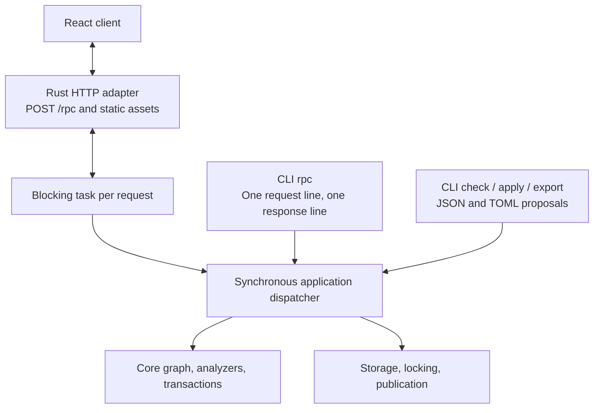

# LifeCore Application Interfaces

Status: proposed application contract. [PLAN.md](PLAN.md) lists remaining work.
[SPEC.md](SPEC.md) defines graph semantics; [FILES.md](FILES.md) defines proposals,
their JSON/TOML encoding, and publication requirements.
[SUGGESTIONS.md](SUGGESTIONS.md) defines suggestion export and replay-verified
acknowledgment.

## 1. Shared synchronous application

Use a React/TypeScript browser client, a Rust HTTP server, and a small native CLI.
All operations use shared Serde request, result, error, and proposal types and
one synchronous application dispatcher. CLI calls execute locally without a
running HTTP server. The web application embeds the service rather than launching
a subprocess or forwarding requests over stdio.



The shared contract owns data that crosses a transport or thread boundary.
Borrowed views and resolutions can be converted into owned results or serialized
within the request's task. Reuse domain types and semantics without leaking storage,
HTTP types, or borrowed graph lifetimes into the public request contract.

Async execution and HTTP dependencies belong to the server adapter. It runs
each request on a blocking task that calls the synchronous service the way a CLI
invocation does: it reads the current snapshot, performs the operation, and
keeps no graph or analysis state between requests. Requests run concurrently;
the file lock serializes writers exactly as it does between CLI processes.
There is no worker thread, queue, or server-side cache.

A client that disconnects does not cancel its call: the task runs to
completion and its outcome stands, so a disconnect is never a rollback, and the
adapter only notes it on stderr. A caller that lost its answer preserves its
drafts, reports the outcome as unknown, and inspects the stored state; nothing
retries the call automatically, and durable retry recognition is backlogged. The core and application operations remain ordinary
synchronous calls; a CLI invocation calls them directly. Package boundaries must
preserve this dependency direction.

## 2. CLI surface

| Command | Responsibility |
| --- | --- |
| `lifecore init` | Explicitly create the selected database without clobbering an existing one. Add TypeCheck by default; `--no-typecheck` opts out. This operation is outside RPC. |
| `lifecore serve` | Serve the embedded React client and HTTP RPC endpoint for the selected database, which must already be readable; otherwise print the error object and exit nonzero. Print the client URL as the only line on stdout ([section 3.2](#32-server-access)). `--port <port>` selects the loopback port, default 0 for one the system chooses; port 80 is refused at startup, because browsers omit it from `Host` and `Origin`, which the access checks require. `--ui-dir <dir>` serves the client from disk instead ([section 5.1](#51-frontend-build-and-tests)). |
| `lifecore rpc` | Read one request line from stdin, execute it locally, print one response line, exit. |
| `lifecore check FILE` | Decode a JSON/TOML proposal and call shared proposal checking. |
| `lifecore apply FILE` | Decode a JSON/TOML proposal and call shared checked application. |
| `lifecore plan-id` | Mint a token for the selected current database/base without changing history. |
| `lifecore export FILE --format json\|toml` | Serialize a proposal document in the chosen format, preserving `plan_id` and `acknowledges`. |
| `lifecore add-analyzer NAME [CONFIGURATION]` | Append a registered analyzer with its configuration string, default `{}`, to the ordered suite. |

These conveniences call the same operations and use the same data as RPC.
Collection-specific planning remains backlogged. `init`, `check`, `apply`,
`plan-id`, and `add-analyzer` print the corresponding RPC result or error object
as JSON on stdout, adding a one-line diagnostic on stderr for errors, and exit
zero on success, nonzero on rejection or error. `check` of a proposal that is
not accepted prints its result and exits nonzero. `export` prints the converted
document. `FILE` arguments select JSON or TOML by their `.json` or `.toml`
extension. There is no separate human-readable renderer yet. `check`, `apply`, and `add-analyzer` take
`--evaluation-time <timestamp>` or `--now`; without either, evaluation time is
absent. `--now` captures one instant before evaluation and reports it.
`init` creates an empty database only; it does not import an existing graph.

Changing the analyzer suite is a deliberate action, separate from proposals.
`add-analyzer` and its RPC method build a one-operation transaction
(`Change::AddAnalyzer`) against the current state and check it like any other
mutation. The replay runs every prefix under the extended suite, so an analyzer
that finds inconsistencies anywhere in existing history is rejected, with the
analysis output reported as for `apply`. Success rotates the graph revision and
invalidates outstanding plan IDs. There is no removal or reconfiguration.

Analysis results pair each suggestion observation with a ready-made `Proposal`
that names its finding in `acknowledges`. React selects that attached proposal; a
CLI caller extracts it into a change file and can convert it with `export`.
Several suggestions are alternatives against one base, not an apply batch.
`check`/`apply` verify the acknowledgment against their own replay and publish it
with the graph changes; see [SUGGESTIONS](SUGGESTIONS.md).

Default initialization stores the registered `Type_Check` analyzer with the
original configuration string `"{}"`. The opt-out omits that suite entry; it does
not weaken structural validation or silently skip other configured analyzers.
The core remains configurable. Missing configured implementations remain errors
when checking or applying changes.

`rpc` has no positional method argument, parameter flags, file option, request
loop, or interactive mode. A complete newline-terminated line is enough to
execute; it does not wait for stdin to close. EOF can terminate the first line.
It does not read or execute a second line. Pretty-printed multiline requests
must be compacted by the caller. Escaped newlines inside JSON strings are fine.

For example, the whole stdin line is:

```json
{"jsonrpc":"2.0","id":"request-1","method":"plan_id.mint","params":{}}
```

The result or error is one compact JSON object followed by a newline on stdout.
Empty or malformed input produces one structured error response without mutation.
Logs and operational diagnostics go to stderr. A response carrying `result`
exits zero, including a check with `accepted: false`; an `error` response exits
nonzero while retaining the machine-readable response when output is available.
No automatic write retry occurs.

## 3. Shared RPC envelope

HTTP and CLI use the same JSON-RPC-based single-call request/response profile:
`jsonrpc = "2.0"`, a required non-null request `id`, `method`, and object-valued
`params`. Responses carry that ID and either `result` or `error`. Protocol errors
without a usable ID use null. The initial profile excludes batches and
notifications; reject them before dispatch. This deliberately restricted profile
always responds, and is not a general JSON-RPC notification/batch implementation.
The [JSON-RPC specification](https://www.jsonrpc.org/specification) supplies the
envelope and standard protocol-error vocabulary.

`POST /rpc` accepts one request object in its body. HTTP framing permits formatted
JSON; CLI framing requires one physical line. Both share validation, dispatch,
result serialization, and stable application-error details. Every JSON-RPC
response, success or error, travels with HTTP status 200; only the access
rejections of [section 3.2](#32-server-access) use HTTP errors. A JSON-RPC ID
correlates a call; it is distinct from a proposal's `plan_id` and from a receipt.

The initial method families cover database description, entry selection and
resolution, bounded comparisons, analyzer inspection/execution, analyzer suite
append, proposal checking/application/export, plan-ID minting, and dismissal
listing/update/restore. Entry listing and lookup come first, so the first
[CLI slice](PLAN.md#41-first-slice-change-files-storage-and-cli) can find the
exact identities proposals refer to.
Method names and shapes are reshaped by the UI stages
([PLAN §4.3](PLAN.md#43-iterative-ui-stages)); each change updates the method
table and the fixtures together. `init` and host filesystem-path selection are
not RPC methods.

Application result types pair exported observations with their proposals and
report prospective/committed dismissal effects. Keep these types outside the core
`Observation` and `AnalysisOutput`. Diagnostics for an uncommitted check candidate
carry no ready-made proposals; analyze the committed result again after apply.

Change files serialize `Proposal`; check/apply parameters contain that same type
plus explicit evaluation inputs. A file convenience command reads the file once
and calls the same operation. Browser file imports send raw contents to the Rust
codec, so bare large integer shorthand is parsed without JavaScript rounding.
Structured editors send canonical proposals. Requests do not carry paths for
the server to open. Source locations are optional diagnostic metadata, not
proposal identity.

Keep malformed transport data, invalid proposals, unverified acknowledgments,
analyzer execution failures, stale bases, pre-publication failures,
and uncertain publication distinguishable.
Checking a structurally valid rejected proposal should retain complete analysis
context and advisories alongside blocking findings. Such a result must not
expose a commit capability. Missing analyzers must not prevent reading an
otherwise structurally valid database.

### 3.1 Provisional first-slice methods

These names and shapes are provisional; the UI stages reshape them as the
screens need. Unknown or repeated request members are rejected (`-32600`), as are
unknown parameters (`-32602`). Parameters never accept `null`: omit an optional
parameter instead, as for optional proposal fields. Results may carry `null`
for absent optional values, such as `view.head` or `analysis.inputs.evaluation_time`.
Evaluation-dependent methods take optional `evaluation_time` (a Jiff timestamp
string) or `now: true`, not both; the host captures `now` once and the result's
`analysis.inputs` reports the instant used.

A `proposal` parameter is decoded on its own, exactly like a change file, so a
malformed one fails with `malformed_proposal` (2001) and a `data.decode.path`
inside it, such as `entries[0].payload.n`; failures of other parameters are
`-32602`.

| Method | Parameters | Result |
| --- | --- | --- |
| `database.describe` | none | `database`, `graph_revision`, current `view`, ordered `suite`, and `registered`: the sorted names of the analyzer factories this host registers, the only names `analyzers.add` can append |
| `entries.list` | optional `kind` (`node`/`edge`), `ty_name`, `currentness` (`current` default, `historical`, `all`), `text` (node text search), `as_of` | `database`, `graph_revision`, `view`, `entries` in append order |
| `entries.get` | `id` (exact `EntryId`), optional `as_of` | `view` and `entry` |
| `entries.inspect` | `id`, optional `as_of` | tagged by `kind`: a node with its `type` resolution, its `lineage` (the whole revision tree, root first), its incident `edges` of any currentness in append order (each with `direction` and the id of the `other` endpoint), and `neighbours`, the record of each other endpoint once, in append order; or an edge with `from` and `to` |
| `types.list` | optional `as_of` | `view` and `types`: one summary per name the view knows, sorted by name, with its `resolution` (`builtin`, `declared` with the structured schema, `missing`, `ambiguous`, `malformed`) and node counts by currentness |
| `views.query` | `seeds` (exact node `ids`, each a node of the view, else `invalid_seeds`; or a node selection), ordered `expand` steps (`hops`, `direction`, `ty_names`, `currentness`), an `edges` filter, optional `as_of` | `view`, `nodes` with their `provenance` (`seed`, or `reached` at a hop over an edge from a node), and the matching `edges` among them |
| `views.render` | `query` (the `views.query` parameters) and `format` (`dot`/`svg`) | `format` and `text`: the queried subgraph as deterministic DOT (`digraph lifecore`, labeled with the database and boundary; nodes `n<position>`, names local to the view, with the row label on one line and cut at 60 characters, `@position`, and type, superseded ones gray; dashed blue `revision` links only between result nodes; solid edges labeled `@position <ty_name>`, historical ones gray; the empty type name reads `(unnamed)`; every node and edge has `id`, an `href` of `#inspect/<origin>/<position>`, and the uncut label as `tooltip`; payload text reads literally, with control characters shown as spaces), or that DOT rendered by Graphviz's `dot -Tsvg`, run synchronously with a 10 s deadline and a 16 MiB output cap |
| `plan_id.mint` | none | `plan_id` |
| `proposal.check` | `proposal`, evaluation inputs | `accepted` and `report`: `database`, `base_revision`, `base` view, `operations` (name to provisional entry), complete `analysis` |
| `proposal.apply` | `proposal`, evaluation inputs | new `graph_revision` and the report with actual entry IDs |
| `proposal.decode` | raw `text`, `format` (`json`/`toml`) | canonical `Proposal` |
| `proposal.encode` | `proposal`, `format` | `text` |
| `analyzers.add` | `name`, `configuration` (default `{}`), evaluation inputs | new `graph_revision`, `suite`, and the report |
| `analysis.run` | optional `as_of`, evaluation inputs | `analysis`: the selected prefix replayed with fresh analyzers under the stored ordered suite, which history does not version ([section 4](#4-database-selection-and-concurrency)); `dismissals`: the stored records (`key`, `reason`, `note`), from the same snapshot read, whose complete key equals that of a returned observation, so no record reveals a finding first emitted past the boundary; the analysis never applies them ([section 6](#6-analysis-lifetime-and-dismissal-persistence)) |
| `findings.dismiss` | `key` (complete finding key of the selected database, else `foreign_database`), `reason` (`acknowledged`, `false_positive`, `no_longer_relevant`), optional `note` | `dismissals`: every stored record after the edit; an existing record of the key is updated in place, and one with the same reason and note publishes nothing |
| `findings.restore` | `key` | `dismissals` after the edit and `restored`: whether a record of the key existed; nothing is published otherwise |

Read methods take an optional `as_of`, a decimal position: they answer from
the prefix `[0, as_of)`, whose boundary the result's `view` names, and default
to the whole history. A boundary past the visible end fails with
`beyond_boundary` (4002). `ui/src/contract.ts` declares the exact shapes.

Each entry record is the stored entry of
[FILES §2.5](FILES.md#25-entry-shaped-types) with `current` beside its members.

List and query results are complete. The prototype applies no result limits or
paging; they are [backlogged](PLAN.md#other-deferred-work).

A structurally valid proposal whose replay emits an inconsistency is still a
`check` result, with `accepted: false` and the complete report, including
advisories. `apply` refuses it with the `rejected` error, whose `data.report` is
that report; `analyzers.add` rejects the same way, with no operations.
Application errors use codes outside the reserved JSON-RPC range and a stable
`data.kind`:

| Code | `data.kind` | Meaning |
| --- | --- | --- |
| 1001 | `state_path_empty`, `working_directory`, `directory_missing` | The state path cannot be selected, or `init`'s containing directory does not exist. |
| 1002 | `database_missing` | No database at the selected path. |
| 1003 | `database_unreadable` | The snapshot cannot be read or is invalid. |
| 1004 | `database_exists` | `init` refuses to replace an existing path. |
| 1005 | `lock_failed` | The lock file cannot be opened or locked. |
| 1006 | `busy` | Another writer held the lock throughout the retry. |
| 1007 | `publication_failed` | Failure before replacement; stored state unchanged. |
| 1008 | `publication_uncertain` | Synchronization failed after replacement; `data.outcome` is the result the call would have returned, such as the new `graph_revision` and report, tagged by `kind` (`initialized`, `applied`, `analyzer_added`, `dismissed`, or `restored`), so the caller can inspect the stored state. |
| 2001 | `malformed_proposal` | Decoding failed; `data.decode` has `format` and `message`, plus `path`, `line`, and `column` where known. A JSON `message` is serde_json's own text, which names a position; for a `proposal` parameter that position counts from the start of the member. |
| 2002 | `invalid_proposal` | Names, references, intent, or structure; `data.location` names the entry and field where known. |
| 2003 | `acknowledgment_unsupported` | `acknowledges` is present but not yet verified (plan section 4.4). |
| 2004 | `foreign_database` | The plan ID, or the key `findings.dismiss` was given, names another database; `data.expected` is that database and `data.actual` the selected one. |
| 2005 | `stale_base` | The plan ID names an earlier graph revision. |
| 2006 | `rejected` | Inconsistencies; `data.report` has the complete report. For `init`, whose base was never published, the report omits `base_revision`. |
| 3001 | `analyzer_failure` | Missing analyzer, invalid configuration, or execution failure. |
| 4001 | `entry_not_found` | The identity is not present in the selected view. |
| 4002 | `beyond_boundary` | `as_of` exceeds the visible end; `data` carries `requested` and `visible` as decimal strings. |
| 4003 | `cannot_dismiss_inconsistency` | `findings.dismiss` named an inconsistency key, emitted or not; `data.key` is that key. Refused before the writer lock; nothing is stored. |
| 4004 | `graphviz_unavailable` | `views.render` with `format: "svg"` could not start the `dot` program, whether missing, not executable, or refused for another reason; `data.message` is the operating system's text. |
| 4005 | `graphviz_failed` | `dot` started but failed. `data.cause`, tagged by `kind`, says why: `deadline` or `oversized`, past the deadline (`milliseconds`) or the output cap (`bytes`), and killed at once; `exited` unsuccessfully, with the platform's `status` text; `input_unread` on exit, with the write failure's `message`, or null while the write was still blocked; `output_open` `milliseconds` after the exit; `invalid_utf8`; or the operating system's `message` from `pipe_thread`, `unwaitable`, `output_unreadable`, or `stderr_unreadable`. `data.stderr` is what `dot` wrote there, trimmed and cut at 64 KiB, empty when nothing was read. |
| 4006 | `invalid_seeds` | `views.query` or `views.render` named `ids` seeds that are not nodes of the selected view; `data.refused` lists each once, in request order, as `id` and `reason`: `absent` from the view, or an `edge`. Nothing is expanded. |
| 5001 | `backend_failure` | The host task running the call ended without a response, for example by panicking. A write it was making may or may not have been published; inspect the stored state. Never a rollback. |

Invalid parameters (`-32602`, `invalid_params`) and internal errors (`-32603`,
`internal`) also carry a `data.kind`; envelope errors (`-32700`, `-32600`,
`-32601`) carry no `data`.

### 3.2 Server access

`lifecore serve` listens on the loopback interface only, on `127.0.0.1` and the
port of `--port`, or one the system chooses. At each start it generates a
random launch token of 256 bits from the operating system's CSPRNG, as 64
lowercase hexadecimal digits, and prints the client URL with the token in the
URL fragment as the only line on standard output, for example
`http://127.0.0.1:<port>/#token=<token>`. A browser never sends the fragment to
the server, so the token stays out of request lines and access logs; nothing
else prints or logs it.

The client reads the token from the fragment, keeps it in session storage,
removes it from the address bar, and sends it on every `POST /rpc` as
`Authorization: Bearer <token>`. Before JSON-RPC dispatch, the adapter rejects
with an HTTP error any request whose `Host` is not the bound address and port
(`127.0.0.1:<port>` or `localhost:<port>`), whose `Origin`, when present, is not
the served origin, whose `/rpc` call lacks the exact token, compared in
constant time, or whose `/rpc` call does not declare a JSON content type. The
`Host` check defeats DNS rebinding. The token, the `Origin` check, and the
content-type requirement each defeat cross-site requests on their own: a form
post cannot set a JSON content type, and a cross-origin fetch that sets it or
the custom header forces a CORS preflight that the adapter never approves. Static assets carry no secrets and
need no token, but pass the `Host` and `Origin` checks. A restart issues a new
token, so open pages must be reopened from the newly printed URL. The one-shot
CLI `rpc` runs as the local user on the selected file and uses none of this.

The served origin is `http://` followed by the request's own accepted `Host`.
The checks run in this order, each answering with the HTTP status shown and a
JSON body `{"kind": ..., "message": ...}`; the body of a `/rpc` call is not read
before they pass:

| Status | `kind` | Rejected request |
| --- | --- | --- |
| 421 | `host` | `Host` is missing, repeated, or neither accepted authority, or an absolute request target names another. |
| 403 | `origin` | `Origin` is present but not the served origin, including `null`. |
| 401 | `token` | `/rpc` without exactly one `Authorization: Bearer <token>` (scheme case-insensitive) naming the launch token. Also sends `WWW-Authenticate: Bearer`. |
| 415 | `content_type` | `/rpc` whose `Content-Type` essence is not `application/json`; parameters such as `charset` are ignored. |
| 413 | `body` | `/rpc` whose body exceeds 64 MiB. |
| 400 | `body` | `/rpc` whose body cannot be read, for example malformed chunking or a connection closed before the declared length. |

Assets and RPC answers are sent with `Cache-Control: no-store`; assets also
carry a content security policy that loads scripts only from the served origin.

The adapter runs each call on a blocking task as described in
[section 1](#1-shared-synchronous-application), which also owns what a client
disconnect means. The first SIGINT or SIGTERM starts an orderly shutdown: the
server stops accepting connections, lets every running call finish and answer
its client if still connected, and then exits; a second signal exits at once,
with status 128 plus that signal's number (130 for SIGINT, 143 for SIGTERM),
which atomic publication makes safe for the stored snapshot. A call whose task panics answers `backend_failure` with its
request ID in builds that unwind; this workspace's dev profile aborts on panic
instead.

## 4. Database selection and concurrency

Resolve the database path in one synchronous host helper:

1. Use `LIFECORE_STATE_FILE_PATH` when set; an empty value is an error.
2. Otherwise use `LifeCoreState.json` in the process working directory.
3. Resolve any relative selected path against that directory. Do not search
   parent directories or fall back after a selected path fails.

The server resolves its path once at startup; each CLI process resolves its own
path. Failures to open an existing database remain errors. Only `init` creates
one. Moving the file preserves database identity. Frontend requests never select
arbitrary host files.

Other CLI/server processes may write the same database, so the server keeps no
state between requests: each request opens the selected snapshot afresh, and
historical requests select a prefix of it. Standalone reads/checks
open the selected JSON snapshot once and read that complete immutable file;
atomic replacement gives them either the old or the new snapshot. They need no
writer lock. A current-state reload opens the path again rather than retaining
an old file handle. No lock spans standalone check and subsequent apply.

The snapshot envelope contains `graph_revision`, `graph` (database identity,
entries, and ordered analyzer suite), and `dismissals`.
There are no persisted analysis outputs. Full-snapshot rewriting is acceptable
for this initial implementation. [FILES](FILES.md#8-atomic-publication) defines
the layout and publication sequence.

Initially mutations acquire writer exclusion, reload, verify the selected base,
check, publish atomically, perform required synchronization, and release the
lock. Dismissal edits reread and preserve other records under writer exclusion.
Lock `<state-path>.lock`, a stable sibling file retained across snapshot
replacement; the default is `LifeCoreState.json.lock`. Use the standard library's
`File::lock`/`try_lock`. A writer that finds the lock held retries for a
bounded window, then returns a structured busy error instead of blocking
indefinitely. The window defaults to 10 seconds, leaving a margin over a
competing apply's check, which takes about a second at 4,000 entries and grows
roughly quadratically ([PLAN](PLAN.md#5-checking-cost)); hosts can change it with
`Service::with_busy_retry`. Ordinary operations on a missing
database fail without creating the snapshot or its lock file. `init` requires
the containing directory to exist on a filesystem with hard links
([FILES](FILES.md#8-atomic-publication)), and a refused `init` creates no lock
file.
Do not hold locks across browser editing or between standalone check and apply.
An optimization that prepares outside the lock must compare the exact base
again under writer exclusion before publication.

`ViewId` describes a graph prefix; it does not include the analyzer suite. A
plan ID carries database/revision/proposal identities, using the
[token format](FILES.md#optional-structured-plan-identity).
The stored revision UUID changes with every graph or ordered-suite change,
including equal-count divergence, but not dismissal edits, no-ops, or token minting.
Verify the token's database/revision against the snapshot; core commit still compares
database identity, original entry count/content, and the exact ordered suite.
Revision maintenance assumes application-owned snapshots; hand-editing the
graph while retaining its revision is outside that guarantee.

A verified `acknowledges` stages an `Acknowledged` dismissal, retaining any
existing reason/note, and publishes it in the same snapshot as the checked graph
changes. All current dismissal records come from the reload under writer exclusion.

A disconnected browser leaves an executing mutation to complete as
[section 1](#1-shared-synchronous-application) describes.

## 5. React client

The initial UI targets a local user and one database. Serve the client and RPC
on the same origin, behind the access checks of [section 3.2](#32-server-access).
The client owns editors, drafts, navigation, and presentation state, including
the grouping of observations by complete finding key with the core's semantics
([SPEC §8.3](SPEC.md#83-presentation-and-dismissal)). The backend owns
resolution, queries, validation, analysis, Graphviz rendering, and publication.

Write the TypeScript definitions of the shared contract by hand in
`ui/src/contract.ts`. The contract is small, its methods are reshaped by the
stages, and the types that matter most have hand-written `Serialize`
implementations that a generator could not follow. Guard it with fixtures: a
Rust test in `lifecore-server` records representative requests and responses of
every method, every application error kind, the envelope errors, and every HTTP
rejection, mostly from real calls through the server's own request path, and
commits them under `ui/src/fixtures/`. Each fixture is a TypeScript module that
exports the Rust-serialized JSON value followed by `satisfies` its declared
type, so the frontend type-check rejects a changed Rust shape: a missing or
renamed member, a member the contract does not declare, or a wrong tag.
Imported `.json` files would not do, because `tsc` widens their string literals
and skips excess-member checks. A generated `index.ts` maps every method of the
dispatcher's single method list (`rpc::Method::ALL`) to its fixture, so a method
the contract declares without a fixture, or the reverse, also fails `tsc`.
HTTP rejection statuses are pinned per kind as literal types. Random UUIDs and
scratch paths are replaced by stable stand-ins, so an unchanged shape rewrites
nothing.

Canonical integer payloads are
`{"kind":"integer","value":"9223372036854775807"}`-shaped objects. Keep the decimal
strings in model state, including inside lists/records, and use `bigint` only
when arithmetic is needed; serialize back to strings. Known large control
integers, such as entry positions and view boundaries, are also decimal strings
but need no payload wrapper. Small bounded protocol fields such as error codes
can remain JSON numbers. Canonical responses can use ordinary JSON parsing; no
lossless-number JSON parser is required. Send raw JSON/TOML file imports to the
Rust codec, which accepts bare `i64` shorthand and returns canonical envelopes.
Never parse that shorthand through JavaScript numbers before sending it.
Keep timestamp strings at full precision in model state; date widgets must not
silently replace them with lower-precision values. The same requirement applies
when importing and exporting change files.

Drafts carry a service-minted `plan_id`. Preserve exact existing references and
stable local operation names. Preview identities are provisional; use returned
operation-to-entry mappings after application. A stale proposal requires
deliberate replanning, without silently refreshing its token.

Suggestion selection is not built
([PLAN §4.4](PLAN.md#44-suggestions-and-acknowledgment)). When it is, selecting
a suggestion selects its ready-made proposal, shown and applied as
[SUGGESTIONS](SUGGESTIONS.md) describes; editing its operations requires
removing `acknowledges`, turning it into an ordinary draft.

Evaluation time is an explicit choice, absent by default; for `now`, the host
captures one instant and reports it
([section 3.1](#31-provisional-first-slice-methods)). Check, the Findings
screen, and analyzer adds each offer their own choice: absent, `now`, or an
explicit timestamp. Each displayed analysis identifies its view,
implementations, configuration strings, and evaluation inputs. Keep
certificates opaque; use supplied subjects and the focus entry for UI
navigation. Dismissal and display filtering never change acceptance.

The prototype covers browsing types, entries, lineage, and relationships at any
boundary; Explore queries shown as tables, threads, or Graphviz drawings; drafts
built by form, raw JSON, or import, with check, explicit apply, and
reconnection after revisions; findings with current/history selection, sticky
historical labels, dismissal reasons and notes, and restore; and appending
analyzers. Suggestion selection, comparison between boundaries, and refine
steps are not built ([PLAN §4.3.4](PLAN.md#434-views-and-navigation),
[§4.4](PLAN.md#44-suggestions-and-acknowledgment)).

### 5.1 Frontend build and tests

The client lives in `lifecore-server/ui` as a small Node project: npm with a
committed `package-lock.json`, esbuild for bundling, `tsc --noEmit` for
type-checking, Biome for linting and formatting, `node --test` for unit tests,
and Playwright Test for browser tests. Its only runtime dependencies are React
and ReactDOM; add libraries only when a stage needs them.

`lifecore-server`'s `build.rs` bundles `ui/src/main.tsx` with the installed
esbuild into a fixed-name `app.js` in `OUT_DIR` and copies the handwritten
`ui/index.html` beside it; the server embeds both. Both steps live in
`ui/build.mjs`, which `build.rs` runs with `node` and the npm `build` and
`watch` scripts run for `ui/dist`, so every bundle uses the same options.
`build.rs` declares `rerun-if-changed` for `ui/src`, `ui/index.html`,
`ui/package-lock.json`, and the inputs that shape the bundle besides them
(`ui/package.json`, `ui/build.mjs`, `ui/tsconfig.json`), and
`rerun-if-env-changed` for `LIFECORE_UI`. It
never installs packages: when `ui/node_modules` is missing, it fails with an
instruction to run `npm ci` in `lifecore-server/ui`. Setting `LIFECORE_UI=skip`
embeds a placeholder page instead, for builds that do not touch the client, such
as agents and CI running `cargo test --workspace` without Node.
Type-checking, linting, and tests are separate checks, not part of the build.

For quick iteration, `serve --ui-dir <dir>` serves `index.html` and `app.js`
from `<dir>`, reading them on every request, while `npm run watch` rebuilds
them into `ui/dist`; a browser refresh picks up changes, and the launch token
survives in session storage.

The fixture test writes `ui/src/fixtures/` when Rust tests run, which is after
`build.rs` has bundled, and fails when the committed copies are stale, so the
build only reads committed files. It rewrites only stale files, so an
unchanged run leaves `ui/src` untouched and does not trigger a rebundle.

Browser tests run in Firefox, the priority for compatibility; other browsers are
[backlogged](PLAN.md#other-deferred-work). A global setup builds `lifecore`
with Cargo, unless `LIFECORE_BIN` names a binary, and refuses a binary that
embeds the `LIFECORE_UI=skip` placeholder. It initializes one scratch database,
with the default TypeCheck suite, through `LIFECORE_STATE_FILE_PATH`, and
starts one `lifecore serve` on it. Tests open the URL it printed, launch token
included, so they exercise the real access flow and the embedded client.

All spec files share that server and database, so Playwright runs one worker:
files run one at a time in name order, and each file runs its tests serially,
mostly on one shared page. A file that needs data applies its own types and
entries through `proposal.apply` over RPC before its tests and leaves other
files' types alone. `zz-analyzers.spec.ts` is named to run last, because the
analyzer it appends changes the suite for every later file. Tests simulate lost
or unconfirmed answers by intercepting `/rpc`.

Graphviz is optional. The rendering test in `navigate.spec.ts` skips when
`dot` is not installed. The two `lifecore-app` tests that run the real `dot`
are ignored by default; `cargo test -p lifecore-app -- --ignored` runs them.

### 5.2 Client decisions

Presentation choices of the browsing client, recorded so the code can cite
them; none is a server contract.

#### Identity, labels, and boundaries

- Row label: a node's `title` field when it is text, else `name` when text,
  else the text field whose name sorts first by code point, the byte order
  `views.render` labels by, else `<ty_name> @<position>`. Blank text does not
  count. An empty type name reads "(unnamed)". Labels are cut at 60
  characters (30 in relationship cells and seed chips, 40 in sidebar places,
  28 in the trail), with the full text as a tooltip.
- `@position` is an entry's on-screen identity, shown beside a field label; the
  origin UUID is never shown.
- Badges call a node current or superseded and an edge current or historical.
  Lists show current entries unless asked for historical or all.
- As-of is one global boundary, set in the top bar up to the visible end or by
  an inspector's "As of here" just after its entry, and not part of Back
  history; another database answering clears it. Browsing reads send it as
  `as_of`; `database.describe` (the Database screen) and reconnection read the
  whole history. The top bar shows `showing the first N of M entries, view
  [0, N)`; tables and the inspector show the `view` their response names,
  with the same words as a tooltip.
- Nothing learned at a wider boundary names an entry past the as-of boundary:
  the trail, seed chips, and sidebar places name it by `@position` alone.
- A failed read shows a heading and a sentence for the error kinds a reader
  meets (an entry not in the view, a boundary past the end, refused query
  seeds), else the server's message; the method, code, kind, and data wait behind "Details".

#### Navigation and places

- Navigation is in memory; a page reload loses Back history and as-of. Back
  pops a stack of steps; reopening the current screen adds none. A trail under
  the top bar names the current step and the six before it, older ones folded
  into "…"; a click returns to that step.
- A step remembers its screen's state: a table's currentness, text,
  relationship toggle, sort, open cells, and rows shown; the inspector's
  expanded outline rows, toggled groups, historical toggles, filters, and raw
  JSON; Explore's form, query, and display choices. Returning restores the main
  pane's scroll offset once the content is tall enough, unless the user
  scrolls, clicks, or types there first.
- The last result of each call is cached (40 calls), so a screen returned to
  renders at once, reads again, and shows "reloading…" until the answer. An
  answer with the same JSON as the cached one keeps the cached object. A
  reload shows the previous answer only if it was read at the same or a
  narrower boundary, so lowering as-of shows "loading…" until the bounded
  answer. The cache and the labels noted from reads hold one database and
  start afresh when another answers. Explore stays mounted under the other
  screens, so its results, drawings, or failure survive a detour; hidden, it
  reads nothing, and on return it reads again at the boundary then selected.
- Places, per database in `localStorage` under `lifecore.places.<database>`,
  are listed in the sidebar below Views: Pinned entries (☆/★ in the inspector
  header), Saved views (the Explore form under a name, replacing one of that
  name; opening one restores the form and runs it), and Recent (the last 15
  inspected entries, most recent first, without repeats). An entry keeps the
  label and type of its last inspection; an edge reads `from —Type→ to`.
  Entries past the as-of boundary are dimmed and named by `@position` alone,
  without their type. Another tab's change arrives through the `storage`
  event. Malformed stored items are dropped one by one.

#### Tables and relationships

- Table columns: label, `@position`, current (in a type table of historical or
  all rows, or an Explore table with a superseded row), Explore's via, the
  relationship columns, the declared fields by status (mandatory, encouraged,
  optional, deprecated) and name, then undeclared fields present in the rows,
  marked. The field that labels every row has no column. The `Type` table
  shows a declaration summary instead of field columns.
- A table renders 500 rows, then "show next 500" and "show all" with the count
  of the rest. Cells render on one line (`[a, b]`, `{owner: me}`, `true`), cut
  at 80 characters with the full text as a tooltip. Integers sort by value,
  timestamps by instant at full precision, everything else as text; absent
  cells sort last ascending. A wide table scrolls sideways.
- A type table sends its text filter as the `text` of its node seed, 300 ms
  after the last keystroke; Explore sends its own on Run. The Findings and
  outline filters run in the client.
- Relationship columns: a type table reads its rows with `views.query`, the
  rows as node seeds and, while the columns are on, one hop both ways over
  edges of the rows' currentness (`all` for historical or all rows), keeping
  only the seeds; with them off, it sends no expansion. Each edge type
  and direction among the rows' incident edges gets a column, outgoing first
  and then by name, headed `→ PartOf` or `← DependsOn`. A cell lists the
  neighbours' labels and sorts by the first. Beyond three, it starts with the
  count by type (`460 Tasks:`) and shows three labels, then "+N more" in place
  up to 20, or above 20 "+N in Explore", a query of the row over that type and
  direction. A "relationships" checkbox, on by default, shows the columns.
  Explore's tables show the same columns over the result's edges. Label, via,
  and relationship cells stay on one line until expanded.
- Inspector relationships follow the header, beside the payload and lineage
  once the pane is 72rem wide: an outline of groups by edge type and direction,
  ordered as the relationship columns, with counts and the neighbours' types
  (`← PartOf 460 · Task`), collapsed and filterable by label above 20 edges. A
  neighbour's ▸ reads that node with `entries.inspect` at the inspected view's
  boundary and nests its groups, to any depth; a node already on the path is
  marked "(on this path)" and does not expand. Historical edges wait behind a
  per-group toggle, except under a superseded node, all of whose edges are
  historical.
- A `Type` node's inspector shows the parsed schema, then the full payload
  table, so `name` and fields outside the grammar stay visible. The schema is
  the server's parse when the boundary's `types.list` resolves the name to this
  node, else a client-side reading.

#### Explore, threads, and drawings

- The client bounds an Explore query to 3 expansion steps of up to 3 hops
  each; the server imposes none. Its node selection takes any type or one
  type, the unnamed one included.
- Each query run is a Back step: Run, a row's "focus" (the node as the only
  seed, node selection off, steps and edge filter kept) or "+ seed", a saved
  view, "+N in Explore", or "Explore from here", which seeds the node alone
  with the default form (one step of 1 hop both ways over current edges of any
  type). Back to a step shows its own query. Editing the form, or rerunning
  the query on show, stays on the step; a form that no longer matches the
  query on show says so until Run. A query started outside Explore keeps the
  last step's display choices, except that a graph shows as a table.
- Seed chips and the folded summary name seeds as `label @position`. Arrows
  read from the node in context: `→ PartOf` for an edge from it, `← PartOf` for
  one to it, in columns, the outline, thread prefixes, and via cells. A via
  cell reads `<hop> via → PartOf from <label>`, the arrow linking to the edge,
  or the edge's `@position` when the edge filter dropped it.
- Thread display: one edge type, or all of them, and one direction at a time;
  with outgoing, an edge's `from` is the parent. All types is the default when
  the result has several; each child row then carries the types joining it to
  its parent, read from the child. The default direction leaves fewer roots,
  outgoing on a tie. A node's first occurrence expands; later ones collapse to
  "also under", and a revisit on the current path is cut as a cycle. Nodes
  occurring more than once get one of 8 stripe colors, then a numeric suffix;
  hovering one highlights them all. Row actions show on hover or focus.
- Graph display: nothing is drawn until Render, which calls `views.render` with
  the query on show at its result's boundary. Render sits beside the result's
  node and edge counts, which warn above 200 nodes; the drawing names its view.
  The SVG, from `<svg` on, is inserted as served, with the seeds of the query
  on show outlined thick. A click in a node's shape or on an edge's link opens
  the inspector. DOT fetches the text only while its toggle is on.
- The drawing scrolls in a frame up to 70% of the window high, zoomed by a CSS
  transform from 1% to 400%: fit (at most 100%; below 5% it suggests 100% and
  scrolling), 100%, and ×1.25 or ÷1.25 steps keeping the middle in place. Its
  natural size comes from the SVG's `width` and `height`, else its `viewBox`.
  A new drawing starts fitted but at least at 60%, centered on the first seed
  it shows, once its frame is visible.
- While Explore shows a result, the last drawing of each of 6 query-and-view
  pairs keeps its zoom and scroll, so Back to a drawn query shows it. Another
  query shows the latest drawing, marked as drawn for another query or view.

#### Drafts and writes

- Drafts: one per database in `localStorage` under
  `lifecore.draft.<database>`, held under the last database ID that loaded, so
  a failed or reloading description neither empties nor remounts it. No edit
  lands before the first description answers. The proposal, its kept-edge
  provenance, an uncertain-apply record, and an apply-in-flight marker are
  saved synchronously on every change; check results and editor state are not,
  so a restored draft needs a new check. An unreadable stored draft is dropped,
  as is one whose uncertain record holds an applied outcome without its
  report's operations, base, view, and observations.
- Tabs of one database share its draft. Each re-reads the stored record on
  another tab's `storage` event and adopts it, keeping its own selection,
  pick, and check where they still apply. A tab never saves over a record
  carrying an in-flight or uncertain marker it did not hold: the change is
  dropped with a notice and that record adopted, and an Apply whose marker
  could not be saved sends nothing. Another tab's apply in flight freezes the
  draft as an own one does until that tab saves the answer; if that tab went
  away first, a reload restores the draft as uncertain. An adopted uncertain
  record spends the adopting tab's check too. While its own apply is in
  flight, a tab writes its record again over one without markers.
- A plan ID is minted whenever a non-empty draft lacks one: at its first
  operation, before Check if a mint failed, and for operations an Apply left
  behind. Otherwise only an explicit Replan mints one, clearing the check. A
  replacing import takes the file's plan ID or a fresh one; an appending import
  keeps the draft's.
- Operation names default to `<ty_name lowercased>_<n>` with the smallest free
  `n`, characters outside the name grammar replaced by `_`. Names identify
  operations in the client, so a rename to a name in use is refused; renames
  update `added` references, kept-edge provenance, and the last check's
  findings. Imported operations get a `_<n>` suffix on a name collision; a
  proposal that acknowledges a finding is not imported.
- Removing an operation unsets every reference to it, a predecessor included:
  the node keeps its intent, and Check waits until it is picked again. A
  notice, kept until dismissed, names the affected operations and offers to
  remove the edges left without an end. Clear, Remove, that offer, and
  Reconnection's "Keep none" take a second click; Remove then goes Back. A
  move that puts a reference before its target posts a notice.
- Picking: an editor's pick leaves a pending role (predecessor, from, or to).
  While it is pending, every node inspector offers "Use as <role>", which sets
  an `existing` reference and returns to the operation; edges cannot be picked.
  Connect starts an edge from the inspected node and picks its `to`. A draft
  with an endpoint or predecessor unpicked is neither sent nor exported.
- Revise and Branch copy the node's payload; only a current node can be
  revised. Under an as-of boundary Revise is off, since a bounded read does
  not say what is current in the state drafts apply to; Branch stays, as a
  revision's payload is the same at every boundary. Reconnection lists the
  predecessor's current edges, read without `as_of`, by direction and type,
  collapsed beyond 10. Revise keeps all of them by default, also for a
  picked predecessor; Branch keeps none. Each kept edge
  becomes an explicit edge operation, `<operation>_keep_<edge position>`,
  placed after the revision ([SPEC §5](SPEC.md#5-current-and-historical-data)).
  Its other end is the revision itself for a self-loop, else the latest earlier
  revise successor of the other node in the draft, else that node. An edge
  whose end the draft supersedes, or whose revision no longer revises the node
  it was kept from, carries a warning. Edges that arrive follow their
  operation through renames; those arriving after it was removed or changed
  are not added, nor are edges already kept.
- Check is manual. Apply is enabled only after an accepted, unspent check of
  identical proposal JSON, plan ID included, with the same evaluation choice.
  It sends the evaluation time that check reported, so `now` applies at the
  instant the check captured; the tray shows which. An explicit evaluation
  time gets a hint naming the RFC 3339 form while what is typed does not
  look like it; the server parses it. While an apply is in flight the draft
  is frozen: no edit, pick, import, or Clear lands. Drafts always apply to
  the current state; under an as-of boundary the tray says so.
- A successful Apply removes the operations it carried, matched by name and
  content, turns references to them into the assigned IDs, lists those IDs and
  the report's finding counts until dismissed, and reloads every screen.
- Write failures (apply, analyzer add, dismissal edit): envelope errors,
  structured HTTP rejections, and the kinds a method reports before publishing
  change nothing. Those kinds are `invalid_params`, `busy`, `lock_failed`,
  `database_missing`, `database_unreadable`, and `publication_failed` for all
  three; `rejected` and `analyzer_failure` for apply and analyzer add;
  `malformed_proposal`, `invalid_proposal`, `acknowledgment_unsupported`, and
  `stale_base` for apply; `foreign_database` for apply and dismissal; and
  `cannot_dismiss_inconsistency` for dismissal. Any other failure may follow a
  publication: `publication_uncertain`, `backend_failure`, `internal`, an
  unknown kind, an unstructured HTTP refusal, or a lost or unreadable answer.
  None is retried ([section 1](#1-shared-synchronous-application)).
- An apply failure that changed nothing keeps the draft and its check unspent:
  `rejected` shows the apply's report in place of the check, `stale_base` keeps
  Apply off until Replan, and `busy` offers a retry.
- Any other apply failure spends the check and stores an uncertain record with
  the draft: plan ID, request JSON, the check's base revision and end, error
  kind and message, and `data.outcome` when present. An apply still in flight
  when the page went away restores as uncertain. A banner then stays above the
  others, with Apply and Replan off, until the user decides that the entries
  are present (offered when the outcome, or a look at the positions the request
  would have taken, shows them), which removes the operations the request
  carried as a successful Apply does, or that the draft was verified not
  applied, or clears the draft. A stale base does not show that an earlier apply was
  published: any writer moves the revision.
- The tray is a column: a fixed header with the status, Check, Apply and the
  evaluation it will use, the evaluation choice, the draft-wide buttons, and
  every banner, above a scrolling list of one-line operations with their
  provisional position `@<base + index>`. A revision's kept edges collapse into
  one line under it. An idle tray (an empty draft and nothing to report) folds
  to a strip until an operation arrives or the strip is clicked; a fold or
  unfold by the user holds until the tray becomes idle or stops being idle.
- A check finding belongs to the operation whose entry is the newest in the
  first prefix it was emitted at, matched by position against the report's
  operations and kept by operation index, so renames keep it. Findings from a
  check of other content are dimmed. Each shows its range against the
  candidate's head, with "not emitted at the head" when it ended before;
  nothing reads as resolved. Initialization findings are suite-level;
  provisional subjects link to their operations.
- "Already in history" covers findings first emitted in the committed base. Its
  inconsistencies are always listed, those the base no longer emits included;
  advisories still emitted at the base fold into one line with counts per kind
  until expanded, and those no longer emitted there are only counted.

#### Findings and analyzers

- One finding row everywhere: kind, message, analyzer name and version (the
  configuration string as a tooltip), range, the focus, and the subjects other
  than the focus. Ranges read against the boundary of their report: `since N`
  when they run up to it, `N–M` or `at N` when they ended before it, and
  `initialization`. Runs of the stored database mark an ended range "(ended)",
  and reports of a check or a replay "not emitted at the head". A sticky
  advisory that ended before the boundary is labeled "historical;
  applicability unconfirmed" instead. The "sticky" mark and that label each
  have a tooltip saying what they do not claim.
- The Findings screen runs `analysis.run` at the top bar's as-of only on Run,
  which always asks the server again. The last run stays on show with its
  view, evaluation time, and analyzers with versions and configuration strings,
  and says so when the top bar selects another view (a whole-history run of
  `[0, N)` is the view as of N) or a reload has moved on. A failed Run shows
  its failure, and over a previous run of the same parameters says that the
  findings on show are that run's. The page keeps 4 runs and never evicts the
  one on show.
- Groups follow the core's grouping and current or history selection
  ([SPEC §8.3](SPEC.md#83-presentation-and-dismissal)). Category,
  "show dismissed", and text (message or focus label) filters apply to
  advisories only; counts per category are taken before them. Groups with one
  analyzer identity, kind, and message cluster into one line: the message, the
  analyzer when the suite has several, the count, the first three distinct
  foci (keys without one are skipped), and "+N more findings" for the keys
  none of them names, which expands to a row per key. A cluster whose keys are
  all dismissed says so. History mode dims nonsticky advisories that ended
  before the boundary. Inconsistencies are never dimmed or filtered out, and
  their clusters offer no "Dismiss all".
- Labels are read at the run's boundary, only for the entries findings name:
  `entries.get` for each below 20, else one `views.query` of `ids` seeds,
  asked once more without every id its `invalid_seeds` refusal names.
- Dismiss takes a reason and an optional note; an inconsistency shows it
  disabled, with the reason. "Dismiss all N" on an advisory cluster takes them
  once and dismisses its undismissed keys with progress and Stop; a key's
  failure stays on its row. Edits go one at a time, and the records each answer
  lists replace the run's without a new run. A form opened on a record closes
  when an answer or a newer run changes that record, so it never sends values
  read before.
- A dismissal failure that changed nothing shows on its row.
  `publication_uncertain` with a `dismissed` or `restored` outcome adopts its
  records and labels the row "written; durability unconfirmed". Any other
  failure puts a banner over the Findings screen and the inspector section ("A
  dismissal edit may have been stored; Run again to see the stored records")
  until an edit answers or a run requested after it arrives; it ends a
  "Dismiss all".
- Suggestions in runs of the stored database list their actions read-only.
  "Add to draft" appends them as ordinary operations with default names,
  `added: n` becoming the name of the n-th earlier action (any other index is
  left unset), and never sets `acknowledges`. It is enabled only for an
  observation emitted at the boundary of a whole-history run of the current
  reload, since the draft applies to the current history, and otherwise says
  why. Afterwards, while any of those operations remain in the draft, it reads
  "added (N operations)" and asks before adding them again.
- The inspector's "Findings about this entry" sits above the relationships of a
  node and below an edge. It is collapsed until opened and then stays open
  across inspections; collapsed, it counts from a run already held for its
  parameters. One run without an evaluation time per as-of selection and
  reload serves every inspection, reusing a Findings run with the same
  parameters; while the section is open, a changed boundary or reload waits
  300 ms before running; a failed run waits for Run again. It names the
  analyzers that ran and lists the current findings whose focus or subjects
  name the entry, without a focus chip that names it again.
- Analyzers: the Database screen lists the suite with each configuration
  string verbatim and appends only names from `registered`, with a
  configuration (default `{}`) sent as typed. "Add…" asks first, naming the
  analyzer, the configuration, its position in the suite as last read, the
  evaluation time, and the consequences of [section 2](#2-cli-surface): a
  whole-history replay that any inconsistency rejects, no removal, and stale
  plan IDs, so a non-empty draft will need Replan. The confirmed request is
  sent once.
- A successful add shows the new suite and finding counts and reloads every
  screen. `rejected` lists its inconsistencies in the shared finding row and
  counts the rest; `analyzer_failure` names the failing analyzer and the
  boundary when given; `busy` offers Try again. A failure that may follow
  publication says the analyzer may have been added and keeps Add off until
  Refresh re-reads the suite, which then says whether it holds one more copy of
  the analyzer. The form and the last outcome survive a detour.

## 6. Analysis lifetime and dismissal persistence

Return `AnalysisOutput` as an ephemeral result. The service does not save an
analysis-output archive or issue durable report IDs. Each request replays the
selected history. In-memory caching is deferred; a future cache must match the exact graph/view, ordered suite, implementation identities,
and evaluation inputs. Display always includes the actual evaluation context.

History mode selects observations across prefixes replayed in that run. It does
not retrieve previous runs at earlier host times or with older analyzer versions.
Changing time or implementation can change findings, including which sticky
observations are reconstructed. Sticky affects selection within an output; it
does not turn outputs into persistent records. A client may retain an old result
for comparison, but it must label that result with its original context.

Persist dismissal keys, reasons, and notes in the snapshot independently of
outputs. They survive restart and absent current emission; a later observation
with the same complete key is still dismissed. Apply dismissals when presenting
a result, not as part of analysis-cache identity or transaction acceptance.
`findings.dismiss` and `findings.restore` make these edits under writer
exclusion and publish them without rotating the graph revision
([section 4](#4-database-selection-and-concurrency)).
Persistent analysis archives are backlogged.

An exported suggestion names its complete finding key, and apply verifies it by
replay, so no cache or report registry is needed. Restoring a dismissal does not
undo graph changes. See
[SUGGESTIONS](SUGGESTIONS.md#5-display-retries-and-empty-suggestions) for empty
proposals and retry limits.
