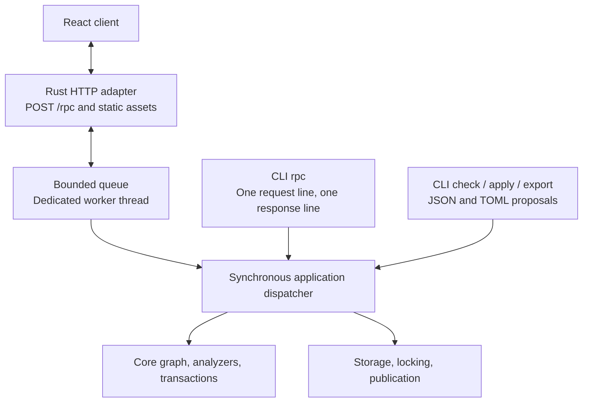

# LifeCore Application Interfaces

Status: proposed application contract. [PLAN.md](PLAN.md) lists remaining work.
[SPEC.md](SPEC.md) defines graph semantics; [FILES.md](FILES.md) defines proposals,
their JSON/TOML encoding, and publication requirements.
[SUGGESTIONS.md](SUGGESTIONS.md) defines suggestion export and replay-verified
acknowledgment.

## 1. Shared synchronous application

Use a React/TypeScript browser client, a Rust HTTP server, and a small native CLI.
All operations use shared Serde request, result, error, and proposal types and
one synchronous application dispatcher. CLI calls execute locally without a
running HTTP server. The web application embeds the service rather than launching
a subprocess or forwarding requests over stdio.



The shared contract owns data that crosses a transport or thread boundary.
Borrowed views and resolutions can be converted into owned results or serialized
within the worker. Reuse domain types and semantics without leaking storage,
HTTP types, or borrowed graph lifetimes into the public request contract.

Async execution, HTTP, and queue dependencies belong to the server adapter.
An ordinary worker thread constructs and owns the analyzer factories. It handles
each request the way a CLI invocation does: it reads the current snapshot,
performs the operation, and keeps no graph or analysis state between requests.
Requests are processed sequentially. In-memory caching in the worker is
deferred. The core and
application operations remain ordinary synchronous calls; a CLI invocation calls
them directly. Package boundaries must preserve this dependency direction.

## 2. CLI surface

| Command | Responsibility |
| --- | --- |
| `lifecore init` | Explicitly create the selected database without clobbering an existing one. Add TypeCheck by default; `--no-typecheck` opts out. This operation is outside RPC. |
| `lifecore serve` | Serve the React assets and HTTP RPC endpoint for the selected database. |
| `lifecore rpc` | Read one request line from stdin, execute it locally, print one response line, exit. |
| `lifecore check FILE` | Decode a JSON/TOML proposal and call shared proposal checking. |
| `lifecore apply FILE` | Decode a JSON/TOML proposal and call shared checked application. |
| `lifecore plan-id` | Mint a token for the selected current database/base without changing history. |
| `lifecore export FILE --format json\|toml` | Serialize a proposal document in the chosen format, preserving `plan_id` and `acknowledges`. |
| `lifecore add-analyzer NAME [CONFIG]` | Append a registered analyzer with its configuration string, default `{}`, to the ordered suite. |

These conveniences call the same operations and use the same data as RPC.
Collection-specific planning remains backlogged. `init`, `check`, `apply`,
`plan-id`, and `add-analyzer` print the corresponding RPC result or error object
as JSON on stdout, adding a one-line diagnostic on stderr for errors, and exit
zero on success, nonzero on rejection or error. `check` of a proposal that is
not accepted prints its result and exits nonzero. `export` prints the converted
document. `FILE` arguments select JSON or TOML by their `.json` or `.toml`
extension. There is no separate human-readable renderer yet. `check`, `apply`, and `add-analyzer` take
`--evaluation-time <timestamp>` or `--now`; without either, evaluation time is
absent. `--now` captures one instant before evaluation and reports it.
`init` creates an empty database only; it does not import an existing graph.

Changing the analyzer suite is a deliberate action, separate from proposals.
`add-analyzer` and its RPC method build a one-operation transaction
(`Change::AddAnalyzer`) against the current state and check it like any other
mutation. The replay runs every prefix under the extended suite, so an analyzer
that finds inconsistencies anywhere in existing history is rejected, with the
analysis output reported as for `apply`. Success rotates the graph revision and
invalidates outstanding plan IDs. There is no removal or reconfiguration.

Analysis results pair each suggestion observation with a ready-made `Proposal`
that names its finding in `acknowledges`. React selects that attached proposal; a
CLI caller extracts it into a change file and can convert it with `export`.
Several suggestions are alternatives against one base, not an apply batch.
`check`/`apply` verify the acknowledgment against their own replay and publish it
with the graph changes; see [SUGGESTIONS](SUGGESTIONS.md).

Default initialization stores the registered `Type_Check` analyzer with the
original configuration string `"{}"`. The opt-out omits that suite entry; it does
not weaken structural validation or silently skip other configured analyzers.
The core remains configurable. Missing configured implementations remain errors
when checking or applying changes.

`rpc` has no positional method argument, parameter flags, file option, request
loop, or interactive mode. A complete newline-terminated line is enough to
execute; it does not wait for stdin to close. EOF can terminate the first line.
It does not read or execute a second line. Pretty-printed multiline requests
must be compacted by the caller. Escaped newlines inside JSON strings are fine.

For example, the whole stdin line is:

```json
{"jsonrpc":"2.0","id":"request-1","method":"plan_id.mint","params":{}}
```

The result or error is one compact JSON object followed by a newline on stdout.
Empty or malformed input produces one structured error response without mutation.
Logs and operational diagnostics go to stderr. A response carrying `result`
exits zero, including a check with `accepted: false`; an `error` response exits
nonzero while retaining the machine-readable response when output is available.
No automatic write retry occurs.

## 3. Shared RPC envelope

HTTP and CLI use the same JSON-RPC-based single-call request/response profile:
`jsonrpc = "2.0"`, a required non-null request `id`, `method`, and object-valued
`params`. Responses carry that ID and either `result` or `error`. Protocol errors
without a usable ID use null. The initial profile excludes batches and
notifications; reject them before dispatch. This deliberately restricted profile
always responds, and is not a general JSON-RPC notification/batch implementation.
The [JSON-RPC specification](https://www.jsonrpc.org/specification) supplies the
envelope and standard protocol-error vocabulary.

`POST /rpc` accepts one request object in its body. HTTP framing permits formatted
JSON; CLI framing requires one physical line. Both share validation, dispatch,
result serialization, and stable application-error details. A JSON-RPC ID
correlates a call; it is distinct from a proposal's `plan_id` and from a receipt.

The initial method families cover database description, entry selection and
resolution, bounded comparisons, analyzer inspection/execution, analyzer suite
append, proposal checking/application/export, plan-ID minting, and dismissal
listing/update/restore. Entry listing and lookup come first, so the first
[CLI slice](PLAN.md#41-first-slice-change-files-storage-and-cli) can find the
exact identities proposals refer to.
Freeze exact method names and fixtures before implementing clients. `init` and
host filesystem-path selection are not RPC methods.

Application result types pair exported observations with their proposals and
report prospective/committed dismissal effects. Keep these types outside the core
`Observation` and `AnalysisOutput`. Diagnostics for an uncommitted check candidate
carry no ready-made proposals; analyze the committed result again after apply.

Change files serialize `Proposal`; check/apply parameters contain that same type
plus explicit evaluation inputs. A file convenience command reads the file once
and calls the same operation. Browser file imports send raw contents to the Rust
codec, so bare large integer shorthand is parsed without JavaScript rounding.
Structured editors send canonical proposals. Requests do not carry paths for
the server to open. Source locations are optional diagnostic metadata, not
proposal identity.

Keep malformed transport data, invalid proposals, unverified acknowledgments,
analyzer execution failures, stale bases, pre-publication failures,
and uncertain publication distinguishable.
Checking a structurally valid rejected proposal should retain complete analysis
context and advisories alongside blocking findings. Such a result must not
expose a commit capability. Missing analyzers must not prevent reading an
otherwise structurally valid database.

### 3.1 Provisional first-slice methods

These names and shapes are provisional until section 4.2 of the plan freezes
them. Unknown or repeated request members are rejected (`-32600`), as are
unknown parameters (`-32602`). Parameters never accept `null`: omit an optional
parameter instead, as for optional proposal fields. Results may carry `null`
for absent optional values, such as `view.head` or `analysis.inputs.evaluation_time`.
Evaluation-dependent methods take optional `evaluation_time` (a Jiff timestamp
string) or `now: true`, not both; the host captures `now` once and the result's
`analysis.inputs` reports the instant used.

A `proposal` parameter is decoded on its own, exactly like a change file, so a
malformed one fails with `malformed_proposal` (2001) and a `data.decode.path`
inside it, such as `entries[0].payload.n`; failures of other parameters are
`-32602`.

| Method | Parameters | Result |
| --- | --- | --- |
| `database.describe` | none | `database`, `graph_revision`, current `view`, ordered `suite` |
| `entries.list` | optional `kind` (`node`/`edge`), `type`, `currentness` (`current` default, `historical`, `all`), `text` (node text search) | `database`, `graph_revision`, `view`, `entries` in append order |
| `entries.get` | `id` (exact `EntryId`) | `view` and `entry` |
| `plan_id.mint` | none | `plan_id` |
| `proposal.check` | `proposal`, evaluation inputs | `accepted` and `report`: `database`, `base_revision`, `base` view, `operations` (name to provisional entry), complete `analysis` |
| `proposal.apply` | `proposal`, evaluation inputs | new `graph_revision` and the report with actual entry IDs |
| `proposal.decode` | raw `text`, `format` (`json`/`toml`) | canonical `Proposal` |
| `proposal.encode` | `proposal`, `format` | `text` |
| `analyzers.add` | `name`, `configuration` (default `{}`), evaluation inputs | new `graph_revision`, `suite`, and the report |

Each entry record carries `kind`, exact `id`, `type`, `current`, and either
`predecessor` (when present) and `payload`, or `from` and `to`.

A structurally valid proposal whose replay emits an inconsistency is still a
`check` result, with `accepted: false` and the complete report, including
advisories. `apply` refuses it with the `rejected` error, whose `data.report` is
that report; `analyzers.add` rejects the same way, with no operations.
Application errors use codes outside the reserved JSON-RPC range and a stable
`data.kind`:

| Code | `data.kind` | Meaning |
| --- | --- | --- |
| 1001 | `state_path_empty`, `working_directory`, `directory_missing` | The state path cannot be selected, or `init`'s containing directory does not exist. |
| 1002 | `database_missing` | No database at the selected path. |
| 1003 | `database_unreadable` | The snapshot cannot be read or is invalid. |
| 1004 | `database_exists` | `init` refuses to replace an existing path. |
| 1005 | `lock_failed` | The lock file cannot be opened or locked. |
| 1006 | `busy` | Another writer held the lock throughout the retry. |
| 1007 | `publication_failed` | Failure before replacement; stored state unchanged. |
| 1008 | `publication_uncertain` | Synchronization failed after replacement; `data.outcome` is the result the call would have returned, such as the new `graph_revision` and report, so the caller can inspect the stored state. |
| 2001 | `malformed_proposal` | Decoding failed; `data.decode` has `format` and `message`, plus `path`, `line`, and `column` where known. |
| 2002 | `invalid_proposal` | Names, references, intent, or structure; `data.location` names the entry and field where known. |
| 2003 | `acknowledgment_unsupported` | `acknowledges` is present but not yet verified (plan section 4.4). |
| 2004 | `foreign_database` | The plan ID names another database. |
| 2005 | `stale_base` | The plan ID names an earlier graph revision. |
| 2006 | `rejected` | Inconsistencies; `data.report` has the complete report. |
| 3001 | `analyzer_failure` | Missing analyzer, invalid configuration, or execution failure. |
| 4001 | `entry_not_found` | The identity is not present in the selected view. |

## 4. Database selection and concurrency

Resolve the database path in one synchronous host helper:

1. Use `LIFECORE_STATE_FILE_PATH` when set; an empty value is an error.
2. Otherwise use `LifeCoreState.json` in the process working directory.
3. Resolve any relative selected path against that directory. Do not search
   parent directories or fall back after a selected path fails.

The server resolves its path once at startup; each CLI process resolves its own
path. Failures to open an existing database remain errors. Only `init` creates
one. Moving the file preserves database identity. Frontend requests never select
arbitrary host files.

Other CLI/server processes may write the same database, so the worker keeps no
state between requests: each request opens the selected snapshot afresh, and
historical requests select a prefix of it. Standalone reads/checks
open the selected JSON snapshot once and read that complete immutable file;
atomic replacement gives them either the old or the new snapshot. They need no
writer lock. A current-state reload opens the path again rather than retaining
an old file handle. No lock spans standalone check and subsequent apply.

The snapshot envelope contains `format_version`, `graph_revision`, `graph`
(database identity, entries, and ordered analyzer suite), and `dismissals`.
There are no persisted analysis outputs. Full-snapshot rewriting is acceptable
for this initial implementation. [FILES](FILES.md#81-atomic-publication) defines
the layout and publication sequence.

Initially mutations acquire writer exclusion, reload, verify the selected base,
check, publish atomically, perform required synchronization, and release the
lock. Dismissal edits reread and preserve other records under writer exclusion.
Lock `<state-path>.lock`, a stable sibling file retained across snapshot
replacement; the default is `LifeCoreState.json.lock`. Use the standard library's
`File::lock`/`try_lock`. A writer that finds the lock held retries for a
bounded window, then returns a structured busy error instead of blocking
indefinitely. The window defaults to 10 seconds, since one check can take
seconds on a large history ([PLAN](PLAN.md#5-upcoming-checking-cost)); hosts can
change it with `Service::with_busy_retry`. Ordinary operations on a missing
database fail without creating the snapshot or its lock file. `init` requires
the containing directory to exist on a filesystem with hard links
([FILES](FILES.md#81-atomic-publication)), and a refused `init` creates no lock
file.
Do not hold locks across browser editing or between standalone check and apply.
An optimization that prepares outside the lock must compare the exact base
again under writer exclusion before publication.

`ViewId` describes a graph prefix; it does not include the analyzer suite. A
plan ID carries database/revision/proposal identities, using the
[token format](FILES.md#optional-structured-plan-identity).
The stored revision UUID changes with every graph or ordered-suite change,
including equal-count divergence, but not dismissal edits, no-ops, or token minting.
Verify the token's database/revision against the snapshot; core commit still compares
database identity, original entry count/content, and the exact ordered suite.
Revision maintenance assumes application-owned snapshots; hand-editing the
graph while retaining its revision is outside that guarantee.

A verified `acknowledges` stages an `Acknowledged` dismissal, retaining any
existing reason/note, and publishes it in the same snapshot as the checked graph
changes. All current dismissal records come from the reload under writer exclusion.

Disconnecting a browser does not establish cancellation or rollback of an
executing mutation. Preserve drafts, report uncertainty when acknowledgment is
lost, and support state inspection. Durable retry recognition is backlogged.

## 5. React client

The initial UI targets a local user and one database. Serve the client and RPC
on the same origin, with local binding and access controls at the HTTP adapter.
The client owns editors, drafts, navigation, layouts, and presentation state;
the backend owns resolution, analyzer grouping, validation, and publication.

Generate TypeScript definitions from the shared Rust contracts with
[ts-rs](https://docs.rs/ts-rs), enabling its `uuid-impl`, `semver-impl`, and
`jiff-impl` features, and commit the generated files. Core types that appear in
the contract derive `TS` behind an optional `ts` feature, so the graph library
does not depend on ts-rs by default. ts-rs follows derived Serde
attributes but not hand-written `Serialize` implementations, and by default
maps `usize` to `number` and `i64` to `bigint`. Declare the TypeScript shape of
every custom-encoded type and field explicitly with `#[ts(as = "..")]` or
`#[ts(type = "..")]`. Then guard the result: emit serialized Rust fixtures as
typed TypeScript constants and require them to type-check against the generated
definitions. Canonical integer payloads are
`{"kind":"integer","value":"9223372036854775807"}`-shaped objects. Keep the decimal
strings in model state, including inside lists/records, and use `bigint` only
when arithmetic is needed; serialize back to strings. Known large control
integers, such as entry positions and view boundaries, are also decimal strings
but need no payload wrapper. Small bounded protocol fields such as format
versions and error codes can remain JSON numbers. Canonical responses can use
ordinary JSON parsing; no lossless-number JSON parser is required. Send raw
JSON/TOML file imports to the Rust codec, which accepts bare `i64` shorthand
and returns canonical envelopes. Never parse that shorthand through JavaScript
numbers before sending it.
Keep timestamp strings at full precision in model state; date widgets must not
silently replace them with lower-precision values. The same requirement applies
when importing and exporting change files.

Generated drafts include a service-minted `plan_id`. Preserve exact existing
references and stable local operation names. Preview identities are provisional;
use returned operation-to-entry mappings after application. A stale proposal
requires deliberate replanning, without silently refreshing its token.

Selecting a suggestion selects its ready-made proposal. Show its original
observation/context and the prospective acknowledgment alongside the graph
preview, and apply it with the export's evaluation inputs unless the user changes
them. Editing its operations requires removing `acknowledges`, turning it into an
ordinary draft. After graph-changing application, sibling proposals from the
previous base need reconsideration.

Make evaluation time an explicit choice, defaulting to absent. If a user chooses
current time, the host captures one timestamp before evaluation and reports it.
Freeze that input across initialization and replay. Each displayed analysis
identifies its view, implementations, configuration strings, and evaluation
inputs. Keep certificates opaque; use supplied subjects and locations for UI
navigation. Dismissal and display filtering never change acceptance.

The first complete workflow is browse, create/edit or import a draft, check,
review findings and differences, apply explicitly, reload, and inspect history.
Include current/history report selection, sticky historical labels, dismissal
reasons/notes, restore, and explicit suggestion selection. Elaborate graph layouts
and specialized form builders can follow a working basic editor.

## 6. Analysis lifetime and dismissal persistence

Return `AnalysisOutput` as an ephemeral result. The service does not save an
analysis-output archive or issue durable report IDs. Each request replays the
selected history. In-memory caching is deferred with worker caching; a future
cache must match the exact graph/view, ordered suite, implementation identities,
and evaluation inputs. Display always includes the actual evaluation context.

History mode selects observations across prefixes replayed in that run. It does
not retrieve previous runs at earlier host times or with older analyzer versions.
Changing time or implementation can change findings, including which sticky
observations are reconstructed. Sticky affects selection within an output; it
does not turn outputs into persistent records. A client may retain an old result
for comparison, but it must label that result with its original context.

Persist dismissal keys, reasons, and notes in the snapshot independently of
outputs. They survive restart and absent current emission; a later observation
with the same complete key is still dismissed. Apply dismissals when presenting
a result, not as part of analysis-cache identity or transaction acceptance.
Persistent analysis archives are backlogged.

An exported suggestion names its complete finding key, and apply verifies it by
replay, so no cache or report registry is needed. Restoring a dismissal does not
undo graph changes. See
[SUGGESTIONS](SUGGESTIONS.md#5-display-retries-and-empty-suggestions) for empty
proposals and retry limits.
