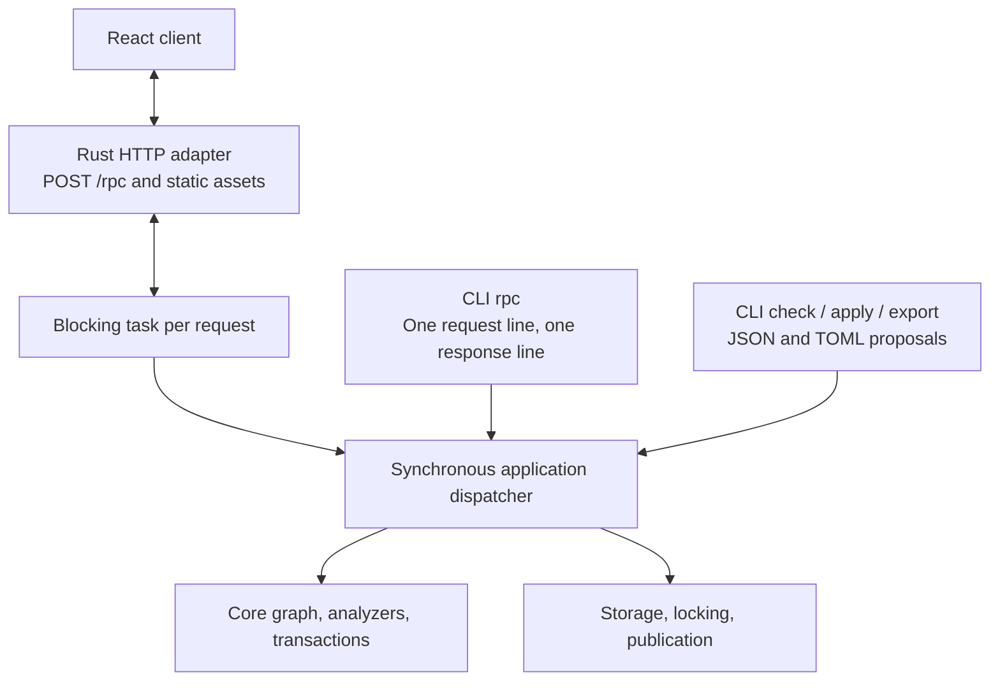

# LifeCore Application Interfaces

Status: proposed application contract. [PLAN.md](PLAN.md) lists remaining work.
[SPEC.md](SPEC.md) defines graph semantics; [FILES.md](FILES.md) defines proposals,
their JSON/TOML encoding, and publication requirements.
[SUGGESTIONS.md](SUGGESTIONS.md) defines suggestion export and replay-verified
acknowledgment.

## 1. Shared synchronous application

Use a React/TypeScript browser client, a Rust HTTP server, and a small native CLI.
All operations use shared Serde request, result, error, and proposal types and
one synchronous application dispatcher. CLI calls execute locally without a
running HTTP server. The web application embeds the service rather than launching
a subprocess or forwarding requests over stdio.



The shared contract owns data that crosses a transport or thread boundary.
Borrowed views and resolutions can be converted into owned results or serialized
within the request's task. Reuse domain types and semantics without leaking storage,
HTTP types, or borrowed graph lifetimes into the public request contract.

Async execution and HTTP dependencies belong to the server adapter. It runs
each request on a blocking task that calls the synchronous service the way a CLI
invocation does: it reads the current snapshot, performs the operation, and
keeps no graph or analysis state between requests. Requests run concurrently;
the file lock serializes writers exactly as it does between CLI processes.
There is no worker thread, queue, or server-side cache.

A client that disconnects does not cancel its call: the task runs to
completion and its outcome stands, so a disconnect is never a rollback, and the
adapter only notes it on stderr. A caller that lost its answer preserves its
drafts, reports the outcome as unknown, and inspects the stored state; nothing
retries the call automatically, and durable retry recognition is backlogged. The core and application operations remain ordinary
synchronous calls; a CLI invocation calls them directly. Package boundaries must
preserve this dependency direction.

## 2. CLI surface

| Command | Responsibility |
| --- | --- |
| `lifecore init` | Explicitly create the selected database without clobbering an existing one. Add TypeCheck by default; `--no-typecheck` opts out. This operation is outside RPC. |
| `lifecore serve` | Serve the embedded React client and HTTP RPC endpoint for the selected database, which must already be readable; otherwise print the error object and exit nonzero. Print the client URL as the only line on stdout ([section 3.2](#32-server-access)). `--port <port>` selects the loopback port, default 0 for one the system chooses; port 80 is refused at startup, because browsers omit it from `Host` and `Origin`, which the access checks require. `--ui-dir <dir>` serves the client from disk instead ([section 5.1](#51-frontend-build-and-tests)). |
| `lifecore rpc` | Read one request line from stdin, execute it locally, print one response line, exit. |
| `lifecore check FILE` | Decode a JSON/TOML proposal and call shared proposal checking. |
| `lifecore apply FILE` | Decode a JSON/TOML proposal and call shared checked application. |
| `lifecore plan-id` | Mint a token for the selected current database/base without changing history. |
| `lifecore export FILE --format json\|toml` | Serialize a proposal document in the chosen format, preserving `plan_id` and `acknowledges`. |
| `lifecore add-analyzer NAME [CONFIGURATION]` | Append a registered analyzer with its configuration string, default `{}`, to the ordered suite. |

These conveniences call the same operations and use the same data as RPC.
Collection-specific planning remains backlogged. `init`, `check`, `apply`,
`plan-id`, and `add-analyzer` print the corresponding RPC result or error object
as JSON on stdout, adding a one-line diagnostic on stderr for errors, and exit
zero on success, nonzero on rejection or error. `check` of a proposal that is
not accepted prints its result and exits nonzero. `export` prints the converted
document. `FILE` arguments select JSON or TOML by their `.json` or `.toml`
extension. There is no separate human-readable renderer yet. `check`, `apply`, and `add-analyzer` take
`--evaluation-time <timestamp>` or `--now`; without either, evaluation time is
absent. `--now` captures one instant before evaluation and reports it.
`init` creates an empty database only; it does not import an existing graph.

Changing the analyzer suite is a deliberate action, separate from proposals.
`add-analyzer` and its RPC method build a one-operation transaction
(`Change::AddAnalyzer`) against the current state and check it like any other
mutation. The replay runs every prefix under the extended suite, so an analyzer
that finds inconsistencies anywhere in existing history is rejected, with the
analysis output reported as for `apply`. Success rotates the graph revision and
invalidates outstanding plan IDs. There is no removal or reconfiguration.

Analysis results pair each suggestion observation with a ready-made `Proposal`
that names its finding in `acknowledges`. React selects that attached proposal; a
CLI caller extracts it into a change file and can convert it with `export`.
Several suggestions are alternatives against one base, not an apply batch.
`check`/`apply` verify the acknowledgment against their own replay and publish it
with the graph changes; see [SUGGESTIONS](SUGGESTIONS.md).

Default initialization stores the registered `Type_Check` analyzer with the
original configuration string `"{}"`. The opt-out omits that suite entry; it does
not weaken structural validation or silently skip other configured analyzers.
The core remains configurable. Missing configured implementations remain errors
when checking or applying changes.

`rpc` has no positional method argument, parameter flags, file option, request
loop, or interactive mode. A complete newline-terminated line is enough to
execute; it does not wait for stdin to close. EOF can terminate the first line.
It does not read or execute a second line. Pretty-printed multiline requests
must be compacted by the caller. Escaped newlines inside JSON strings are fine.

For example, the whole stdin line is:

```json
{"jsonrpc":"2.0","id":"request-1","method":"plan_id.mint","params":{}}
```

The result or error is one compact JSON object followed by a newline on stdout.
Empty or malformed input produces one structured error response without mutation.
Logs and operational diagnostics go to stderr. A response carrying `result`
exits zero, including a check with `accepted: false`; an `error` response exits
nonzero while retaining the machine-readable response when output is available.
No automatic write retry occurs.

## 3. Shared RPC envelope

HTTP and CLI use the same JSON-RPC-based single-call request/response profile:
`jsonrpc = "2.0"`, a required non-null request `id`, `method`, and object-valued
`params`. Responses carry that ID and either `result` or `error`. Protocol errors
without a usable ID use null. The initial profile excludes batches and
notifications; reject them before dispatch. This deliberately restricted profile
always responds, and is not a general JSON-RPC notification/batch implementation.
The [JSON-RPC specification](https://www.jsonrpc.org/specification) supplies the
envelope and standard protocol-error vocabulary.

`POST /rpc` accepts one request object in its body. HTTP framing permits formatted
JSON; CLI framing requires one physical line. Both share validation, dispatch,
result serialization, and stable application-error details. Every JSON-RPC
response, success or error, travels with HTTP status 200; only the access
rejections of [section 3.2](#32-server-access) use HTTP errors. A JSON-RPC ID
correlates a call; it is distinct from a proposal's `plan_id` and from a receipt.

The initial method families cover database description, entry selection and
resolution, bounded comparisons, analyzer inspection/execution, analyzer suite
append, proposal checking/application/export, plan-ID minting, and dismissal
listing/update/restore. Entry listing and lookup come first, so the first
[CLI slice](PLAN.md#41-first-slice-change-files-storage-and-cli) can find the
exact identities proposals refer to.
Method names and shapes are reshaped by the UI stages
([PLAN §4.3](PLAN.md#43-iterative-ui-stages)); each change updates the method
table and the fixtures together. `init` and host filesystem-path selection are
not RPC methods.

Application result types pair exported observations with their proposals and
report prospective/committed dismissal effects. Keep these types outside the core
`Observation` and `AnalysisOutput`. Diagnostics for an uncommitted check candidate
carry no ready-made proposals; analyze the committed result again after apply.

Change files serialize `Proposal`; check/apply parameters contain that same type
plus explicit evaluation inputs. A file convenience command reads the file once
and calls the same operation. Browser file imports send raw contents to the Rust
codec, so bare large integer shorthand is parsed without JavaScript rounding.
Structured editors send canonical proposals. Requests do not carry paths for
the server to open. Source locations are optional diagnostic metadata, not
proposal identity.

Keep malformed transport data, invalid proposals, unverified acknowledgments,
analyzer execution failures, stale bases, pre-publication failures,
and uncertain publication distinguishable.
Checking a structurally valid rejected proposal should retain complete analysis
context and advisories alongside blocking findings. Such a result must not
expose a commit capability. Missing analyzers must not prevent reading an
otherwise structurally valid database.

### 3.1 Provisional first-slice methods

These names and shapes are provisional; the UI stages reshape them as the
screens need. Unknown or repeated request members are rejected (`-32600`), as are
unknown parameters (`-32602`). Parameters never accept `null`: omit an optional
parameter instead, as for optional proposal fields. Results may carry `null`
for absent optional values, such as `view.head` or `analysis.inputs.evaluation_time`.
Evaluation-dependent methods take optional `evaluation_time` (a Jiff timestamp
string) or `now: true`, not both; the host captures `now` once and the result's
`analysis.inputs` reports the instant used.

A `proposal` parameter is decoded on its own, exactly like a change file, so a
malformed one fails with `malformed_proposal` (2001) and a `data.decode.path`
inside it, such as `entries[0].payload.n`; failures of other parameters are
`-32602`.

| Method | Parameters | Result |
| --- | --- | --- |
| `database.describe` | none | `database`, `graph_revision`, current `view`, ordered `suite` |
| `entries.list` | optional `kind` (`node`/`edge`), `ty_name`, `currentness` (`current` default, `historical`, `all`), `text` (node text search), `as_of` | `database`, `graph_revision`, `view`, `entries` in append order |
| `entries.get` | `id` (exact `EntryId`), optional `as_of` | `view` and `entry` |
| `entries.inspect` | `id`, optional `as_of` | tagged by `kind`: a node with its `type` resolution, its `lineage` (the whole revision tree, root first) and its incident `edges` of any currentness (each with `direction` and the `other` endpoint); or an edge with `from` and `to` |
| `types.list` | optional `as_of` | `view` and `types`: one summary per name the view knows, sorted by name, with its `resolution` (`builtin`, `declared` with the structured schema, `missing`, `ambiguous`, `malformed`) and node counts by currentness |
| `views.query` | `seeds` (exact node `ids`, or a node selection), ordered `expand` steps (`hops`, `direction`, `ty_names`, `currentness`), an `edges` filter, optional `as_of` | `view`, `nodes` with their `provenance` (`seed`, or `reached` at a hop over an edge from a node), and the matching `edges` among them |
| `views.render` | the `views.query` parameters and `format` (`dot`/`svg`) | `format` and `text`: the queried subgraph as DOT (`digraph lifecore`, labeled with the database and boundary; nodes `n<position>` with the row label, `@position`, and type, superseded ones gray; dashed blue `revision` links only between result nodes; edges labeled `@position <ty_name>`, historical ones gray; every node and edge has `id` and an `href` of `#inspect/<origin>/<position>`), or that DOT rendered by Graphviz's `dot -Tsvg`, run synchronously with a 10 s deadline and a 16 MiB output cap |
| `plan_id.mint` | none | `plan_id` |
| `proposal.check` | `proposal`, evaluation inputs | `accepted` and `report`: `database`, `base_revision`, `base` view, `operations` (name to provisional entry), complete `analysis` |
| `proposal.apply` | `proposal`, evaluation inputs | new `graph_revision` and the report with actual entry IDs |
| `proposal.decode` | raw `text`, `format` (`json`/`toml`) | canonical `Proposal` |
| `proposal.encode` | `proposal`, `format` | `text` |
| `analyzers.add` | `name`, `configuration` (default `{}`), evaluation inputs | new `graph_revision`, `suite`, and the report |
| `analysis.run` | optional `as_of`, evaluation inputs | `analysis`: the selected prefix replayed with fresh analyzers under the stored ordered suite, which history does not version ([section 4](#4-database-selection-and-concurrency)); `dismissals`: the stored records (`key`, `reason`, `note`) of the same snapshot read, which the analysis never applies ([section 6](#6-analysis-lifetime-and-dismissal-persistence)) |
| `findings.dismiss` | `key` (complete finding key), `reason` (`acknowledged`, `false_positive`, `no_longer_relevant`), optional `note` | `dismissals`: every stored record after the edit; an existing record of the key is updated in place |
| `findings.restore` | `key` | `dismissals` after the edit and `restored`: whether a record of the key existed |

Read methods take an optional `as_of`, a decimal position: they answer from
the prefix `[0, as_of)`, whose boundary the result's `view` names, and default
to the whole history. A boundary past the visible end fails with
`beyond_boundary` (4002). `ui/src/contract.ts` declares the exact shapes.

Each entry record is the stored entry of
[FILES §2.5](FILES.md#25-entry-shaped-types) with `current` beside its members.

List and query results are complete. The prototype applies no result limits or
paging; they are [backlogged](PLAN.md#other-deferred-work).

A structurally valid proposal whose replay emits an inconsistency is still a
`check` result, with `accepted: false` and the complete report, including
advisories. `apply` refuses it with the `rejected` error, whose `data.report` is
that report; `analyzers.add` rejects the same way, with no operations.
Application errors use codes outside the reserved JSON-RPC range and a stable
`data.kind`:

| Code | `data.kind` | Meaning |
| --- | --- | --- |
| 1001 | `state_path_empty`, `working_directory`, `directory_missing` | The state path cannot be selected, or `init`'s containing directory does not exist. |
| 1002 | `database_missing` | No database at the selected path. |
| 1003 | `database_unreadable` | The snapshot cannot be read or is invalid. |
| 1004 | `database_exists` | `init` refuses to replace an existing path. |
| 1005 | `lock_failed` | The lock file cannot be opened or locked. |
| 1006 | `busy` | Another writer held the lock throughout the retry. |
| 1007 | `publication_failed` | Failure before replacement; stored state unchanged. |
| 1008 | `publication_uncertain` | Synchronization failed after replacement; `data.outcome` is the result the call would have returned, such as the new `graph_revision` and report, tagged by `kind` (`initialized`, `applied`, or `analyzer_added`), so the caller can inspect the stored state. |
| 2001 | `malformed_proposal` | Decoding failed; `data.decode` has `format` and `message`, plus `path`, `line`, and `column` where known. A JSON `message` is serde_json's own text, which names a position; for a `proposal` parameter that position counts from the start of the member. |
| 2002 | `invalid_proposal` | Names, references, intent, or structure; `data.location` names the entry and field where known. |
| 2003 | `acknowledgment_unsupported` | `acknowledges` is present but not yet verified (plan section 4.4). |
| 2004 | `foreign_database` | The plan ID names another database. |
| 2005 | `stale_base` | The plan ID names an earlier graph revision. |
| 2006 | `rejected` | Inconsistencies; `data.report` has the complete report. For `init`, whose base was never published, the report omits `base_revision`. |
| 3001 | `analyzer_failure` | Missing analyzer, invalid configuration, or execution failure. |
| 4001 | `entry_not_found` | The identity is not present in the selected view. |
| 4002 | `beyond_boundary` | `as_of` exceeds the visible end; `data` carries `requested` and `visible` as decimal strings. |
| 4003 | `cannot_dismiss_inconsistency` | `findings.dismiss` named an inconsistency key, emitted or not; `data.key` is that key. Nothing is stored. |
| 4004 | `graphviz_unavailable` | `views.render` with `format: "svg"` could not start the `dot` program; `data.message` is the operating system's text. |
| 4005 | `graphviz_failed` | `dot` started but exceeded the deadline, exited unsuccessfully, or produced invalid UTF-8 or more than the output cap; `data.message` includes its stderr. |
| 5001 | `backend_failure` | The host task running the call ended without a response, for example by panicking. A write it was making may or may not have been published; inspect the stored state. Never a rollback. |

Invalid parameters (`-32602`, `invalid_params`) and internal errors (`-32603`,
`internal`) also carry a `data.kind`; envelope errors (`-32700`, `-32600`,
`-32601`) carry no `data`.

### 3.2 Server access

`lifecore serve` listens on the loopback interface only, on `127.0.0.1` and the
port of `--port`, or one the system chooses. At each start it generates a
random launch token of 256 bits from the operating system's CSPRNG, as 64
lowercase hexadecimal digits, and prints the client URL with the token in the
URL fragment as the only line on standard output, for example
`http://127.0.0.1:<port>/#token=<token>`. A browser never sends the fragment to
the server, so the token stays out of request lines and access logs; nothing
else prints or logs it.

The client reads the token from the fragment, keeps it in session storage,
removes it from the address bar, and sends it on every `POST /rpc` as
`Authorization: Bearer <token>`. Before JSON-RPC dispatch, the adapter rejects
with an HTTP error any request whose `Host` is not the bound address and port
(`127.0.0.1:<port>` or `localhost:<port>`), whose `Origin`, when present, is not
the served origin, whose `/rpc` call lacks the exact token, compared in
constant time, or whose `/rpc` call does not declare a JSON content type. The
`Host` check defeats DNS rebinding. The token, the `Origin` check, and the
content-type requirement each defeat cross-site requests on their own: a form
post cannot set a JSON content type, and a cross-origin fetch that sets it or
the custom header forces a CORS preflight that the adapter never approves. Static assets carry no secrets and
need no token, but pass the `Host` and `Origin` checks. A restart issues a new
token, so open pages must be reopened from the newly printed URL. The one-shot
CLI `rpc` runs as the local user on the selected file and uses none of this.

The served origin is `http://` followed by the request's own accepted `Host`.
The checks run in this order, each answering with the HTTP status shown and a
JSON body `{"kind": ..., "message": ...}`; the body of a `/rpc` call is not read
before they pass:

| Status | `kind` | Rejected request |
| --- | --- | --- |
| 421 | `host` | `Host` is missing, repeated, or neither accepted authority, or an absolute request target names another. |
| 403 | `origin` | `Origin` is present but not the served origin, including `null`. |
| 401 | `token` | `/rpc` without exactly one `Authorization: Bearer <token>` (scheme case-insensitive) naming the launch token. Also sends `WWW-Authenticate: Bearer`. |
| 415 | `content_type` | `/rpc` whose `Content-Type` essence is not `application/json`; parameters such as `charset` are ignored. |
| 413 | `body` | `/rpc` whose body exceeds 64 MiB. |
| 400 | `body` | `/rpc` whose body cannot be read, for example malformed chunking or a connection closed before the declared length. |

Assets and RPC answers are sent with `Cache-Control: no-store`; assets also
carry a content security policy that loads scripts only from the served origin.

The adapter runs each call on a blocking task as described in
[section 1](#1-shared-synchronous-application), which also owns what a client
disconnect means. The first SIGINT or SIGTERM starts an orderly shutdown: the
server stops accepting connections, lets every running call finish and answer
its client if still connected, and then exits; a second signal exits at once,
with status 128 plus that signal's number (130 for SIGINT, 143 for SIGTERM),
which atomic publication makes safe for the stored snapshot. A call whose task panics answers `backend_failure` with its
request ID in builds that unwind; this workspace's dev profile aborts on panic
instead.

## 4. Database selection and concurrency

Resolve the database path in one synchronous host helper:

1. Use `LIFECORE_STATE_FILE_PATH` when set; an empty value is an error.
2. Otherwise use `LifeCoreState.json` in the process working directory.
3. Resolve any relative selected path against that directory. Do not search
   parent directories or fall back after a selected path fails.

The server resolves its path once at startup; each CLI process resolves its own
path. Failures to open an existing database remain errors. Only `init` creates
one. Moving the file preserves database identity. Frontend requests never select
arbitrary host files.

Other CLI/server processes may write the same database, so the server keeps no
state between requests: each request opens the selected snapshot afresh, and
historical requests select a prefix of it. Standalone reads/checks
open the selected JSON snapshot once and read that complete immutable file;
atomic replacement gives them either the old or the new snapshot. They need no
writer lock. A current-state reload opens the path again rather than retaining
an old file handle. No lock spans standalone check and subsequent apply.

The snapshot envelope contains `graph_revision`, `graph` (database identity,
entries, and ordered analyzer suite), and `dismissals`.
There are no persisted analysis outputs. Full-snapshot rewriting is acceptable
for this initial implementation. [FILES](FILES.md#8-atomic-publication) defines
the layout and publication sequence.

Initially mutations acquire writer exclusion, reload, verify the selected base,
check, publish atomically, perform required synchronization, and release the
lock. Dismissal edits reread and preserve other records under writer exclusion.
Lock `<state-path>.lock`, a stable sibling file retained across snapshot
replacement; the default is `LifeCoreState.json.lock`. Use the standard library's
`File::lock`/`try_lock`. A writer that finds the lock held retries for a
bounded window, then returns a structured busy error instead of blocking
indefinitely. The window defaults to 10 seconds, leaving a margin over a
competing apply's check, which takes about a second at 4,000 entries and grows
roughly quadratically ([PLAN](PLAN.md#5-checking-cost)); hosts can change it with
`Service::with_busy_retry`. Ordinary operations on a missing
database fail without creating the snapshot or its lock file. `init` requires
the containing directory to exist on a filesystem with hard links
([FILES](FILES.md#8-atomic-publication)), and a refused `init` creates no lock
file.
Do not hold locks across browser editing or between standalone check and apply.
An optimization that prepares outside the lock must compare the exact base
again under writer exclusion before publication.

`ViewId` describes a graph prefix; it does not include the analyzer suite. A
plan ID carries database/revision/proposal identities, using the
[token format](FILES.md#optional-structured-plan-identity).
The stored revision UUID changes with every graph or ordered-suite change,
including equal-count divergence, but not dismissal edits, no-ops, or token minting.
Verify the token's database/revision against the snapshot; core commit still compares
database identity, original entry count/content, and the exact ordered suite.
Revision maintenance assumes application-owned snapshots; hand-editing the
graph while retaining its revision is outside that guarantee.

A verified `acknowledges` stages an `Acknowledged` dismissal, retaining any
existing reason/note, and publishes it in the same snapshot as the checked graph
changes. All current dismissal records come from the reload under writer exclusion.

A disconnected browser leaves an executing mutation to complete as
[section 1](#1-shared-synchronous-application) describes.

## 5. React client

The initial UI targets a local user and one database. Serve the client and RPC
on the same origin, with the loopback binding, launch token, and `Host`/`Origin`
checks of [section 3.2](#32-server-access) at the HTTP adapter.
The client owns editors, drafts, navigation, layouts, and presentation state;
the backend owns resolution, analyzer grouping, validation, and publication.

Write the TypeScript definitions of the shared contract by hand in
`ui/src/contract.ts`. The contract is small, its methods are reshaped by the
stages, and the types that matter most have hand-written `Serialize`
implementations that a generator could not follow. Guard it with fixtures: a
Rust test in `lifecore-server` records representative requests and responses of
every method, every application error kind, the envelope errors, and every HTTP
rejection, mostly from real calls through the server's own request path, and
commits them under `ui/src/fixtures/`. Each fixture is a TypeScript module that
exports the Rust-serialized JSON value followed by `satisfies` its declared
type, so the frontend type-check rejects a changed Rust shape: a missing or
renamed member, a member the contract does not declare, or a wrong tag.
Imported `.json` files would not do, because `tsc` widens their string literals
and skips excess-member checks. A generated `index.ts` maps every method of the
dispatcher's single method list (`rpc::Method::ALL`) to its fixture, so a method
the contract declares without a fixture, or the reverse, also fails `tsc`.
HTTP rejection statuses are pinned per kind as literal types. Random UUIDs and scratch paths are replaced by stable
stand-ins, so an unchanged shape rewrites nothing. Canonical integer payloads are
`{"kind":"integer","value":"9223372036854775807"}`-shaped objects. Keep the decimal
strings in model state, including inside lists/records, and use `bigint` only
when arithmetic is needed; serialize back to strings. Known large control
integers, such as entry positions and view boundaries, are also decimal strings
but need no payload wrapper. Small bounded protocol fields such as error codes can remain JSON numbers. Canonical responses can use
ordinary JSON parsing; no lossless-number JSON parser is required. Send raw
JSON/TOML file imports to the Rust codec, which accepts bare `i64` shorthand
and returns canonical envelopes. Never parse that shorthand through JavaScript
numbers before sending it.
Keep timestamp strings at full precision in model state; date widgets must not
silently replace them with lower-precision values. The same requirement applies
when importing and exporting change files.

Generated drafts include a service-minted `plan_id`. Preserve exact existing
references and stable local operation names. Preview identities are provisional;
use returned operation-to-entry mappings after application. A stale proposal
requires deliberate replanning, without silently refreshing its token.

Selecting a suggestion selects its ready-made proposal. Show its original
observation/context and the prospective acknowledgment alongside the graph
preview, and apply it with the export's evaluation inputs unless the user changes
them. Editing its operations requires removing `acknowledges`, turning it into an
ordinary draft. After graph-changing application, sibling proposals from the
previous base need reconsideration.

Make evaluation time an explicit choice, defaulting to absent. If a user chooses
current time, the host captures one timestamp before evaluation and reports it.
Freeze that input across initialization and replay. Each displayed analysis
identifies its view, implementations, configuration strings, and evaluation
inputs. Keep certificates opaque; use supplied subjects and the focus entry for UI
navigation. Dismissal and display filtering never change acceptance.

The first complete workflow is browse, create/edit or import a draft, check,
review findings and differences, apply explicitly, reload, and inspect history.
Include current/history report selection, sticky historical labels, dismissal
reasons/notes, restore, and explicit suggestion selection. Elaborate graph layouts
and specialized form builders can follow a working basic editor.

### 5.1 Frontend build and tests

The client lives in `lifecore-server/ui` as a small Node project: npm with a
committed `package-lock.json`, esbuild for bundling, `tsc --noEmit` for
type-checking, Biome for linting and formatting, `node --test` for the few unit
tests, and Playwright Test for browser tests. It starts with React and ReactDOM;
add libraries only when a stage needs them.

`lifecore-server`'s `build.rs` bundles `ui/src/main.tsx` with the installed
esbuild into a fixed-name `app.js` in `OUT_DIR` and copies the handwritten
`ui/index.html` beside it; the server embeds both. Both steps live in
`ui/build.mjs`, which `build.rs` runs with `node` and the npm `build` and
`watch` scripts run for `ui/dist`, so every bundle uses the same options.
`build.rs` declares `rerun-if-changed` for `ui/src`, `ui/index.html`,
`ui/package-lock.json`, and the inputs that shape the bundle besides them
(`ui/package.json`, `ui/build.mjs`, `ui/tsconfig.json`), and
`rerun-if-env-changed` for `LIFECORE_UI`. It
never installs packages: when `ui/node_modules` is missing, it fails with an
instruction to run `npm ci` in `lifecore-server/ui`. Setting `LIFECORE_UI=skip`
embeds a placeholder page instead, for builds that do not touch the client, such
as agents and CI running `cargo test --workspace` without Node.
Type-checking, linting, and tests are separate checks, not part of the build.

For quick iteration, `serve --ui-dir <dir>` serves `index.html` and `app.js`
from `<dir>`, reading them on every request, while `npm run watch` rebuilds
them into `ui/dist`; a browser refresh picks up changes, and the launch token
survives in session storage.

The fixture test writes `ui/src/fixtures/` when Rust tests run, which is after
`build.rs` has bundled, and fails when the committed copies are stale, so the
build only reads committed files. It rewrites only stale files, so an
unchanged run leaves `ui/src` untouched and does not trigger a rebundle.

Browser tests run in Firefox, the priority for compatibility; other browsers are
[backlogged](PLAN.md#other-deferred-work). A global setup builds `lifecore`
with Cargo, unless `LIFECORE_BIN` names a binary, initializes a scratch
database through `LIFECORE_STATE_FILE_PATH`, starts `lifecore serve`, reads the
printed URL with its launch token from standard output, and opens it, so tests
exercise the real access flow and the embedded client.

### 5.2 Client decisions

Presentation choices of the browsing client, recorded so the code can cite
them; none is a server contract.

- Row label: a node's `title` field when it is text, else `name` when text,
  else the alphabetically first top-level text field, else
  `<ty_name> @<position>`. Blank text does not count; an empty type name reads
  "(unnamed)". `@position` is shown beside a field label. Labels are cut at 60
  characters on screen with the full text as a tooltip.
- `@position` is an entry's on-screen identity; the origin UUID is never shown.
- As-of is one global client state set in the top bar, sent as `as_of` with
  every read, and not part of Back history. `database.describe` is read
  history-wide, so the Database screen counts the whole history, while the top
  bar shows `view [0, as_of) of N entries` and tables and the inspector show
  the `view` their own response names.
- Navigation is in memory: Back pops a stack, reopening the current screen is
  not a step, and Explore stays mounted under the other screens, so its form
  and results, or its failure, survive a detour.
- Table columns: label, `@position`, current, then the declared fields by
  status (mandatory, encouraged, optional, deprecated) and name, then
  undeclared fields present in the rows, marked. The `Type` table shows a
  declaration summary instead of field columns. Cells render on one line
  (`[a, b]`, `{owner: me}`, `true`), cut at 80 characters with the full text as
  a tooltip. Integers sort by value, timestamps by instant at full precision,
  everything else as text, absent cells last.
- Currentness words: a node is current or superseded, an edge current or
  historical; lists default to current, with historical and all on request.
- Text filters are server-side (`text` of `entries.list` and of node seeds),
  debounced by 300 ms.
- Explore is bounded by the client, not the server, to 3 expansion steps of up
  to 3 hops each. "Explore from here" in the inspector adds the node as a seed
  and runs the query; a form that no longer matches the query on show says so
  until Run.
- Thread display: one edge type and one direction at a time; with outgoing,
  the edge's `from` is the parent. A node's first occurrence is expanded, later
  ones collapse to "also under"; a revisit on the current path is cut as a
  cycle. Nodes that occur more than once get one of 8 stripe colors, then a
  numeric suffix.
- The inspector of a `Type` node shows the parsed schema (the server's parse
  for a current declaration, else a client-side reading) and then the full
  payload table, so `name` and fields outside the grammar stay visible.

## 6. Analysis lifetime and dismissal persistence

Return `AnalysisOutput` as an ephemeral result. The service does not save an
analysis-output archive or issue durable report IDs. Each request replays the
selected history. In-memory caching is deferred; a future cache must match the exact graph/view, ordered suite, implementation identities,
and evaluation inputs. Display always includes the actual evaluation context.

History mode selects observations across prefixes replayed in that run. It does
not retrieve previous runs at earlier host times or with older analyzer versions.
Changing time or implementation can change findings, including which sticky
observations are reconstructed. Sticky affects selection within an output; it
does not turn outputs into persistent records. A client may retain an old result
for comparison, but it must label that result with its original context.

Persist dismissal keys, reasons, and notes in the snapshot independently of
outputs. They survive restart and absent current emission; a later observation
with the same complete key is still dismissed. Apply dismissals when presenting
a result, not as part of analysis-cache identity or transaction acceptance.
`findings.dismiss` and `findings.restore` make these edits under writer
exclusion and publish them without rotating the graph revision
([section 4](#4-database-selection-and-concurrency)).
Persistent analysis archives are backlogged.

An exported suggestion names its complete finding key, and apply verifies it by
replay, so no cache or report registry is needed. Restoring a dismissal does not
undo graph changes. See
[SUGGESTIONS](SUGGESTIONS.md#5-display-retries-and-empty-suggestions) for empty
proposals and retry limits.
