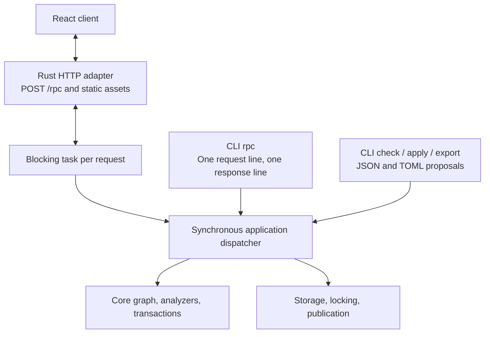

# LifeCore Application Interfaces

Status: proposed application contract for the shared service's architecture,
the CLI, the RPC envelope, server access, and analysis lifetime.
[RPC](RPC.md) lists the methods and errors, [STORAGE](STORAGE.md) database
selection and publication, and [CLIENT](CLIENT.md) the React client.

## 1. Shared synchronous application

Use a React/TypeScript browser client, a Rust HTTP server, and a small native CLI.
All operations use shared Serde request, result, error, and proposal types and
one synchronous application dispatcher. CLI calls execute locally without a
running HTTP server. The web application embeds the service rather than launching
a subprocess or forwarding requests over stdio.



The shared contract owns data that crosses a transport or thread boundary.
Borrowed views and resolutions can be converted into owned results or serialized
within the request's task. Reuse domain types and semantics without leaking storage,
HTTP types, or borrowed graph lifetimes into the public request contract.

Async execution and HTTP dependencies belong to the server adapter. It runs
each request on a blocking task that calls the synchronous service the way a CLI
invocation does: it reads the current snapshot, performs the operation, and
keeps no graph or analysis state between requests. Requests run concurrently;
the file lock serializes writers exactly as it does between CLI processes.
There is no worker thread, queue, or server-side cache. Do not add async traits
or cross-thread requirements to the core for HTTP convenience: only the
service's analyzer factory constructor must be `Send + Sync`.

A client that disconnects does not cancel its call: the task runs to
completion and its outcome stands, so a disconnect is never a rollback, and the
adapter only notes it on stderr. A caller that lost its answer preserves its
drafts, reports the outcome as unknown, and inspects the stored state; nothing
retries the call automatically, and durable retry recognition is
[backlogged](backlog/RECEIPTS.md). The core and application operations remain
ordinary synchronous calls; a CLI invocation calls them directly. Package
boundaries must preserve this dependency direction.

Format and transport adapters cannot introduce unchecked writes or different
domain rules. Every adapter preserves exact references, explicit revision
intent, every-prefix validation, frozen evaluation inputs, and the unfiltered
inconsistency gate ([SPEC §7](SPEC.md#7-mandatory-validation),
[§8](SPEC.md#8-analyzers)).

## 2. CLI surface

| Command | Responsibility |
| --- | --- |
| `lifecore init` | Explicitly create the selected database without clobbering an existing one. Add TypeCheck by default; `--no-typecheck` opts out. This operation is outside RPC. |
| `lifecore serve` | Serve the embedded React client and HTTP RPC endpoint for the selected database, which must already be readable; otherwise print the error object and exit nonzero. Print the client URL as the only line on stdout ([section 4](#4-server-access)). `--port <port>` selects the loopback port, default 0 for one the system chooses; port 80 is refused at startup, because browsers omit it from `Host` and `Origin`, which the access checks require. `--ui-dir <dir>` serves the client from disk instead ([CLIENT §6](CLIENT.md#6-build-and-tests)). |
| `lifecore rpc` | Read one request line from stdin, execute it locally, print one response line, exit. |
| `lifecore check FILE` | Decode a JSON/TOML proposal and call shared proposal checking. |
| `lifecore apply FILE` | Decode a JSON/TOML proposal and call shared checked application. |
| `lifecore plan-id` | Mint a token for the selected current database/base without changing history. |
| `lifecore export FILE --format json\|toml` | Serialize a proposal document in the chosen format, preserving `plan_id` and `acknowledges`. |
| `lifecore add-analyzer NAME [CONFIGURATION]` | Append a registered analyzer with its configuration string, default `{}`, to the ordered suite. |

These conveniences call the same operations and use the same data as RPC.
`init`, `check`, `apply`, `plan-id`, and `add-analyzer` print the corresponding
RPC result or error object as JSON on stdout, adding a one-line diagnostic on
stderr for errors, and exit zero on success, nonzero on rejection or error.
`check` of a proposal that is not accepted prints its result and exits nonzero.
`export` prints the converted document. `FILE` arguments select JSON or TOML by
their `.json` or `.toml` extension. There is no separate human-readable
renderer yet. `check`, `apply`, and `add-analyzer` take
`--evaluation-time <timestamp>` or `--now`; without either, evaluation time is
absent. `--now` captures one instant before evaluation and reports it.
`init` creates an empty database only; it does not import an existing graph.

Changing the analyzer suite is a deliberate action, separate from proposals.
`add-analyzer` and its RPC method build a one-operation transaction
(`Change::AddAnalyzer`) against the current state and check it like any other
mutation. The replay runs every prefix under the extended suite, so an analyzer
that finds inconsistencies anywhere in existing history is rejected, with the
analysis output reported as for `apply`. Success rotates the graph revision and
invalidates outstanding plan IDs. There is no removal or reconfiguration.

Default initialization stores the registered `Type_Check` analyzer with the
original configuration string `"{}"`. The opt-out omits that suite entry; it does
not weaken structural validation or silently skip other configured analyzers.
The core remains configurable. Missing configured implementations remain errors
when checking or applying changes.

Once suggestion export is built, a CLI caller extracts a suggestion's
ready-made proposal into a change file and can convert it with `export`
([SUGGESTIONS](SUGGESTIONS.md)).

`rpc` has no positional method argument, parameter flags, file option, request
loop, or interactive mode. A complete newline-terminated line is enough to
execute; it does not wait for stdin to close. EOF can terminate the first line.
It does not read or execute a second line. Pretty-printed multiline requests
must be compacted by the caller. Escaped newlines inside JSON strings are fine.

For example, the whole stdin line is:

```json
{"jsonrpc":"2.0","id":"request-1","method":"plan_id.mint","params":{}}
```

The result or error is one compact JSON object followed by a newline on stdout.
Empty or malformed input produces one structured error response without mutation.
Logs and operational diagnostics go to stderr. A response carrying `result`
exits zero, including a check with `accepted: false`; an `error` response exits
nonzero while retaining the machine-readable response when output is available.
No automatic write retry occurs.

## 3. Shared RPC envelope

HTTP and CLI use the same JSON-RPC-based single-call request/response profile:
`jsonrpc = "2.0"`, a required non-null request `id`, `method`, and object-valued
`params`. Responses carry that ID and either `result` or `error`. Protocol errors
without a usable ID use null. The profile excludes batches and notifications;
reject them before dispatch. This deliberately restricted profile always
responds, and is not a general JSON-RPC notification/batch implementation.
The [JSON-RPC specification](https://www.jsonrpc.org/specification) supplies the
envelope and standard protocol-error vocabulary.

`POST /rpc` accepts one request object in its body. HTTP framing permits formatted
JSON; CLI framing requires one physical line. Both share validation, dispatch,
result serialization, and stable application-error details. Every JSON-RPC
response, success or error, travels with HTTP status 200; only the access
rejections of [section 4](#4-server-access) use HTTP errors. A JSON-RPC ID
correlates a call; it is distinct from a proposal's `plan_id` and from a receipt.

[RPC](RPC.md) lists the methods and application errors. Their names and shapes
are provisional: a UI stage reshapes them as its screens need
([PLAN §2](PLAN.md#2-remaining-work)), and each change updates the method table,
the fixtures, and `contract.ts` together. `init` and host filesystem-path
selection are not RPC methods.

Change files serialize `Proposal`; check/apply parameters contain that same type
plus explicit evaluation inputs. A file convenience command reads the file once
and calls the same operation. Browser file imports send raw contents to the Rust
codec, so bare large integer shorthand is parsed without JavaScript rounding.
Structured editors send canonical proposals. Requests do not carry paths for
the server to open. Source locations are optional diagnostic metadata, not
proposal identity.

Keep malformed transport data, invalid proposals, unverified acknowledgments,
analyzer execution failures, stale bases, pre-publication failures,
and uncertain publication distinguishable.
Checking a structurally valid rejected proposal should retain complete analysis
context and advisories alongside blocking findings. Such a result must not
expose a commit capability. Missing analyzers must not prevent reading an
otherwise structurally valid database.

## 4. Server access

`lifecore serve` listens on the loopback interface only, on `127.0.0.1` and the
port of `--port`, or one the system chooses. At each start it generates a
random launch token of 256 bits from the operating system's CSPRNG, as 64
lowercase hexadecimal digits, and prints the client URL with the token in the
URL fragment as the only line on standard output, for example
`http://127.0.0.1:<port>/#token=<token>`. A browser never sends the fragment to
the server, so the token stays out of request lines and access logs; nothing
else prints or logs it.

The client reads the token from the fragment, keeps it in session storage,
removes it from the address bar, and sends it on every `POST /rpc` as
`Authorization: Bearer <token>`. Before JSON-RPC dispatch, the adapter rejects
with an HTTP error any request whose `Host` is not the bound address and port
(`127.0.0.1:<port>` or `localhost:<port>`), whose `Origin`, when present, is not
the served origin, whose `/rpc` call lacks the exact token, compared in
constant time, or whose `/rpc` call does not declare a JSON content type. The
`Host` check defeats DNS rebinding. The token, the `Origin` check, and the
content-type requirement each defeat cross-site requests on their own: a form
post cannot set a JSON content type, and a cross-origin fetch that sets it or
the custom header forces a CORS preflight that the adapter never approves.
Static assets carry no secrets and need no token, but pass the `Host` and
`Origin` checks. A restart issues a new token, so open pages must be reopened
from the newly printed URL. The one-shot CLI `rpc` runs as the local user on
the selected file and uses none of this.

The served origin is `http://` followed by the request's own accepted `Host`.
The checks run in this order, each answering with the HTTP status shown and a
JSON body `{"kind": ..., "message": ...}`; the body of a `/rpc` call is not read
before they pass:

| Status | `kind` | Rejected request |
| --- | --- | --- |
| 421 | `host` | `Host` is missing, repeated, or neither accepted authority, or an absolute request target names another. |
| 403 | `origin` | `Origin` is present but not the served origin, including `null`. |
| 401 | `token` | `/rpc` without exactly one `Authorization: Bearer <token>` (scheme case-insensitive) naming the launch token. Also sends `WWW-Authenticate: Bearer`. |
| 415 | `content_type` | `/rpc` whose `Content-Type` essence is not `application/json`; parameters such as `charset` are ignored. |
| 413 | `body` | `/rpc` whose body exceeds 64 MiB. |
| 400 | `body` | `/rpc` whose body cannot be read, for example malformed chunking or a connection closed before the declared length. |

Assets and RPC answers are sent with `Cache-Control: no-store`; assets also
carry a content security policy that loads scripts only from the served origin.

The adapter runs each call on a blocking task as described in
[section 1](#1-shared-synchronous-application), which also owns what a client
disconnect means. The first SIGINT or SIGTERM starts an orderly shutdown: the
server stops accepting connections, lets every running call finish and answer
its client if still connected, and then exits; a second signal exits at once,
with status 128 plus that signal's number (130 for SIGINT, 143 for SIGTERM),
which atomic publication makes safe for the stored snapshot. A call whose task
panics answers `backend_failure` with its request ID in builds that unwind;
this workspace's dev profile aborts on panic instead.

## 5. Analysis lifetime and dismissal persistence

Return `AnalysisOutput` as an ephemeral result. The service does not save an
analysis-output archive or issue durable report IDs. Each request replays the
selected history. In-memory caching is deferred; a future cache must match the
exact graph/view, ordered suite, implementation identities, and evaluation
inputs. Display always includes the actual evaluation context.

History mode selects observations across prefixes replayed in that run. It does
not retrieve previous runs at earlier host times or with older analyzer versions.
Changing time or implementation can change findings, including which sticky
observations are reconstructed. Sticky affects selection within an output; it
does not turn outputs into persistent records. A client may retain an old result
for comparison, but it must label that result with its original context.

Persist dismissal keys, reasons, and notes in the snapshot independently of
outputs. They survive restart and absent current emission; a later observation
with the same complete key is still dismissed. Apply dismissals when presenting
a result, not as part of analysis-cache identity or transaction acceptance.
`findings.dismiss` and `findings.restore` make these edits under writer
exclusion and publish them without rotating the graph revision
([STORAGE §3](STORAGE.md#3-graph-revision)).
Persistent analysis archives are [backlogged](PLAN.md#3-backlog).

An exported suggestion names its complete finding key, and apply verifies it by
replay, so no cache or report registry is needed. Restoring a dismissal does not
undo graph changes. See
[SUGGESTIONS](SUGGESTIONS.md#5-display-retries-and-empty-suggestions) for empty
proposals and retry limits.
