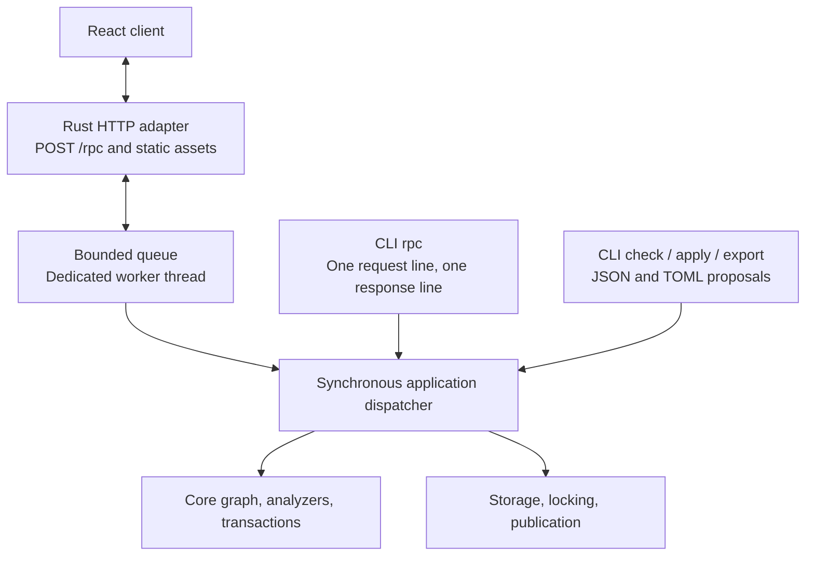

# LifeCore Application Interfaces

Status: proposed application contract. [PLAN.md](PLAN.md) lists remaining work.
[SPEC.md](SPEC.md) defines graph semantics; [FILES.md](FILES.md) defines proposals,
their JSON/TOML encoding, and publication requirements.
[SUGGESTIONS.md](SUGGESTIONS.md) defines authenticated suggestion proposals and
their atomic dismissal effect.

## 1. Shared synchronous application

Use a React/TypeScript browser client, a Rust HTTP server, and a small native CLI.
All operations use shared Serde request, result, error, and proposal types and
one synchronous application dispatcher. CLI calls execute locally without a
running HTTP server. The web application embeds the service rather than launching
a subprocess or forwarding requests over stdio.



The shared contract owns data that crosses a transport or thread boundary.
Borrowed views and resolutions can be converted into owned results or serialized
within the worker. Reuse domain types and semantics without leaking storage,
HTTP types, or borrowed graph lifetimes into the public request contract.

Async execution, HTTP, and queue dependencies belong to the server adapter.
An ordinary worker thread constructs and owns the application state, including
analyzer factories. Requests are initially processed sequentially. The core and
application operations remain ordinary synchronous calls; a CLI invocation calls
them directly. Package boundaries must preserve this dependency direction.

## 2. CLI surface

| Command | Responsibility |
| --- | --- |
| `lifecore init` | Explicitly create the selected database without clobbering an existing one. Add TypeCheck by default; `--no-typecheck` opts out. This operation is outside RPC. |
| `lifecore serve` | Serve the React assets and HTTP RPC endpoint for the selected database. |
| `lifecore rpc` | Read one request line from stdin, execute it locally, print one response line, exit. |
| `lifecore check FILE` | Decode a JSON/TOML proposal and call shared proposal checking. |
| `lifecore apply FILE` | Decode a JSON/TOML proposal and call shared checked application. |
| `lifecore plan-id` | Mint an ordinary token for the selected current database/base without changing history or granting suggestion provenance. |
| `lifecore export FILE --format json\|toml` | Serialize a proposal document in the chosen format, preserving its token. A selected suggestion is already a complete authenticated proposal. |

These conveniences call the same operations and use the same data as RPC.
Collection-specific planning remains backlogged.

Application analysis/export results associate each exported suggestion observation
with a ready-made `Proposal` containing an authenticated `plan_id`. React selects
that attached proposal; a CLI caller extracts the chosen proposal object into a
change file and can convert it with `export`. The shared format-export operation
takes a proposal and requested format. It preserves the token without minting,
refreshing a base, or asserting that the token is valid. `check`/`apply` verify it.

A `FindingKey` selects an issue for dismissal, but its observations may contain
different actions. Do not select arbitrary actions by key alone. Mint suggestion
tokens only from trusted service analysis of committed history; a client-supplied
observation is not evidence that an analyzer emitted it. No persistent report-ID
lookup is required. When returning several suggestions, give each its own proposal
and token; the result is a set of alternatives against one base, not an apply batch.

Export neither applies nor dismisses. Successful application of an authenticated
suggestion publishes its graph changes and acknowledgment of the original finding
together. Ordinary proposals have no automatic dismissal effect. A deliberate
edit can become an ordinary draft; never silently re-sign changed actions.

Default initialization stores the registered `Type_Check` analyzer with the
original configuration string `"{}"`. The opt-out omits that suite entry; it does
not weaken structural validation or silently skip other configured analyzers.
The core remains configurable. Missing configured implementations remain errors
when checking or applying changes.

`rpc` has no positional method argument, parameter flags, file option, request
loop, or interactive mode. A complete newline-terminated line is enough to
execute; it does not wait for stdin to close. EOF can terminate the first line.
It does not read or execute a second line. Pretty-printed multiline requests
must be compacted by the caller. Escaped newlines inside JSON strings are fine.

For example, the whole stdin line is:

```json
{"jsonrpc":"2.0","id":"request-1","method":"plan_id.mint","params":{}}
```

The result or error is one compact JSON object followed by a newline on stdout.
Empty or malformed input produces one structured error response without mutation.
Logs and operational diagnostics go to stderr. Success exits zero; failed calls
exit nonzero while retaining the machine-readable response when output is
available. No automatic write retry occurs.

## 3. Shared RPC envelope

HTTP and CLI use the same JSON-RPC-based single-call request/response profile:
`jsonrpc = "2.0"`, a required non-null request `id`, `method`, and object-valued
`params`. Responses carry that ID and either `result` or `error`. Protocol errors
without a usable ID use null. The initial profile excludes batches and
notifications; reject them before dispatch. This deliberately restricted profile
always responds, and is not a general JSON-RPC notification/batch implementation.
The [JSON-RPC specification](https://www.jsonrpc.org/specification) supplies the
envelope and standard protocol-error vocabulary.

`POST /rpc` accepts one request object in its body. HTTP framing permits formatted
JSON; CLI framing requires one physical line. Both share validation, dispatch,
result serialization, and stable application-error details. A JSON-RPC ID
correlates a call; it is distinct from a proposal's `plan_id` and from a receipt.

The initial method families cover database description, entry selection and
resolution, bounded comparisons, analyzer inspection/execution, proposal
checking/application/export, plan-ID minting, and dismissal listing/update/restore.
Freeze exact method names and fixtures before implementing clients. `init` and
host filesystem-path selection are not RPC methods.

Application result types associate exported observations with their authenticated
proposals and report prospective/committed dismissal effects. Keep these types
outside the core `Observation` and `AnalysisOutput`. A private storage envelope
contains the authentication key; it must never be returned as a public database
description. Generic minting has no option for signing arbitrary suggestion
claims. Diagnostics for an uncommitted check candidate carry no directly applicable
suggestion tokens; analyze the committed result again after apply.

Change files serialize `Proposal`; check/apply parameters contain that same type
plus explicit evaluation inputs. A file convenience command reads the file once
and calls the same operation. Browser file imports send raw contents to the Rust
codec, so bare large integer shorthand is parsed without JavaScript rounding.
Structured editors send canonical proposals. Requests do not carry paths for
the server to open. Source locations are optional diagnostic metadata, not
proposal identity.

Keep malformed transport data, invalid proposals, suggestion authentication
failures, analyzer execution failures, stale bases, pre-publication failures,
and uncertain publication distinguishable.
Checking a structurally valid rejected proposal should retain complete analysis
context and advisories alongside blocking findings. Such a result must not
expose a commit capability. Missing analyzers must not prevent reading an
otherwise structurally valid database.

## 4. Database selection and concurrency

Resolve the database path in one synchronous host helper:

1. Use `LIFECORE_STATE_FILE_PATH` when set; an empty value is an error.
2. Otherwise use `LifeCoreState.json` in the process working directory.
3. Resolve any relative selected path against that directory. Do not search
   parent directories or fall back after a selected path fails.

The server resolves its path once at startup; each CLI process resolves its own
path. Failures to open an existing database remain errors. Only `init` creates
one. Moving the file preserves database identity. Frontend requests never select
arbitrary host files.

The worker owns its in-memory state, but other CLI/server processes may write the
same database. Current-state requests must reload or reliably validate their
cache. Historical requests may use their pinned snapshot. Standalone reads/checks
open the selected JSON snapshot once and read that complete immutable file;
atomic replacement gives them either the old or the new snapshot. They need no
writer lock. A current-state reload opens the path again rather than retaining
an old file handle. No lock spans standalone check and subsequent apply.

The snapshot envelope contains `format_version`, `graph_revision`, `graph`
(database identity, entries, and ordered analyzer suite), `dismissals`, and the
private `proposal_auth_key`. Generate the key at initialization and preserve it
on reload/writes. It never appears in public results or logs.
There are no persisted analysis outputs. Full-snapshot rewriting is acceptable
for this initial implementation. [FILES](FILES.md#81-atomic-publication) defines
the layout and publication sequence.

Initially mutations acquire writer exclusion, reload, verify the selected base,
check, publish atomically, perform required synchronization, and release the
lock. Dismissal edits reread and preserve other records under writer exclusion.
Lock `<state-path>.lock`, a stable sibling file retained across snapshot
replacement; the default is `LifeCoreState.json.lock`.
Do not hold locks across browser editing or between standalone check and apply.
An optimization that prepares outside the lock must compare the exact base
again under writer exclusion before publication.

`ViewId` describes a graph prefix; it does not include the analyzer suite. Both
ordinary and authenticated suggestion plan IDs carry database/revision/proposal
identities, using the [token formats](SUGGESTIONS.md#3-authenticated-plan-ids).
The stored revision UUID changes with every graph or ordered-suite change,
including equal-count divergence, but not dismissal edits, no-ops, or token minting.
Verify the token's database/revision against the snapshot; core commit still compares
database identity, original entry count/content, and the exact ordered suite.
Revision maintenance assumes application-owned snapshots; hand-editing the
graph while retaining its revision is outside that guarantee.

For an authenticated suggestion, verify the MAC/content and source as well as
the expected base before checking and publishing. Stage an `Acknowledged`
dismissal only when the finding has no existing dismissal; retain existing
reasons/notes. Publish it in the same snapshot as the checked graph changes.
All current dismissal records must come from the reload under writer exclusion.

Disconnecting a browser does not establish cancellation or rollback of an
executing mutation. Preserve drafts, report uncertainty when acknowledgment is
lost, and support state inspection. Durable retry recognition is backlogged.

## 5. React client

The initial UI targets a local user and one database. Serve the client and RPC
on the same origin, with local binding and access controls at the HTTP adapter.
The client owns editors, drafts, navigation, layouts, and presentation state;
the backend owns resolution, analyzer grouping, validation, and publication.

Generate TypeScript definitions from the shared Rust contracts and test actual
runtime encoding against fixtures. Canonical integer payloads are
`{"kind":"integer","value":"9223372036854775807"}`-shaped objects. Keep the decimal
strings in model state, including inside lists/records, and use `bigint` only
when arithmetic is needed; serialize back to strings. Known large control
integers, such as entry positions and view boundaries, are also decimal strings
but need no payload wrapper. Small bounded protocol fields such as format
versions and error codes can remain JSON numbers. Canonical responses can use
ordinary JSON parsing; no lossless-number JSON parser is required. Send raw
JSON/TOML file imports to the Rust codec, which accepts bare `i64` shorthand
and returns canonical envelopes. Never parse that shorthand through JavaScript
numbers before sending it.
Keep timestamp strings at full precision in model state; date widgets must not
silently replace them with lower-precision values. The same requirement applies
when importing and exporting change files.

Generated drafts include a service-minted `plan_id`. Preserve exact existing
references and stable local operation names. Preview identities are provisional;
use returned operation-to-entry mappings after application. A stale proposal
requires deliberate replanning, without silently refreshing its token.

Selecting a suggestion selects its already authenticated proposal. Show its
original observation/context and automatic acknowledgment alongside the graph
preview. Download the proposal as JSON or convert it through the shared TOML
codec, preserving the token. Editing its contents requires deliberate conversion
to an ordinary draft with no automatic dismissal; do not ask generic minting to
authenticate edited actions as suggestions. After graph-changing application,
sibling proposals from the previous base need reconsideration.

Make evaluation time an explicit choice, defaulting to absent. If a user chooses
current time, the host captures one timestamp before evaluation and reports it.
Freeze that input across initialization and replay. Each displayed analysis
identifies its view, implementations, configuration strings, and evaluation
inputs. Keep certificates opaque; use supplied subjects and locations for UI
navigation. Dismissal and display filtering never change acceptance.

The first complete workflow is browse, create/edit or import a draft, check,
review findings and differences, apply explicitly, reload, and inspect history.
Include current/history report selection, sticky historical labels, dismissal
reasons/notes, restore, and explicit suggestion selection. Elaborate graph layouts
and specialized form builders can follow a working basic editor.

## 6. Analysis lifetime and dismissal persistence

Return `AnalysisOutput` as an ephemeral result. The service does not save an
analysis-output archive or issue durable report IDs. It may cache outputs in
memory, provided reuse matches the exact graph/view, ordered suite, implementation
identities, and evaluation inputs. Restart discards this cache; the next analysis
replays the selected history. Display always includes the actual evaluation
context, even when an output came from memory.

History mode selects observations across prefixes replayed in that run. It does
not retrieve previous runs at earlier host times or with older analyzer versions.
Changing time or implementation can change findings, including which sticky
observations are reconstructed. Sticky affects selection within an output; it
does not turn outputs into persistent records. A client may retain an old result
for comparison, but it must label that result with its original context.

Persist dismissal keys, reasons, and notes in the snapshot independently of
outputs. They survive restart and absent current emission; a later observation
with the same complete key is still dismissed. Apply dismissals when presenting
a result, not as part of analysis-cache identity or transaction acceptance.
Persistent analysis archives are backlogged.

An exported suggestion carries its full authenticated finding key and issuance
context, so it can be checked/applied after this cache is lost. That token is
neither a persisted report nor a receipt. Applying under a different evaluation
context checks anew and dismisses the original key only. Restoring a dismissal
does not undo the graph changes or revoke exported tokens. See
[SUGGESTIONS](SUGGESTIONS.md#7-retries-and-empty-suggestions) for empty proposals
and replay limits.
