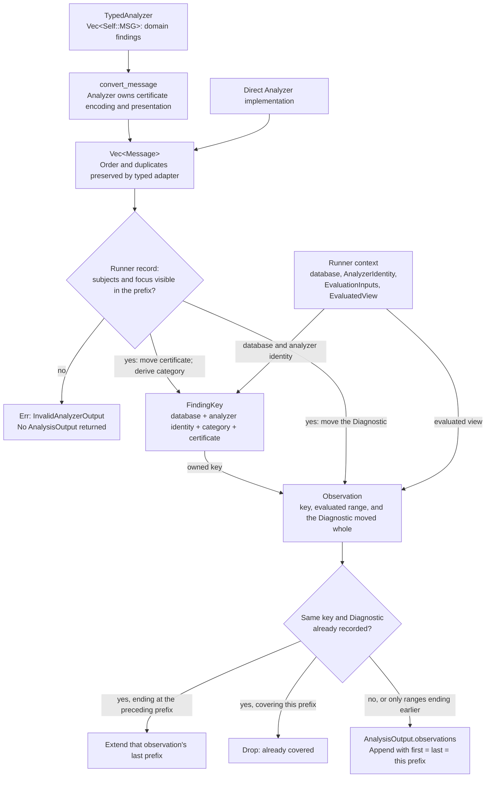
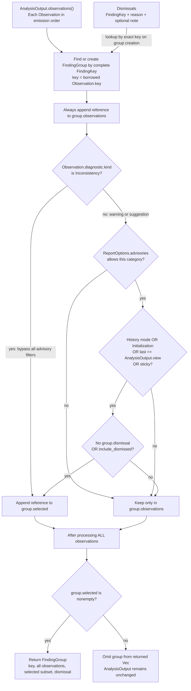
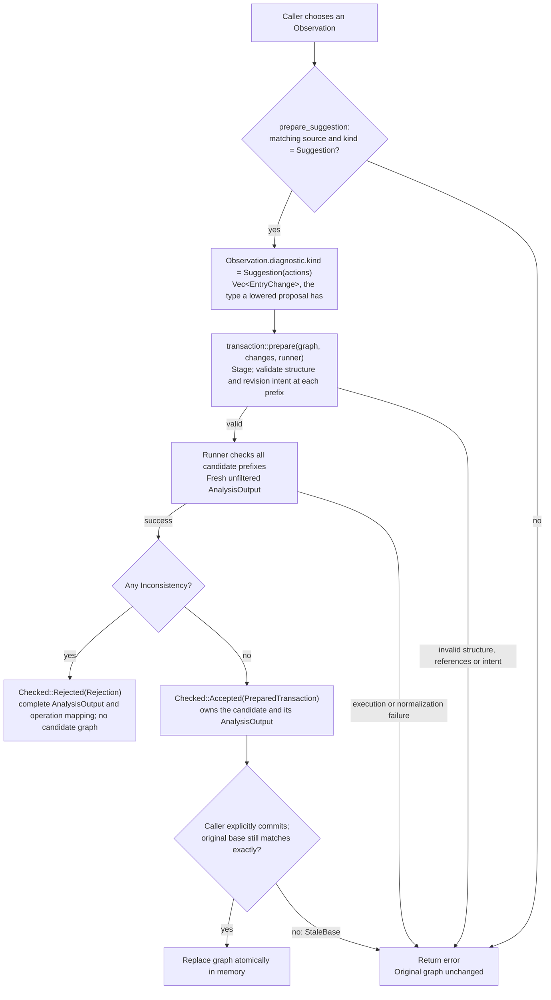

# Analyzer message flow

This describes the current library implementation. For the contract, see
[SPEC §8](SPEC.md#8-analyzers). The diagrams follow owned values into
`AnalysisOutput`, then borrowed references into presentation groups.

The planned application exports suggestions as proposals and, after verifying
them against its own replay, publishes their graph changes with finding
acknowledgment. That layer is described in [SUGGESTIONS.md](SUGGESTIONS.md); the
library flow below does not dismiss findings on commit.

A sticky message's certificate moves into `Observation.key` during normalization,
just like any other certificate. `AnalysisOutput::groups` borrows that key into a
`FindingGroup` before applying display filters. The group is returned only if at
least one of its observations is selected. `sticky` satisfies the boundary test
for an advisory; category and dismissal filters still apply.

## From analyzer findings to observations

Initialization messages have no prefix, so an identical one is dropped and
never merges with a prefix observation. A diagnostic whose previous range ended
more than one prefix ago starts a new observation, which is how a gap is kept.

`AnalysisRunner` constructs all configured analyzers through `AnalyzerFactory`.
The factory receives the original `Config.configuration` string unchanged. The runner
builds each `AnalyzerIdentity` from the registered `Config.name`, the analyzer's
`version()`, and that exact configuration string. Equivalent configuration
spellings can therefore produce different finding keys.

All analyzers initialize in suite order, receiving only frozen `EvaluationInputs`.
Then the first analyzer evaluates every prefix `0..=end_exclusive`, followed by
the second analyzer's full replay, and so on. Prefix `n` contains entries `[0, n)`.
Initialization and prefix zero are separate invocations, even for an empty graph.
The same inputs are passed to every invocation; no clock is read implicitly.
Because every prefix is evaluated, an analyzer can report an event once, at the
prefix whose newest entry it concerns.
[SPEC §8.3](SPEC.md#83-presentation-and-dismissal) states when such an advisory
must be sticky, and [SPEC §7.2](SPEC.md#72-successor-type-permission) how
TypeCheck judges revision transitions this way.

| Information supplied by | Destination | Rule |
| --- | --- | --- |
| `Message.analyzer_certificate` | `Observation.key.analyzer_certificate` | Move the complete `AnalyzerCertificate` string newtype, whether sticky or not. Shared code does not interpret its contents. |
| Selected graph/view and factory identity | `Observation.key.database`, `.analyzer` | Add database identity, registered name, exact version and original configuration string. |
| `Message.diagnostic.kind.ty()` | `Observation.key.kind` | Store only the `MessageType` category: inconsistency, warning or suggestion. |
| `Message.diagnostic` | `Observation.diagnostic` | Move the whole `Diagnostic`: subjects, focus, text, `MessageKind` with a suggestion's ordered `EntryChange` actions, and `sticky`. |
| Runner invocation | `Observation.evaluated_view` | `Initialization`, or `Prefixes { first, last }`, extended when the same key and diagnostic recur at the next prefix. Frozen inputs live only on the output. |
| Selected view, frozen inputs, constructed identities | `AnalysisOutput.view`, `.inputs`, `.implementations` | Retain the run context even if no observations were emitted. Implementation identities preserve suite order and duplicates. |

An initialization message has no focus and no subjects. For replay, the
subjects and the focus entry must be visible in the evaluated prefix;
`evaluated_view` records the prefixes at which the analyzer emitted it.

Certificate encoding belongs to the analyzer. Built-ins encode typed findings,
including exact subjects and distinguishing domain details, as deterministic
JSON. The runner does not derive a certificate from the diagnostic. Wording,
focus, actions and `sticky` are diagnostic details, so changing them produces a
distinct observation of the same finding key, while re-emitting the same
diagnostic at the next prefix extends the existing observation's range. Merging
compares key and diagnostic; grouping and dismissal compare whole finding keys.
Neither comparison treats a hash collision as equality.

Missing factories and invalid configuration return errors. If an analyzer
returns `Err(String)`, the runner creates an `ExecutionFailure` with analyzer
identity, inputs, evaluated view and error text, wrapped in
`LifeCoreError::AnalyzerExecution`. These failures do not become observations.
Any execution or normalization error aborts the run without returning a partial
`AnalysisOutput`. Emitting an inconsistency is different: replay continues and
the successful output contains that observation for the acceptance check below.

## From observations to displayed groups

Each call to `AnalysisOutput::groups(dismissals, options)` builds new groups.
`FindingGroup` borrows its key and observations from the output, and its optional
dismissal from `Dismissals`. The following selection decisions run for **every
observation**, after its reference has been added to `group.observations`.

The returned group's certificate is `group.key.analyzer_certificate`: a field
of the borrowed key, not a separate certificate collection. The certificate
alone is insufficient to join a group; database, analyzer identity and category
must also match. Groups follow the order of their first observation.

`group.observations` includes every normalized occurrence of that key in this
output, including occurrences excluded from `group.selected`. A selected
occurrence keeps the group in the result even when other occurrences are hidden.
`render` prints each returned group's category, analyzer name and certificate,
then only its selected observations. A selected sticky occurrence whose range
ends before the selected view is labeled “historical advisory; current
applicability unconfirmed”.

For example, suppose a warning is emitted only at prefix 4, so its range is
`[4, 4]`, and the selected view is prefix 8. Its normalized observation remains in the output in every row below.
Assuming it is the key's **only occurrence**, these are the grouping outcomes:

| Sticky | Selection | Advisory filter | Matching dismissal | Include dismissed | Selected and group returned? |
| --- | --- | --- | --- | --- | --- |
| No | Current | All | No | No | No: its range ends before the view. |
| Yes | Current | All | No | No | Yes: sticky passes the boundary test. |
| Yes | Current | All | Yes | No | No: dismissal hides it. |
| Yes | Current | All | Yes | Yes | Yes: dismissed findings are requested. |
| Yes | Current | Suggestions or None | No | No | No: warnings are filtered out. |
| No | History | All | No | No | Yes: history passes the boundary test. |
| Yes | History | All | Yes | No | No: history does not bypass dismissal. |

Defaults are `Current`, `All`, and `include_dismissed = false`. Initialization
observations and observations whose range ends at the selected view pass the
boundary test without `sticky`. A nonsticky warning that still holds at the head
has been re-emitted at every prefix since it appeared, so its range ends at the
view and it is selected; its `first` prefix tells when it appeared. Inconsistencies are always selected, regardless of boundary,
sticky flag, advisory filter or even an imported dismissal record.

Sticky is a property of an occurrence, not its finding key. It has no automatic
expiry and does not require re-emission at the selected head. With fixed analyzer
implementation, configuration and inputs, full replay recovers that earlier
occurrence. An analysis ending before it was emitted cannot recover it, and a
later run with different inputs need not emit it. Grouping never copies findings
from a previous `AnalysisOutput` or invents them from dismissal records.

`Dismissals::dismiss` stores an owned complete key, a reason and an optional note;
it rejects inconsistency keys. Updating a record replaces its reason and note.
`restore` removes the matching record. Neither operation changes observations:
a later `groups` call consults the new display state. No dismissal reason,
non-emission or subject supersession establishes resolution.

## From observations to transaction checks

Display is one consumer of `AnalysisOutput`. The `observations`, `errors`,
`warnings` and `suggestions` iterators expose unfiltered occurrences (the latter
three restrict category only). Transaction preparation checks the unfiltered
output too. A caller may explicitly choose a suggestion observation for checking;
being selected for display does not automatically apply its actions.

This diagram follows the suggestion path; direct `transaction::prepare` behaves
the same after staging, including the intent check. Preparation uses the supplied runner's frozen
inputs, not automatically the selected observation's original inputs. Source
checking uses `Observation.key.database` and, for a prefix observation, both
ends of its `evaluated_view` range. The opaque certificate is not an action or a commit receipt.
`sticky`, `ReportOptions` and `Dismissals` are not inputs to transaction acceptance.
Warnings and suggestions do not block it. Commit checks the original database,
entry count/content and ordered analyzer suite before replacing the graph.

Implementation: [runner and normalization](../src/analysis/mod.rs),
[identity types](../src/analysis/identity.rs),
[grouping and dismissal](../src/analysis/presentation.rs),
[suggestion preparation](../src/analysis/suggestion.rs),
[transaction checks](../src/transaction/mod.rs).
