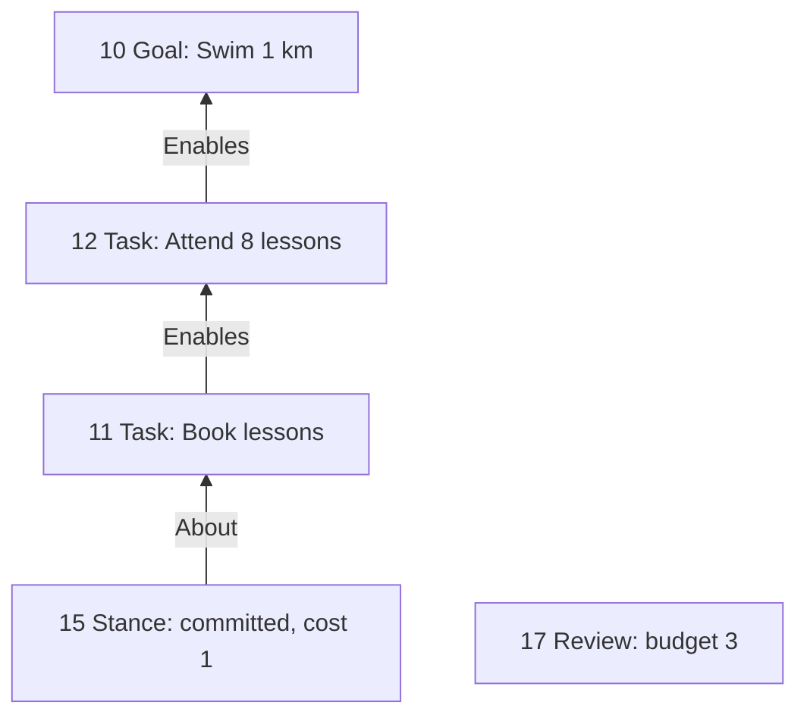
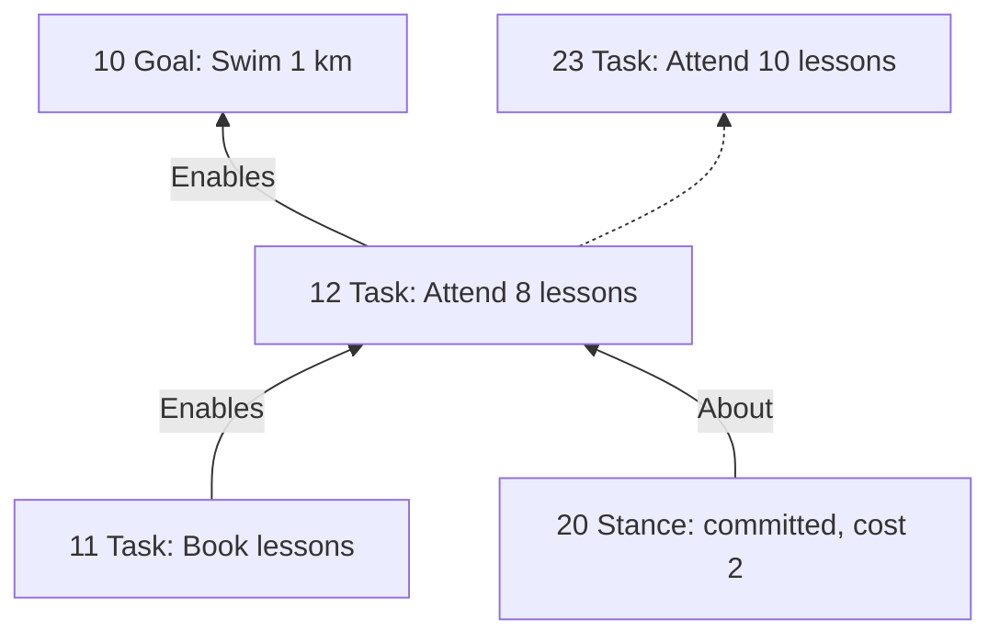
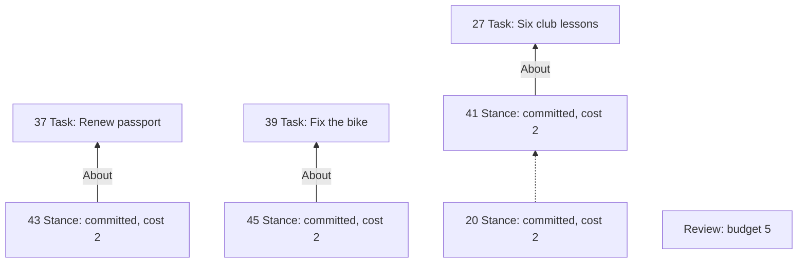
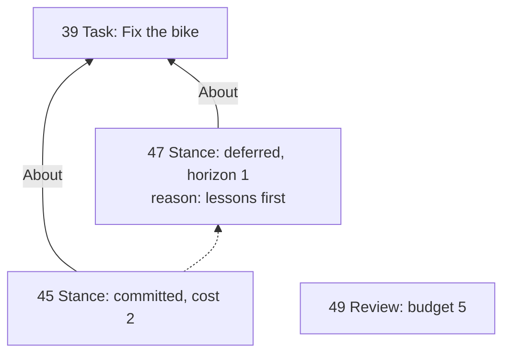
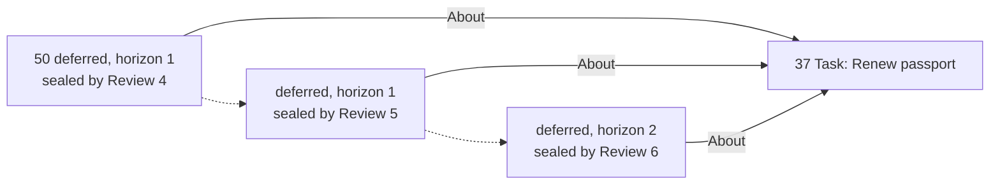
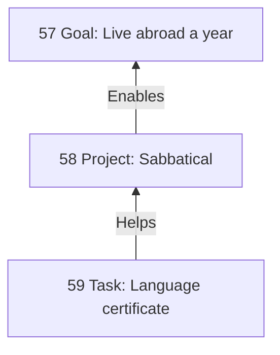
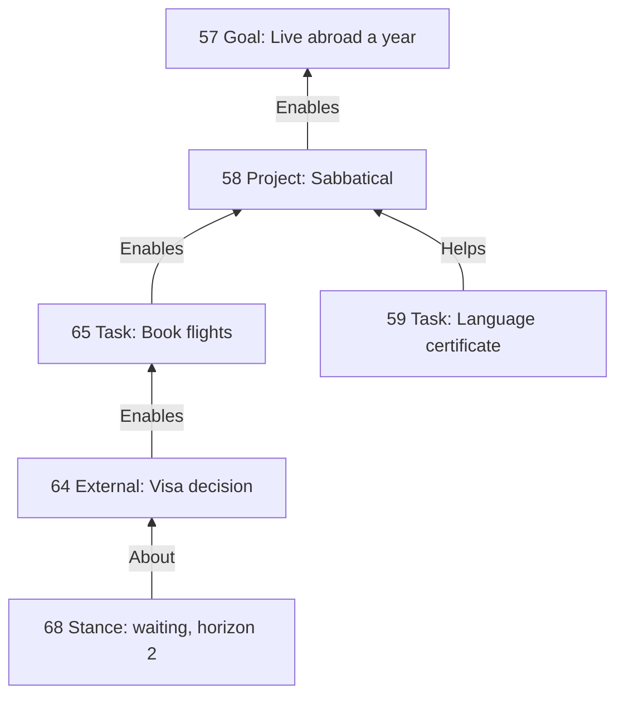
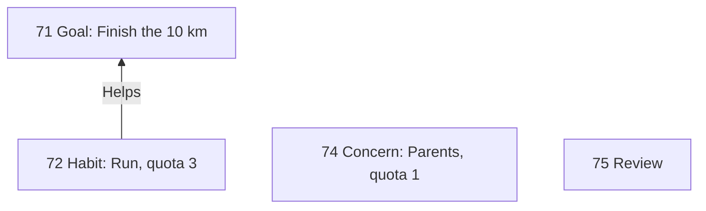
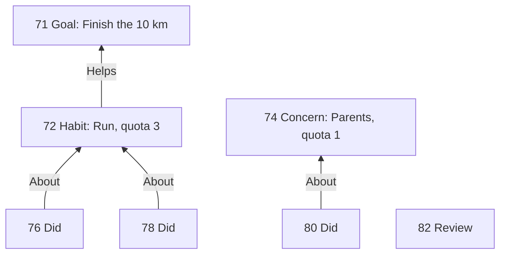
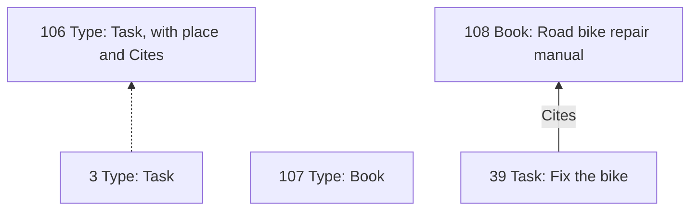

# Reviews as the clock, stances as commitment

A planning analyzer for LifeCore, worked through by example. The rules it
illustrates are owned by [PLANNING](PLANNING.md); this document is the
rationale, and each "why not" callout links the decision it explains in
[PLANNING §13](PLANNING.md#13-design-decisions). It assumes the reader knows
LifeCore's append-only graph,
revisions and supersession, exact-endpoint edges, bounded views, configured
analyzers with full-prefix replay, finding keys, observations, and dismissal.

Every entry is shown as the TOML change file Reza writes and applies with
`lifecore apply FILE` ([FILES](FILES.md)). The files were applied in order to
a scratch database holding the ten declarations of
[PLANNING §11](PLANNING.md#11-configuration-and-bootstrap) at positions 0 to
9, and the positions and `origin` values below are the ones that run
assigned; a reader repeating the walk gets different origins, since each
applied plan mints its own, and copies them from each `apply` result. A test
in `lifecore-prod` replays the walk under TypeCheck and the planning analyzer,
with the default configuration of PLANNING §11, and checks every position
shown and what each seal, and each file checked but not applied, reports.

The scratch run applied the files under TypeCheck alone, before the
application registered the analyzer, and what the planning analyzer says
about them below is what the test checks. A reader starts the walk with
`lifecore init --default-analyzers`, which configures the planning analyzer
and Reconnect after TypeCheck
([INTERFACES §2](INTERFACES.md#2-cli-surface)); neither analyzer adds an
entry, so the positions are the same.

Diagram conventions: solid labeled arrows are edges, dashed arrows are
predecessor links, and the number on a node is its position in the scratch
run. Each stance and event is followed by its `About` edge, which is an entry
of its own with the next position; the diagrams draw it as an arrow without
its position.

## 1. The ask

A person wants to plan their life on top of LifeCore. They have goals, the
projects and tasks that lead to them, habits that sustain them, and broad
concerns that never finish. They want two things that pull against each
other.

- **Breadth.** Everything that matters should be in the graph, including work
  they may never do, so that neglect and conflict become visible.
- **Pressure.** Recorded work should push them to act, under finite capacity,
  in a way that is hard to evade, without the database turning into a guilt
  generator, or into a bucket list of things nobody ever decided about.

The analyzer that serves this must coexist with whatever else the user keeps
in the same database. It owns a handful of types, and nothing else.

## 2. Why findings cannot carry it

The obvious design is a set of warnings: "this task has no path to a goal",
"this goal has had no progress", "this item is overdue". In LifeCore those
warnings run into two walls.

**Findings are facts with identity.** Re-emitting a finding merges into one
observation, and dismissing its key hides it for good. That is right for
"this edge closes a cycle". It is wrong for pressure, which needs to *renew*
after being ignored and needs *magnitude*. To fake renewal you would vary the
certificate with a counter, and every variation is a new finding that
accumulates forever. To fake magnitude you would emit escalating variants.
Neither is what the user wants, which is simply what presses most right now
([decision 12](PLANNING.md#13-design-decisions)).

**Completion by supersession erases the plan.** If "done" means revising a
task with a new status, then the moment a prerequisite is done its dependency
edges become historical, because edges hold exact revisions. An analyzer over
the current graph can no longer tell a bypassed prerequisite from a satisfied
one, and every status change asks the user to re-assert relationships that
did not change ([decision 9](PLANNING.md#13-design-decisions)).

The design answers both with graph structure rather than analyzer cleverness.
In one breath: an explicit **review** node is the only clock, and the window
between reviews is a macro-transaction whose state is judged only when it is
sealed; the dependency graph records what matters while a **stance** records
what the user has decided; status changes are **events**, not revisions, and a
finished revision is final; every connection names an exact revision, as the
core already says; and pressure between reviews is a **ranking**, not a
finding. The rest of this document earns each claim with an example.

## 3. A first plan

Reza wants to swim a kilometer. Two tasks lead there: book lessons, then
attend eight of them. The first planning session is one change file. Within
a file, an edge names a node created earlier in the same file by its
operation name, with `added`; timestamps and integers use the envelopes of
[FILES §2.1](FILES.md#21-syntax-and-values), with bare integers accepted as
shorthand.

```toml
[[entries]]
name = "swim"
kind = "node"
ty_name = "Goal"
payload = { title = "Swim 1 km" }

[[entries]]
name = "book"
kind = "node"
ty_name = "Task"
payload = { title = "Book lessons" }

[[entries]]
name = "attend"
kind = "node"
ty_name = "Task"
payload = { title = "Attend 8 lessons" }

[[entries]]
name = "book_enables_attend"
kind = "edge"
ty_name = "Enables"
from = { added = "book" }
to = { added = "attend" }

[[entries]]
name = "attend_enables_swim"
kind = "edge"
ty_name = "Enables"
from = { added = "attend" }
to = { added = "swim" }

[[entries]]
name = "commit_book"
kind = "node"
ty_name = "Stance"
payload = { kind = "committed", at = { kind = "timestamp", value = "2026-01-04T18:05:00Z" }, cost = 1 }

[[entries]]
name = "commit_book_about"
kind = "edge"
ty_name = "About"
from = { added = "commit_book" }
to = { added = "book" }
```

Then the review, as its own file, because the ritual is to append decisions
first and the review last; if the seal is rejected, the review is the
transaction that fails.

```toml
[[entries]]
name = "review_1"
kind = "node"
ty_name = "Review"
payload = { budget = 3, at = { kind = "timestamp", value = "2026-01-05T09:00:00Z" } }
```

Here is the graph after both.



> **Items** are the nodes the plan is about: `Goal`, `Project`, `Task`,
> `Habit`, `Concern`, `External`. Two edge labels connect them, both pointing
> the way work flows, from contributor to what it serves. `Enables` is strict:
> the target cannot be finished until the source is. `Helps` is optional: a
> worthwhile contribution that blocks nothing. Their union must be acyclic.
> [PLANNING §3.2](PLANNING.md#32-edges) lists every permitted
> `(from, label, to)` set; any other pair is an inconsistency at the edge's
> own prefix. The planning types that are not items are **bookkeeping
> nodes**, recording what Reza decided, did, and reviewed: the stances,
> events, and reviews below. None of the analyzer's edges points at one.

Positions 10 to 14 record a goal, two tasks, and the dependencies between
them. Nothing there says Reza owes action. But recording is not free either:
every open item is **in play** from the moment it is recorded, and an item in
play is owed a *decision*, not action. Position 15 adds the first decision.

> A **stance** is a node recording one decision about one revision, with a
> `kind`, a timestamp, and an `About` edge to the revision. The kinds are
> `committed`, `deferred`, `waiting`, `resumed`, `sufficient`, and
> `abandoned`. Changing a decision supersedes the stance with a successor, as
> with any node, and a revision has at most one current stance.

At position 15 Reza commits to booking lessons this coming window at a cost of
one unit. Cost is whatever coarse capacity unit Reza likes; the analyzer only
adds it up. The goal needs no stance: recording it is how Reza says it
matters, and section 13 shows what a goal does need.

> **Why is an `Enables` edge not a commitment?** If the edge meant both
> "this matters" and "I owe action on this now", honest breadth would
> produce chronic overcommitment, and deleting edges would become the
> cheapest way to feel feasible. The edge records what matters; the stance
> records what Reza decided. [Decision 7](PLANNING.md#13-design-decisions).

> **Why not a stance that says "I pursue this goal", with only what is
> pursued or committed in play?** Then an item recorded and never pursued
> would owe nothing, forever, which is a deferral with no horizon, and the
> database would become a bucket list. Instead everything recorded is in
> play until a decision sets it aside, and section 8 shows how one decision
> sets aside a whole branch.
> [Decision 40](PLANNING.md#13-design-decisions).

Then position 17 appends a `Review` with a budget of three. This is the only
entry that moves the analyzer's clock.

> A **review** divides history into **windows**. Appending one **seals** the
> window since the previous review. At that prefix, and only there, the
> analyzer judges the protocol: was every item that needed a decision given
> one, does the committed work fit the budget, and can every goal still
> advance. The stances sealed by a review are the plan for the window it
> opens. Between reviews, no protocol rule blocks anything.

What does the seal at 17 check?

1. **The frontier.** Which revisions need a decision right now? `Book
   lessons` has no `Enables` sources, so it is *ready*, and it is in play, so
   it needs a decision. `Attend 8 lessons` is blocked by it; the graph itself
   says why nothing is happening there, so it needs no decision. A goal
   enters the frontier only once it has prerequisites and all of them are
   done; until then, the fourth check is how a goal is judged.
2. **Undecided items.** `Book lessons` has a `committed` stance in this
   window. Nothing is undecided.
3. **Budget.** Committed cost 1, budget 3.
4. **Broken plans.** Can the goal advance at all? The chain of tasks that
   strictly enable it contains a ready one. Yes.

**Seal passes.** The transaction containing position 17 commits.

## 4. The next window

Reza books the lessons and comes back a week later. One file records the
completion and the next commitment; `About` edges from a new event or stance
to an existing item use `existing` references copied from the first plan's
result.

```toml
[[entries]]
name = "booked"
kind = "node"
ty_name = "Done"
payload = { at = { kind = "timestamp", value = "2026-01-08T17:30:00Z" } }

[[entries]]
name = "booked_about"
kind = "edge"
ty_name = "About"
from = { added = "booked" }
to = { existing = { origin = "abb5ad8a-199e-4eaa-b4cf-85a4755457c4", position = "11" } }

[[entries]]
name = "commit_attend"
kind = "node"
ty_name = "Stance"
payload = { kind = "committed", at = { kind = "timestamp", value = "2026-01-11T18:00:00Z" }, cost = 2 }

[[entries]]
name = "commit_attend_about"
kind = "edge"
ty_name = "About"
from = { added = "commit_attend" }
to = { existing = { origin = "abb5ad8a-199e-4eaa-b4cf-85a4755457c4", position = "12" } }
```

```toml
[[entries]]
name = "review_2"
kind = "node"
ty_name = "Review"
payload = { budget = 3, at = { kind = "timestamp", value = "2026-01-12T09:00:00Z" } }
```


> **Events** record that something happened to a revision. `Done` completes a
> task, project, or external; `Did` records one act of participation in a
> habit or attention to a concern. An event has a timestamp and an `About`
> edge, and is never revised. Completion is an append, not a revision of the
> item, and a done revision is final: it can never be superseded.

Look at what position 18 did not do: it did not supersede `Book lessons`. The
edge from it to `Attend 8 lessons` is still current. Because of that, the
analyzer can judge the `Done` against the plan: at the prefix of its `About`
edge, 19, it checks that every `Enables` source of `Book lessons` is done. It
has none, so the event is accepted.

Had Reza instead tried to mark `Attend 8 lessons` done while `Book lessons`
was still open, that `Done` would be an inconsistency at its `About` prefix
and the transaction would fail. Events cannot be taken back, so they are the
one thing judged the moment they appear. Completion is recorded against the
plan, not around it.

> **Why is the `Done` judged at once and not at the seal?** Because an
> event cannot be taken back. Everything else in a window is a working
> state the seal names; a `Done` is a fact.
> [Decision 10](PLANNING.md#13-design-decisions).

> A stance's lifetime is counted in seals from its position. Relative to a
> seal, a stance appended in the window being sealed is **fresh**; one sealed
> earlier and still within its lifetime is **standing**; one past its lifetime
> has **lapsed**. Fresh or standing, a stance is a **decision**. A `committed`
> stance stands for exactly the one window after the seal that sealed it.

Now the seal at 22:

- `Book lessons` is done, so `Attend 8 lessons` is ready and enters the
  frontier. It has a fresh `committed` stance. Decided.
- The commitment from position 15 was the plan for window 1 and lapses here.
  Had the task still been open it would need a new decision, but it is done.
- Cost 2, budget 3.

**Seal passes.** Suppose the stance at 20 were missing. The seal would fail
with one **Undecided item** inconsistency about `Attend 8 lessons` and the
review. Reza appends the stance and retries. The transaction that fails is the
one that claimed the window was reviewed, which is the right one to fail.

> **Why judge at seals?** It follows the pattern TypeCheck uses for type
> transitions: judge once, at a fixed prefix, against the view at that
> prefix. Later entries cannot change the verdict, so replay is stable, and
> the user is never locked out of repairing the graph by the rules that say
> it needs repair. [Decision 2](PLANNING.md#13-design-decisions).

## 5. Editing a task

Reza decides eight lessons is too few and revises the task to say ten. This
is an ordinary LifeCore revision: a successor node with the same type, whose
`predecessor` is the exact identity of the old one.

```toml
[[entries]]
name = "attend_10"
kind = "node"
ty_name = "Task"
predecessor = { existing = { origin = "abb5ad8a-199e-4eaa-b4cf-85a4755457c4", position = "12" } }
intent = "revise"
payload = { title = "Attend 10 lessons" }
```



Every connection to 12 is now historical: both `Enables` edges and the
stance's `About` edge. That is exactly what SPEC §5 says supersession means,
and the analyzer adds no exception. Position 23 has no prerequisites, serves
nothing, and has no decision. Serving nothing, it is in play by itself, and
with no prerequisites it is ready, so the next seal will ask about it. The
goal, meanwhile, has lost its only prerequisite.

Help comes from elsewhere. A separate, general analyzer
([RECONNECT](RECONNECT.md)) looks at every supersession and suggests
recreating the predecessor's edges on the successor: here two `Enables` edges
between current revisions, and one new `About` edge from the existing stance
20 to 23. Each suggestion is exported as a one-edge proposal
([RECONNECT-EXPLAINER §4](RECONNECT-EXPLAINER.md#4-applying-a-suggestion)
shows the full export with its `acknowledges` key); the three actions, as Reza
applies them one after another, are:

```toml
[[entries]]
name = "action_0"
kind = "edge"
ty_name = "Enables"
from = { existing = { origin = "abb5ad8a-199e-4eaa-b4cf-85a4755457c4", position = "11" } }
to = { existing = { origin = "788b7bed-00e1-48fc-a2ec-c97e62dbffe9", position = "23" } }
```

```toml
[[entries]]
name = "action_0"
kind = "edge"
ty_name = "Enables"
from = { existing = { origin = "788b7bed-00e1-48fc-a2ec-c97e62dbffe9", position = "23" } }
to = { existing = { origin = "abb5ad8a-199e-4eaa-b4cf-85a4755457c4", position = "10" } }
```

```toml
[[entries]]
name = "action_0"
kind = "edge"
ty_name = "About"
from = { existing = { origin = "18d737c3-ca8e-48a0-ac78-e11cd7bac183", position = "20" } }
to = { existing = { origin = "788b7bed-00e1-48fc-a2ec-c97e62dbffe9", position = "23" } }
```

Positions 24, 25, and 26. The core permits the last one because 20 is current
and 23 is current; a stance may acquire `About` edges over time, and its
subject is whatever they currently point at. Accept all three and the plan is
as before, with the same stance, and the same lifetime, still counting. That
is why `About` is not one-to-one: a fresh stance would have a fresh position
and a fresh lifetime.

The planning analyzer judges that last edge at its own prefix, 26, and finds
nothing. A stance that is already about something may be re-pointed only to a
descendant of an earlier target, and 23 descends from 12. Re-pointing stance
20 at an unrelated task would be an inconsistency there
([decision 57](PLANNING.md#13-design-decisions)).

> **Why re-point the stance instead of writing a new one?** The stance's
> lifetime is measured from its position. A new stance would be a new
> decision with a new clock; adding an `About` edge keeps the decision Reza
> made and the window it was made in.
> [Decision 5](PLANNING.md#13-design-decisions).

If Reza seals without accepting them, the seal fails twice: **Undecided item**
for 23, which is ready and has no stance, and **Broken plan** for the goal,
whose strict subgraph no longer holds anything that could advance it. The seal
also emits a sticky **Dropped connection** warning per lost connection, naming
23, 12, and the edge. That warning is not what fails the seal, and it would
not on its own, because sometimes dropping a connection is exactly what the
edit meant. Inside a window the graph is a working tree; the seal is where
loose ends are named ([decision 17](PLANNING.md#13-design-decisions)).

> **Why not resolve connections through the revision tree instead?** An
> earlier draft did, for stances and events only, and paid for it with rules
> against split items, against second decision chains, and against chains
> whose roots diverged, because edges still used exact revisions. One
> identity model is simpler, and the reconnection it asks for is the same
> pattern every other LifeCore relationship already follows.
> [Decision 3](PLANNING.md#13-design-decisions).

> **Why is reconnection not a planning rule?** The `About` edge from a
> stance to a revised item is an ordinary edge of the predecessor, like any
> `Enables` edge. A general analyzer covers them all, and planning keeps
> only what is about windows: naming at the seal what is still missing.
> [Decision 4](PLANNING.md#13-design-decisions).

## 6. Splitting a task

The same rule makes splits ordinary. "Attend 10 lessons" turns out to be two
things: a block of six with the club and four private ones. One file creates
both successors; the second must say `branch`, because after the first
operation the predecessor is no longer current
([FILES §2.4](FILES.md#24-node-and-edge-operations)).

```toml
[[entries]]
name = "club"
kind = "node"
ty_name = "Task"
predecessor = { existing = { origin = "788b7bed-00e1-48fc-a2ec-c97e62dbffe9", position = "23" } }
intent = "revise"
payload = { title = "Six club lessons" }

[[entries]]
name = "private"
kind = "node"
ty_name = "Task"
predecessor = { existing = { origin = "788b7bed-00e1-48fc-a2ec-c97e62dbffe9", position = "23" } }
intent = "branch"
payload = { title = "Four private lessons" }
```

Positions 27 and 28. Reconnect now offers each successor both `Enables` edges
and the stance's `About` edge, exactly as in section 5. Reza applies the four
`Enables` edges and re-points the old commitment to the club block, then
writes a deferral for the private lessons. Written as one hand-made file
instead of five exports, the edges are the same entries; the suggestions they
satisfy are simply marked satisfied rather than acknowledged.

```toml
[[entries]]
name = "book_enables_club"
kind = "edge"
ty_name = "Enables"
from = { existing = { origin = "abb5ad8a-199e-4eaa-b4cf-85a4755457c4", position = "11" } }
to = { existing = { origin = "034813ad-287d-4fca-83c3-f4f5538e01d8", position = "27" } }

[[entries]]
name = "club_enables_swim"
kind = "edge"
ty_name = "Enables"
from = { existing = { origin = "034813ad-287d-4fca-83c3-f4f5538e01d8", position = "27" } }
to = { existing = { origin = "abb5ad8a-199e-4eaa-b4cf-85a4755457c4", position = "10" } }

[[entries]]
name = "book_enables_private"
kind = "edge"
ty_name = "Enables"
from = { existing = { origin = "abb5ad8a-199e-4eaa-b4cf-85a4755457c4", position = "11" } }
to = { existing = { origin = "034813ad-287d-4fca-83c3-f4f5538e01d8", position = "28" } }

[[entries]]
name = "private_enables_swim"
kind = "edge"
ty_name = "Enables"
from = { existing = { origin = "034813ad-287d-4fca-83c3-f4f5538e01d8", position = "28" } }
to = { existing = { origin = "abb5ad8a-199e-4eaa-b4cf-85a4755457c4", position = "10" } }

[[entries]]
name = "commit_attend_about_club"
kind = "edge"
ty_name = "About"
from = { existing = { origin = "18d737c3-ca8e-48a0-ac78-e11cd7bac183", position = "20" } }
to = { existing = { origin = "034813ad-287d-4fca-83c3-f4f5538e01d8", position = "27" } }

[[entries]]
name = "defer_private"
kind = "node"
ty_name = "Stance"
payload = { kind = "deferred", at = { kind = "timestamp", value = "2026-01-14T20:00:00Z" }, horizon = 4 }

[[entries]]
name = "defer_private_about"
kind = "edge"
ty_name = "About"
from = { added = "defer_private" }
to = { existing = { origin = "034813ad-287d-4fca-83c3-f4f5538e01d8", position = "28" } }
```


Both successors are current. Each gets its own edges, re-pointed from the
suggestions, and its own decision: the old commitment now points at the club
block, and the private lessons are deferred for four windows. A deferred item
is **dormant**: no seal asks about it until the deferral lapses (section 8
says exactly what that covers). A `Done` about one successor leaves the other
open. The only thing the two share is their age, because the analyzer measures
how long an item has been part of the plan from its planning root: the oldest
revision of the youngest unbroken run of item types that ends at it, here
simply the root of the tree. The re-pointed edge, 33, passes the check of
section 5 with no finding: the club block descends from 23 and 12, the
stance's earlier targets. The check uses `ancestors`, one of the analyzer's
two history queries, which also finds the planning root. The other, for the
Dropped connection warning of section 5, finds the current successors of a
superseded revision.

## 7. Too much on the plate

A busier window. Reza has three ready tasks, each enabling a goal in play, and
commits to all of them at cost 2 in one transaction. The file adds a second
goal with two tasks of its own and writes the three commitments. The club
block's new commitment supersedes stance 20, the one re-pointed to it in
section 6, because a revision has at most one current stance.

```toml
[[entries]]
name = "trip"
kind = "node"
ty_name = "Goal"
payload = { title = "Cycling trip in May" }

[[entries]]
name = "passport"
kind = "node"
ty_name = "Task"
payload = { title = "Renew passport" }

[[entries]]
name = "passport_enables_trip"
kind = "edge"
ty_name = "Enables"
from = { added = "passport" }
to = { added = "trip" }

[[entries]]
name = "bike"
kind = "node"
ty_name = "Task"
payload = { title = "Fix the bike" }

[[entries]]
name = "bike_enables_trip"
kind = "edge"
ty_name = "Enables"
from = { added = "bike" }
to = { added = "trip" }

[[entries]]
name = "commit_club"
kind = "node"
ty_name = "Stance"
predecessor = { existing = { origin = "18d737c3-ca8e-48a0-ac78-e11cd7bac183", position = "20" } }
intent = "revise"
payload = { kind = "committed", at = { kind = "timestamp", value = "2026-01-18T18:00:00Z" }, cost = 2 }

[[entries]]
name = "commit_club_about"
kind = "edge"
ty_name = "About"
from = { added = "commit_club" }
to = { existing = { origin = "034813ad-287d-4fca-83c3-f4f5538e01d8", position = "27" } }

[[entries]]
name = "commit_passport"
kind = "node"
ty_name = "Stance"
payload = { kind = "committed", at = { kind = "timestamp", value = "2026-01-18T18:01:00Z" }, cost = 2 }

[[entries]]
name = "commit_passport_about"
kind = "edge"
ty_name = "About"
from = { added = "commit_passport" }
to = { added = "passport" }

[[entries]]
name = "commit_bike"
kind = "node"
ty_name = "Stance"
payload = { kind = "committed", at = { kind = "timestamp", value = "2026-01-18T18:02:00Z" }, cost = 2 }

[[entries]]
name = "commit_bike_about"
kind = "edge"
ty_name = "About"
from = { added = "commit_bike" }
to = { added = "bike" }
```

A later transaction appends a review with budget 5.

```toml
[[entries]]
name = "review_3"
kind = "node"
ty_name = "Review"
payload = { budget = 5, at = { kind = "timestamp", value = "2026-01-19T09:00:00Z" } }
```



**Seal fails.** **Budget overrun**: committed cost 6 against budget 5, with
the review and the three stances as subjects. The stances are already
committed; only the review was rejected. Reza could raise the budget,
re-estimate, or abandon a task. The move that keeps the plan honest is to
change one decision.

```toml
[[entries]]
name = "defer_bike"
kind = "node"
ty_name = "Stance"
predecessor = { existing = { origin = "c3f4f576-0bb8-48fd-b895-43d36046e512", position = "45" } }
intent = "revise"
payload = { kind = "deferred", at = { kind = "timestamp", value = "2026-01-19T09:10:00Z" }, horizon = 1, reason = "lessons first" }

[[entries]]
name = "defer_bike_about"
kind = "edge"
ty_name = "About"
from = { added = "defer_bike" }
to = { existing = { origin = "c3f4f576-0bb8-48fd-b895-43d36046e512", position = "39" } }
```

```toml
[[entries]]
name = "review_3"
kind = "node"
ty_name = "Review"
payload = { budget = 5, at = { kind = "timestamp", value = "2026-01-19T09:15:00Z" } }
```



The new stance supersedes the old one, as any revision does, and carries its
own `About` edge. The budget counts each fresh commitment that is a task's
current stance, so the total is now 4. **Seal passes.** The graph now says,
permanently: Reza intended to fix the bike this window and displaced it for
the lessons, with a reason. A list of priorities where everything is "high"
is not a choice. A budget that forces one stance to give way to another is.

> **Why not let a second stance about the club block simply win?** Then the
> older stance would stay current with nothing to show which one counts, and
> re-pointing only the older one after a later revision would quietly revive
> it. So a revision has at most one current stance: a second root stance
> about the club block would be an inconsistency at its `About` edge's
> prefix. Superseding passes, because the old stance's edges are historical
> by the time the new one's edge is appended. The budget then counts the
> `cost` of each fresh `committed` stance that is the current stance of an
> open task, once even if the stance is about both halves of a split. A
> commitment keeps its task in play whatever its goal's state, so no
> commitment escapes the budget.
> [Decisions 58 and 60](PLANNING.md#13-design-decisions).

## 8. Deferring, and deferring again

The passport does not get renewed. In the next window Reza changes the
commitment to a deferral, by superseding the stance. The club block,
meanwhile, is finished, so the same file records its `Done`. Then Reza seals.

```toml
[[entries]]
name = "defer_passport"
kind = "node"
ty_name = "Stance"
predecessor = { existing = { origin = "c3f4f576-0bb8-48fd-b895-43d36046e512", position = "43" } }
intent = "revise"
payload = { kind = "deferred", at = { kind = "timestamp", value = "2026-01-25T20:00:00Z" }, horizon = 1 }

[[entries]]
name = "defer_passport_about"
kind = "edge"
ty_name = "About"
from = { added = "defer_passport" }
to = { existing = { origin = "c3f4f576-0bb8-48fd-b895-43d36046e512", position = "37" } }

[[entries]]
name = "club_done"
kind = "node"
ty_name = "Done"
payload = { at = { kind = "timestamp", value = "2026-01-25T20:05:00Z" } }

[[entries]]
name = "club_done_about"
kind = "edge"
ty_name = "About"
from = { added = "club_done" }
to = { existing = { origin = "034813ad-287d-4fca-83c3-f4f5538e01d8", position = "27" } }
```

```toml
[[entries]]
name = "review_4"
kind = "node"
ty_name = "Review"
payload = { budget = 5, at = { kind = "timestamp", value = "2026-01-26T09:00:00Z" } }
```

At the seal, 54, the frontier is empty. The club block is done, and the
passport, the bike, and the private lessons are deferred, so all three are
dormant. Neither goal is broken: each still has a ready task in its strict
subgraph, deferred or not, because Broken plan asks whether the plan *could*
advance, not whether Reza is advancing it. **Seal passes.**

Suppose Reza keeps deferring the passport, window after window.



A `deferred` stance carries a `horizon`, a number of seals. Sealed by review
*j* with horizon *n*, it stands through review *j+n* and lapses after it. It
may also carry an `Until` edge to a task, project, or external, and then it
lapses early as soon as that item is done or abandoned: "after the move" is
a deferral like any other. If the item it waits on is revised, Reza re-points
the `Until` edge to the successor, as with any connection, and the deferral
keeps its clock. Left unanswered, the deferral ends after the next seal, so
the item comes back to be reassessed against the changed situation
([decision 73](PLANNING.md#13-design-decisions)).

| Seal | Current stance of the task | Outcome |
| --- | --- | --- |
| Review 4 | `S1`, fresh | dormant |
| Review 5 | `S2`, fresh; `S1` is historical, superseded by `S2` | dormant |
| Review 6 | `S3`, fresh; `S2` is historical | dormant |
| Review 7 | `S3`, standing | dormant |
| Review 8 | `S3`, standing for the last time | dormant; lapses after |
| Review 9 | `S3`, lapsed | in play again: **Undecided** unless a stance was appended in window 8 |

Each stance supersedes the last, but nothing is read from that chain. Each
lifetime comes from its own position and the list of reviews. When the last
one lapses, nothing has to be appended for the task to return: it is in play
again by itself, and the seal asks for a decision. What presses on Reza is
not a count of deferrals, which would mean walking the chain, but the plain
fact that the task has been open since Review 3 and is still open. The
ranking (section 14) carries that as `OpenFor`, and it rises every window
whatever Reza writes, until the task is done or abandoned.

> **Why not count the deferrals?** Counting would read the stance chain,
> which is the lineage model the design gave up. Each stance's lifetime
> comes from its own position; the age of the task comes from its planning
> root, the start of its time in the plan.
> [Decision 6](PLANNING.md#13-design-decisions).

Why not defer it once, for a year? Reza tries:

```toml
[[entries]]
name = "park_passport"
kind = "node"
ty_name = "Stance"
predecessor = { existing = { origin = "0a4b8fcd-2f5a-43db-9e32-a6e2fb4abd8d", position = "50" } }
intent = "revise"
payload = { kind = "deferred", at = { kind = "timestamp", value = "2026-01-26T20:00:00Z" }, horizon = 52, reason = "someday" }

[[entries]]
name = "park_passport_about"
kind = "edge"
ty_name = "About"
from = { added = "park_passport" }
to = { existing = { origin = "c3f4f576-0bb8-48fd-b895-43d36046e512", position = "37" } }
```

This file is checked, not applied: the planning analyzer rejects it at its
first operation, with one inconsistency: a
`deferred` stance whose `horizon` of 52 exceeds `max_deferral_horizon`,
which is 12 by default. Someday/maybe is a deferral like any other, and the
cap makes it one Reza looks at again at least every twelve windows. Among
the stances, only `abandoned` sets an item aside for good.

> **Why cap deferrals?** Without a cap, a deferral of a thousand windows
> would be an item recorded and never decided about under another name, and
> the database would be a bucket list. The cap makes a parked item come back
> to be acknowledged. It caps deferrals only: a `waiting` external stays in
> play and in the ranking.
> [Decisions 43 and 44](PLANNING.md#13-design-decisions).

There is a better move than deferring each task. The passport and the bike
wait on the same thing: Reza is not ready to think about the trip. So Reza
defers the goal.

```toml
[[entries]]
name = "defer_trip"
kind = "node"
ty_name = "Stance"
payload = { kind = "deferred", at = { kind = "timestamp", value = "2026-01-27T19:00:00Z" }, horizon = 3, reason = "not before March" }

[[entries]]
name = "defer_trip_about"
kind = "edge"
ty_name = "About"
from = { added = "defer_trip" }
to = { existing = { origin = "c3f4f576-0bb8-48fd-b895-43d36046e512", position = "36" } }
```

That one decision quiets both tasks.

> An open item is **dormant** when its own current stance is a deferral that
> is still a decision, or when it serves at least one item and every item it
> serves is dormant. An item **serves** the targets
> of its `Enables` edges, and of its `Helps` edges into items that are not
> finished or abandoned. A `committed` or `waiting` decision keeps an item in
> play whatever it serves. Every open item that is not dormant is
> **in play**. [PLANNING §7](PLANNING.md#7-in-play-ready-and-the-frontier).

The trip is dormant by its own stance, 55. `Renew passport` and `Fix the bike`
serve only the trip, and neither has a commitment, so they are dormant too,
whatever their own deferrals say. At the next seal, 70, the bike's own
deferral has lapsed, since it stood through Review 4, yet the seal asks
nothing about the bike and does not judge the trip's plan. When the trip's
deferral lapses after Review 8, or sooner if Reza ends it with a `resumed`
stance (section 11), both tasks return to play with it, and each needs a
decision at the next seal. Had Reza committed to the bike instead, the
commitment would keep the bike in play under the dormant goal, and its cost
would count toward the budget.

> **Why does deferring a goal quiet its tasks?** Otherwise deferring a goal
> would quiet only the goal, and each of its tasks would need its own
> decision every time its own deferral lapsed. Dormancy spreads from the
> deferred goal to everything that serves only it.
> [Decision 41](PLANNING.md#13-design-decisions).

## 9. Work that helps is owed a decision too

Reza is planning a sabbatical abroad. A language certificate would help, and
would be a fine thing to have, but the sabbatical can go ahead without it.

```toml
[[entries]]
name = "abroad"
kind = "node"
ty_name = "Goal"
payload = { title = "Live abroad a year" }

[[entries]]
name = "sabbatical"
kind = "node"
ty_name = "Project"
payload = { title = "Sabbatical" }

[[entries]]
name = "certificate"
kind = "node"
ty_name = "Task"
payload = { title = "Language certificate" }

[[entries]]
name = "sabbatical_enables_abroad"
kind = "edge"
ty_name = "Enables"
from = { added = "sabbatical" }
to = { added = "abroad" }

[[entries]]
name = "certificate_helps_sabbatical"
kind = "edge"
ty_name = "Helps"
from = { added = "certificate" }
to = { added = "sabbatical" }
```



The two edge kinds still draw a line. `Enables` is strict, so the sabbatical
cannot be done before its prerequisites; `Helps` blocks nothing, so the
sabbatical can be done without the certificate. But both edges say what their
source serves, and a source that serves something in play is in play itself.
The goal serves nothing, so it is in play; the sabbatical serves the goal, and
the certificate serves the sabbatical, so both are in play too. The
certificate has no prerequisites, so it is ready, and at the next seal it
needs a decision like any other task. For now the sabbatical has no
prerequisites either, so it is ready too; section 10 gives it one before the
next seal.

A year abroad would also be the best language course there is, and Reza is
tempted to record that the sabbatical helps the certificate as well:

```toml
[[entries]]
name = "sabbatical_helps_certificate"
kind = "edge"
ty_name = "Helps"
from = { existing = { origin = "33ad7787-9c0f-41c3-8314-60259c324660", position = "58" } }
to = { existing = { origin = "33ad7787-9c0f-41c3-8314-60259c324660", position = "59" } }
```

This file is checked, not applied: the planning analyzer rejects it at its
only operation, since the union of current `Enables` and `Helps`
edges must be acyclic, and this edge closes a cycle with the certificate's
`Helps` edge, 61. The inconsistency names the cycle's members, and it is
judged at the edge that closes the cycle, not at the earlier one
([decision 34](PLANNING.md#13-design-decisions)).

Reza does not want it now, and defers it with a reason:

```toml
[[entries]]
name = "defer_certificate"
kind = "node"
ty_name = "Stance"
payload = { kind = "deferred", at = { kind = "timestamp", value = "2026-01-27T19:30:00Z" }, horizon = 6, reason = "after the move" }

[[entries]]
name = "defer_certificate_about"
kind = "edge"
ty_name = "About"
from = { added = "defer_certificate" }
to = { existing = { origin = "33ad7787-9c0f-41c3-8314-60259c324660", position = "59" } }
```

Position 62 makes the certificate dormant for six windows. It still sits in
the graph with its `Helps` edge, and it comes back by itself when the deferral
lapses. If the sabbatical is done first, the certificate's `Helps` edge points
at a finished project and serves nothing, so the certificate stands on its
own: once its deferral lapses it is in play and needs a decision like any
task, to commit to it, defer it again, or abandon it
([decision 55](PLANNING.md#13-design-decisions)).

> **Why is helping work owed a decision at all?** A rule that left work
> reached only through `Helps` out of play would leave every habit out of
> play too, because a habit can serve only through `Helps`, and something
> like `pursued` would have to bring it back. What keeps breadth from
> becoming a guilt generator is dormancy instead: one deferral, here or on a
> goal, sets aside everything below it.
> [Decision 42](PLANNING.md#13-design-decisions).

## 10. Waiting on the world

Back to the sabbatical. Booking flights needs a visa decision Reza cannot
influence.

```toml
[[entries]]
name = "visa"
kind = "node"
ty_name = "External"
payload = { title = "Visa decision" }

[[entries]]
name = "flights"
kind = "node"
ty_name = "Task"
payload = { title = "Book flights" }

[[entries]]
name = "visa_enables_flights"
kind = "edge"
ty_name = "Enables"
from = { added = "visa" }
to = { added = "flights" }

[[entries]]
name = "flights_enables_sabbatical"
kind = "edge"
ty_name = "Enables"
from = { added = "flights" }
to = { existing = { origin = "33ad7787-9c0f-41c3-8314-60259c324660", position = "58" } }

[[entries]]
name = "wait_visa"
kind = "node"
ty_name = "Stance"
payload = { kind = "waiting", at = { kind = "timestamp", value = "2026-01-28T19:00:00Z" }, horizon = 2 }

[[entries]]
name = "wait_visa_about"
kind = "edge"
ty_name = "About"
from = { added = "wait_visa" }
to = { added = "visa" }
```

```toml
[[entries]]
name = "review_5"
kind = "node"
ty_name = "Review"
payload = { budget = 5, at = { kind = "timestamp", value = "2026-02-02T09:00:00Z" } }
```



An `External` is an item for something outside the user's control. It is
finished by a `Done` like a task, and the stance peculiar to it is `waiting`,
which must carry a horizon. The horizon is the check-in: after two seals the
wait lapses and Reza must look again, wait again, or abandon.

At the seal, 70: `Book flights` is blocked by the visa, so not in the
frontier. The visa is in play and in the frontier, with a fresh `waiting`
stance. The certificate is dormant. Is the goal **broken**? The rule asks
whether anything can advance it: the goal's strict subgraph, reached over
`Enables` only, must contain a ready task, a ready project, or an open
external someone is waiting on; or a habit in play must help into it. Here
`{Live abroad a year, Sabbatical, Book flights, Visa decision}` contains a
waited-on external. **Not broken.** The sabbatical project is judged the same
way in its own right, and is not broken either. The trip is dormant, so the
seal judges neither it nor its tasks. **Seal passes.**

Remove the `waiting` stance and the seal fails three times over: **Undecided
item** for the visa, and **Broken plan** for the goal and for the project,
since nothing in their strict subgraphs can move. The certificate would not
rescue them even if it were not deferred: work that only helps never rescues
a plan, and only a habit is the exception
([decision 49](PLANNING.md#13-design-decisions)).

The visa arrives later, in section 12.

## 11. Habits and concerns

Running three times a week helps the 10 km goal. Calling the parents is not a
goal at all; it is a `Concern`, a broad area that never finishes and should
get attention every window. One file records the items, and the review
follows.

```toml
[[entries]]
name = "ten_k"
kind = "node"
ty_name = "Goal"
payload = { title = "Finish the 10 km" }

[[entries]]
name = "run"
kind = "node"
ty_name = "Habit"
payload = { title = "Run", quota = 3 }

[[entries]]
name = "run_helps_ten_k"
kind = "edge"
ty_name = "Helps"
from = { added = "run" }
to = { added = "ten_k" }

[[entries]]
name = "parents"
kind = "node"
ty_name = "Concern"
payload = { title = "Parents", quota = 1 }
```

```toml
[[entries]]
name = "review_6"
kind = "node"
ty_name = "Review"
payload = { budget = 5, at = { kind = "timestamp", value = "2026-02-09T09:00:00Z" } }
```



The goal and the concern serve nothing, so they are in play; the habit
serves the goal, so it is in play too. Habits and concerns cannot be
committed or completed. They are decided by *doing*: a single `Did` in the
window counts as the decision, even below quota, because demanding a stance
per window on top of the participation would be ceremony
([decision 19](PLANNING.md#13-design-decisions)).

But neither has had a window yet. Both were recorded in the window 75 seals,
so they are **new** at that seal, and it does not judge them: no **Undecided
item**, no **Shortfall**. Instead it emits one sticky **Grace period** warning
for each, with the item and the review as subjects, saying that the item is
new and is first judged at the next seal. The 10 km goal is not broken: a
habit in play helps into it, and a new habit counts for that. **Seal passes**,
with two warnings.

> **Why a grace period?** Without it, a habit recorded the evening before a
> review would be undecided or short at that seal, for a window it barely
> existed in. Newness is measured from when the item became a habit or
> concern, so revising the habit does not restart the grace, but a task just
> turned into a habit gets one. It is announced by a
> warning because LifeCore has no message kind yet for a notice that needs
> no action.
> [Decisions 46 and 47](PLANNING.md#13-design-decisions).

The next week's participation is one file, and the review another.

```toml
[[entries]]
name = "run_1"
kind = "node"
ty_name = "Did"
payload = { at = { kind = "timestamp", value = "2026-02-10T07:00:00Z" } }

[[entries]]
name = "run_1_about"
kind = "edge"
ty_name = "About"
from = { added = "run_1" }
to = { existing = { origin = "7fa75d44-38d0-47f5-93bc-9d9365264de2", position = "72" } }

[[entries]]
name = "run_2"
kind = "node"
ty_name = "Did"
payload = { at = { kind = "timestamp", value = "2026-02-12T07:00:00Z" } }

[[entries]]
name = "run_2_about"
kind = "edge"
ty_name = "About"
from = { added = "run_2" }
to = { existing = { origin = "7fa75d44-38d0-47f5-93bc-9d9365264de2", position = "72" } }

[[entries]]
name = "called"
kind = "node"
ty_name = "Did"
payload = { at = { kind = "timestamp", value = "2026-02-14T18:00:00Z" } }

[[entries]]
name = "called_about"
kind = "edge"
ty_name = "About"
from = { added = "called" }
to = { existing = { origin = "7fa75d44-38d0-47f5-93bc-9d9365264de2", position = "74" } }
```

```toml
[[entries]]
name = "review_7"
kind = "node"
ty_name = "Review"
payload = { budget = 5, at = { kind = "timestamp", value = "2026-02-16T09:00:00Z" } }
```



The seal at 82: the habit and the concern are in the frontier now, and both
are decided by their `Did` events; **passes**. It also emits one sticky
**Shortfall** warning for the habit, "have 2, quota 3", with subjects the
habit, the review, and the two `Did` events. The concern met its quota.

Shortfall is sticky for the reason the flag exists: it judges a closed window
once, and the next window gets its own finding with its own review in the
certificate. Nothing has to generate participation opportunities, and no
clock decides when one was missed. The review closes the window, and the
window is where the participation did or did not happen
([decision 18](PLANNING.md#13-design-decisions)).

> **Why does each `Did` carry a timestamp the analyzer ignores?** The core
> rejects a node whose predecessor, type, and payload equal a current
> node's. Two runs in one week would be the same entry without a field that
> differs. [Decision 23](PLANNING.md#13-design-decisions).

The evening after Review 7, Reza twists a knee and defers the habit for four
windows.

```toml
[[entries]]
name = "defer_run"
kind = "node"
ty_name = "Stance"
payload = { kind = "deferred", at = { kind = "timestamp", value = "2026-02-16T19:00:00Z" }, horizon = 4, reason = "knee" }

[[entries]]
name = "defer_run_about"
kind = "edge"
ty_name = "About"
from = { added = "defer_run" }
to = { existing = { origin = "7fa75d44-38d0-47f5-93bc-9d9365264de2", position = "72" } }
```

From position 83 the habit is dormant: had a review sealed now, it would
neither ask Run for a `Did` nor count a shortfall. The next morning a scan
shows only a bruise, and Reza ends the deferral by superseding it.

```toml
[[entries]]
name = "resume_run"
kind = "node"
ty_name = "Stance"
predecessor = { existing = { origin = "bcf853bc-1297-4b69-b09f-532f06578c3a", position = "83" } }
intent = "revise"
payload = { kind = "resumed", at = { kind = "timestamp", value = "2026-02-17T08:00:00Z" }, reason = "only bruised" }

[[entries]]
name = "resume_run_about"
kind = "edge"
ty_name = "About"
from = { added = "resume_run" }
to = { existing = { origin = "7fa75d44-38d0-47f5-93bc-9d9365264de2", position = "72" } }
```

> A **`resumed`** stance ends a deferral at once. It applies to any item and
> is never a decision: it has no lifetime and decides nothing, so the item is
> back in play, owed its usual decision, unless it is dormant through what it
> serves.

From position 85 Run is in play again, and the next seal judges it like any
habit, wanting a `Did`. It has to be a successor of the deferral: a second,
root stance about Run would be an inconsistency, since a revision has at most
one current stance.

> **Why a stance that decides nothing?** A task can be brought back early by
> committing to it, and an external by waiting on it, but a goal, project,
> habit, or concern has no kind of its own that does so. Without `resumed`,
> Run would stay dormant for four windows after the knee healed.
> [Decision 54](PLANNING.md#13-design-decisions).

## 12. Projects and sufficient goals

The visa arrives, and Reza appends `Done` about it.

```toml
[[entries]]
name = "visa_granted"
kind = "node"
ty_name = "Done"
payload = { at = { kind = "timestamp", value = "2026-02-17T11:00:00Z" }, note = "Granted for twelve months" }

[[entries]]
name = "visa_granted_about"
kind = "edge"
ty_name = "About"
from = { added = "visa_granted" }
to = { existing = { origin = "f5e0fdfc-3ecb-4e7e-8a08-58f95f6cd783", position = "64" } }
```

`Book flights` is ready at once, and the ranking shows it undecided. The edge
from the visa to it is still current, so when the flights are booked, the
analyzer confirms the prerequisite really was satisfied.

The sabbatical project has three strict prerequisites. Reza records the other
two, "Sublet the flat" and "Hand over at work", and soon the flights are
booked and the flat is sublet; the third is still open.

```toml
[[entries]]
name = "sublet"
kind = "node"
ty_name = "Task"
payload = { title = "Sublet the flat" }

[[entries]]
name = "sublet_enables_sabbatical"
kind = "edge"
ty_name = "Enables"
from = { added = "sublet" }
to = { existing = { origin = "33ad7787-9c0f-41c3-8314-60259c324660", position = "58" } }

[[entries]]
name = "handover"
kind = "node"
ty_name = "Task"
payload = { title = "Hand over at work" }

[[entries]]
name = "handover_enables_sabbatical"
kind = "edge"
ty_name = "Enables"
from = { added = "handover" }
to = { existing = { origin = "33ad7787-9c0f-41c3-8314-60259c324660", position = "58" } }

[[entries]]
name = "flights_booked"
kind = "node"
ty_name = "Done"
payload = { at = { kind = "timestamp", value = "2026-02-19T12:00:00Z" } }

[[entries]]
name = "flights_booked_about"
kind = "edge"
ty_name = "About"
from = { added = "flights_booked" }
to = { existing = { origin = "f5e0fdfc-3ecb-4e7e-8a08-58f95f6cd783", position = "65" } }

[[entries]]
name = "sublet_done"
kind = "node"
ty_name = "Done"
payload = { at = { kind = "timestamp", value = "2026-02-21T12:00:00Z" } }

[[entries]]
name = "sublet_done_about"
kind = "edge"
ty_name = "About"
from = { added = "sublet_done" }
to = { added = "sublet" }
```


A project is not ready while `Hand over at work` is open, so it needs no
decision; its open task does. If Reza appended `Done` about the project now,
it would be rejected at the `About` prefix, exactly as for a task. This file
is checked, not applied, and the planning analyzer rejects it at its second
operation:

```toml
[[entries]]
name = "sabbatical_done"
kind = "node"
ty_name = "Done"
payload = { at = { kind = "timestamp", value = "2026-02-22T12:00:00Z" } }

[[entries]]
name = "sabbatical_done_about"
kind = "edge"
ty_name = "About"
from = { added = "sabbatical_done" }
to = { existing = { origin = "33ad7787-9c0f-41c3-8314-60259c324660", position = "58" } }
```

Once the hand-over is done the project becomes *ready* and enters the
frontier, where its options differ from a task's: accept it with `Done`,
which is an explicit acceptance rather than a mechanical consequence; add
another strict prerequisite, which makes it not ready again; defer it; or
abandon it. Satisfying every dependency makes delivery possible without
proving the deliverable was accepted, so acceptance stays a decision
([decision 27](PLANNING.md#13-design-decisions)).

```toml
[[entries]]
name = "handover_done"
kind = "node"
ty_name = "Done"
payload = { at = { kind = "timestamp", value = "2026-02-27T17:00:00Z" } }

[[entries]]
name = "handover_done_about"
kind = "edge"
ty_name = "About"
from = { added = "handover_done" }
to = { existing = { origin = "86cb462f-5fe7-4b35-b116-9e5ff0e3bfb2", position = "91" } }

[[entries]]
name = "sabbatical_done"
kind = "node"
ty_name = "Done"
payload = { at = { kind = "timestamp", value = "2026-02-28T10:00:00Z" }, note = "Leaving on the first" }

[[entries]]
name = "sabbatical_done_about"
kind = "edge"
ty_name = "About"
from = { added = "sabbatical_done" }
to = { existing = { origin = "33ad7787-9c0f-41c3-8314-60259c324660", position = "58" } }
```

A done project is not open, so no seal judges it again. The certificate's
`Helps` edge now points at a finished project and serves nothing, so when its
deferral lapses the certificate stands on its own (section 9). The goal is
another matter. It has a prerequisite, and all of its prerequisites are done,
so the goal is now *ready*. A ready goal is in the frontier like a ready task
or project, and only leaving the frontier decides it: `sufficient`, a
deferral, `abandoned`, or a new prerequisite. Had Reza sealed now, the goal
would be an **Undecided item** until one of them was appended. It would not
be that seal's only one: the private lessons' deferral stood through Review 7
and has lapsed, and Run and Parents have no `Did` in this window, so each of
them would be undecided too.

> **Why is a finished plan undecided rather than broken?** Its plan is not
> broken; it is done, and the goal is waiting to be called good enough or
> given more to do. A project whose prerequisites are all done is in the
> frontier for the same reason: acceptance is a decision, and the review is
> where it is made. [Decision 61](PLANNING.md#13-design-decisions).

Goals never take `Done`. A year later Reza declares the goal `sufficient`.
The goal had no stance until now, so this one is a root stance.

```toml
[[entries]]
name = "abroad_sufficient"
kind = "node"
ty_name = "Stance"
payload = { kind = "sufficient", at = { kind = "timestamp", value = "2027-03-01T10:00:00Z" } }

[[entries]]
name = "abroad_sufficient_about"
kind = "edge"
ty_name = "About"
from = { added = "abroad_sufficient" }
to = { existing = { origin = "33ad7787-9c0f-41c3-8314-60259c324660", position = "57" } }
```

That stance is legal only when every `Enables` source of the goal is done;
here the project is. Sufficiency is a judgment, but not one that may
contradict the plan. And like a done task, a sufficient goal is final: the
`sufficient` stance can never be superseded, so not even `resumed` reopens the
goal ([decisions 28, 11, and 56](PLANNING.md#13-design-decisions)).

## 13. Goals that arrive and goals that leave

Mid-window, Reza adds a goal, "Learn to cook", with no stance and no plan.

```toml
[[entries]]
name = "cook"
kind = "node"
ty_name = "Goal"
payload = { title = "Learn to cook" }
```

From that moment the goal is in play: it serves nothing, and nothing defers
it. Until a goal is ready it needs no stance at a seal, but it is judged by
whether its plan can advance, and this one has no plan at all: no `Enables`
source and no helping habit. So it goes straight to the top tier of the
ranking, with the reason `BrokenPlan`, and at the next seal it would be a
**Broken plan** inconsistency. Reza can give it a first ready task, defer it,
or abandon it. A deferred goal comes back when its horizon lapses, like any
other deferred item, and the cap means it comes back after twelve windows at
most. Awareness has a cost, and the cost is one decision, not action.

> **Why is a new goal judged as broken rather than undecided?** No stance
> kind keeps a goal in play and decides it, so a goal with no prerequisites
> has no decision to owe. What it needs before the next seal is a plan, or a
> decision to set it aside, which is about as strict as asking for a
> decision. A goal whose prerequisites are all done is the other case: it is
> ready, and undecided until `sufficient` (section 12).
> [Decisions 45 and 61](PLANNING.md#13-design-decisions).

Later, Reza abandons "Finish the 10 km". The goal has no stance yet, so this
is a root stance too.

```toml
[[entries]]
name = "abandon_ten_k"
kind = "node"
ty_name = "Stance"
payload = { kind = "abandoned", at = { kind = "timestamp", value = "2027-03-02T19:00:00Z" }, reason = "Knee" }

[[entries]]
name = "abandon_ten_k_about"
kind = "edge"
ty_name = "About"
from = { added = "abandon_ten_k" }
to = { existing = { origin = "7fa75d44-38d0-47f5-93bc-9d9365264de2", position = "71" } }
```

The habit "Run" helped only the 10 km goal. A `Helps` edge into a finished or
abandoned item serves nothing, so Run now serves nothing and stands on its
own: it is in play, and the next seal asks for a `Did` like any habit. If
Reza no longer wants to run, that is a decision of its own, a deferral or
`abandoned`. A project that strictly enabled the goal would have stopped the
abandonment: a goal can be abandoned only once each of its `Enables` sources
is done, abandoned, or revised without the edge, so Reza would settle the
project first, in the same file. Abandoning a prerequisite works the other
way round: what it enabled can never become ready, so the next seal reports
**Blocked by an abandoned prerequisite** until Reza revises the target
without it or abandons the target too. Nothing is deleted.

> **Why must Reza settle the prerequisites first?** Abandoning is final, so
> its consequences should be decisions, not side effects. Left dormant behind
> an abandoned goal, its prerequisites would sit in the graph unranked and
> never asked about, which is a bucket list by another door. A `Done` and
> `sufficient` already wait for their prerequisites; `abandoned` now waits
> for them to be settled. [Decision 74](PLANNING.md#13-design-decisions).

> **Why does Run stay in play when its goal is gone?** Helping work and
> habits have value of their own. Left dormant behind a finished or abandoned
> target, they would sit in the graph with nothing ever asking about them,
> which is a bucket list by another door.
> [Decision 55](PLANNING.md#13-design-decisions).

> **Why can't Reza revive the 10 km by superseding the `abandoned` stance?**
> Undoing it would make `abandoned` a deferral with no horizon, the bucket
> list again. An `abandoned` stance has no successor, so a mistaken
> `abandoned` is as final as a mistaken `Done`, and reviving the goal means
> recording a new one. [Decision 56](PLANNING.md#13-design-decisions).

## 14. Pressure between reviews

Every protocol rule so far is judged at a seal, and every structural one at
the entry that breaks it. Between seals Reza needs to know what presses, and
that is not a set of facts to be dismissed; it is an ordering. The analyzer
produces a **valuation**: a deterministic ranking at the requested boundary,
each row with structured reasons and rendered text.

> A **valuation** has no finding identity, cannot be dismissed, is never
> recorded as an observation, and is computed only at the boundary asked for.
> It never affects transaction acceptance. Every change in rank has exactly
> one cause: an appended entry.

Take the examples a few windows further, to a boundary in window 10, with
the project of section 12 still waiting on its hand-over and the cooking goal
of section 13 already recorded. The ranking there might read, abridged to
rows that illustrate each tier:

| Tier | Item | Reasons |
| --- | --- | --- |
| 0 | Goal: Learn to cook | `BrokenPlan` |
| 0 | Task: Hand over at work | `Undecided` |
| 1 | Task: Four private lessons | `OpenFor { seals: 10 }`, `DeadlineIn { reviews: 2 }` |
| 2 | Habit: Run | `Shortfall { have: 1, quota: 3 }` |
| 3 | Task: Language certificate | `Standing { kind: deferred, seals_left: 1 }`, `LapsesAtNextSeal`, `OpenFor { seals: 6 }` |
| 4 | Goal: Live abroad a year | `Starved { seals: 2 }` |

The tiers, in order of pressure:

0. **What the next seal would reject**: undecided frontier revisions, ready
   goals among them, and goals and projects whose plan is broken. Sinks
   first, then by how many goals in play the item reaches.
1. **Standing commitments** still open, by how long the item has existed,
   then by nearest deadline. A standing commitment decides its task for this
   window, which keeps the task out of tier 0, but it lapses at the next
   seal, so each of these needs a new decision before it. The private lessons have been open for ten
   seals, counted from their planning root, and committed for
   several of those windows. That is the honest shape of "the easy tasks got
   done and this one did not", and it rises without an escalation rule.
2. **Habits and concerns below quota** so far this window, once they have a
   `Did` in it; one with none is undecided and ranks in tier 0. Reza has run
   once this window, so Run is decided and short of its quota of three.
3. **Deferred or waiting**, those lapsing at the next seal first, then by age.
   `seals_left` counts the seals, from the next one on, at which the stance
   still decides. The certificate's deferral decides at the next seal and no
   later one, so it shows `seals_left: 1` and `LapsesAtNextSeal`, and in the
   window that seal opens the certificate is back in play. A deferred item is
   dormant, and this tier is the only place the ranking shows it; the items
   dormant only through it, such as the tasks of a deferred goal, are not
   ranked until they return.
4. **Starved goals and projects**: in play, but nothing in their strict
   subgraph is committed this window. `Starved` counts the seals since the
   latest review that sealed a commitment to one of their tasks, a task since
   done included, or since the item's root was first sealed.
5. Everything else in play. A habit or concern in its grace period ranks
   here with the reason `New`.

Rows that tie on every key and on the root's position, such as two halves of
a split, are ordered by their own positions, so the ranking is the same on
every run. Tier 1 rows carry no `Standing` reason: a commitment always lapses
at the next seal, so only tier 3's deferrals and waits say how long they
stand.

Nothing in this table can be clicked away. To move the hand-over down, Reza
commits to it, defers it, or finishes it. To move the cooking goal down, Reza
gives it a first task, defers it, or abandons it. That is what "difficult to
evade" means here: not that the analyzer is loud, but that the only quiet is
a written decision.

> **Why a ranking and not findings?** A finding has a fixed identity, so it
> cannot renew after being ignored or carry magnitude without faking both.
> A ranking has no identity and nothing to dismiss.
> [Decision 12](PLANNING.md#13-design-decisions). It is a library function
> over a bounded view and a small executable, not an analyzer output, so no
> core contract changes. [Decision 13](PLANNING.md#13-design-decisions).

> **Why are broken plans in tier 0, and deferred items in tier 3?** Tier 0
> is what the next seal would reject as it stands, so a goal with no plan
> belongs there as much as an undecided task. Tier 3 keeps showing what Reza
> deferred and when it comes back, without listing everything the deferral
> quiets.
> [Decisions 50 and 51](PLANNING.md#13-design-decisions).

## 15. Where time enters

Wall-clock time enters in exactly two places, both bounded.

**Deadlines.** Goals and projects may carry a `deadline` timestamp, and each
review carries an `at` timestamp written by the user. Suppose reviews were
sealed on January 5, 12, 19, and 26, and the swimming goal is due March 2.
The estimate samples the pairs of consecutive reviews whose `at` strictly
increases, at most the last six, which is the default of the valuation's
`deadline_sample_windows` option. Here that is three pairs of seven days, so
the median window is seven days; the latest review was 35 days before the
deadline; so `DeadlineIn { reviews: 5 }`. A task inherits the nearest
deadline of the goals and projects in play it enables, directly or through
other items; a dormant, finished, or abandoned one sets no deadline, since a
deferral means "not now". Everything in the estimate is graph data, so it is
reproducible at any historical boundary.

**A stale review.** If the configuration sets `stale_review_after_days`, the
analyzer requires the runner's explicit evaluation time and errors without
it, then emits one nonsticky warning when the latest review is older than
that, or when there is no review at all. Unset, which is the default, the
analyzer never reads evaluation inputs.

Everything else counts seals. If Reza stops reviewing, the system goes quiet
apart from that one nudge. That is a deliberate dependence on a ritual rather
than on a clock. The alternative, judging windows by wall-clock time, would
mean replaying every historical window under today's frozen evaluation time
and accumulating findings for weeks nobody looked at.

> **Why not wall-clock windows?** Evaluation time is one frozen value per
> run, so every historical window would be judged under today's clock.
> [Decisions 1 and 32](PLANNING.md#13-design-decisions).

## 16. Making the types your own

Months in, Reza wants to record where a task gets done, and to link each task
to the manual it needs. Neither is planning's business. Reza amends the
`Task` declaration with a `place` field and a `Cites` label, and declares a
`Book` type for the other end.

```toml
[[entries]]
name = "task_type_place"
kind = "node"
ty_name = "Type"
predecessor = { existing = { origin = "592e3ada-a22f-47d9-b0fa-53f96bd44b85", position = "3" } }
intent = "revise"
[entries.payload]
name = "Task"
fields = { kind = "record", value = { title = ["mandatory", "text"], note = ["optional", "text"], place = ["optional", "text"] } }
outgoing = ["Enables", "Helps", "Cites"]
incoming = ["Enables", "Helps", "About", "Until"]
successors = []

[[entries]]
name = "book_type"
kind = "node"
ty_name = "Type"
[entries.payload]
name = "Book"
fields = { kind = "record", value = { title = ["mandatory", "text"] } }
outgoing = []
incoming = ["Cites"]
successors = []

[[entries]]
name = "manual"
kind = "node"
ty_name = "Book"
payload = { title = "Road bike repair manual" }

[[entries]]
name = "bike_cites_manual"
kind = "edge"
ty_name = "Cites"
from = { existing = { origin = "c3f4f576-0bb8-48fd-b895-43d36046e512", position = "39" } }
to = { added = "manual" }
```



Positions 106 to 109. TypeCheck accepts them: `place` is optional, so every
current task still fits the revised declaration, and `Cites` is permitted at
both ends of the new edge. The planning analyzer acts at 106, a declaration
that claims `Task`, and judges it against
[PLANNING §3.4](PLANNING.md#34-amending-the-declarations). The revision still
permits every label the canonical `Task` permits, and the analyzer reads no
field of a task, so there is no finding. At 107 to 109 it does nothing at all:
a type it does not own, a node of that type, and an edge with a label it does
not own are outside its vocabulary. Bootstrap stays quiet too, since it
suggests only a declaration that is missing.

> **Why not require the canonical declarations exactly?** Then Reza's
> `place` field would earn a suggestion to revert it at every prefix, and the
> suggestion could not even apply while the `Cites` edge is current, because
> a current edge must stay permitted at both ends. The analyzer asks only for
> what its rules read. [Decision 36](PLANNING.md#13-design-decisions).

The label had to be a new one. Planning owns its ten type names and its four
labels in this database, so had Reza linked the task to the manual with
`About`, the edge would be an inconsistency at its prefix: an `About` edge
comes from a stance or an event
([decision 35](PLANNING.md#13-design-decisions)).

Some amendments the analyzer cannot live with. Suppose Reza tires of setting
a budget at every review and makes `budget` optional:

```toml
[[entries]]
name = "review_type_no_budget"
kind = "node"
ty_name = "Type"
predecessor = { existing = { origin = "592e3ada-a22f-47d9-b0fa-53f96bd44b85", position = "8" } }
intent = "revise"
[entries.payload]
name = "Review"
fields = { kind = "record", value = { budget = ["optional", "integer"], at = ["mandatory", "timestamp"], note = ["optional", "text"] } }
outgoing = []
incoming = []
successors = []
```

This file is checked, not applied. TypeCheck accepts it: the declaration is
well formed, and every current review has a budget. The planning analyzer
rejects it at its only operation, with one inconsistency naming the
declaration and the unmet
requirement, `budget` mandatory integer. Every seal compares the window's
fresh commitments with the review's `budget`, and a review without one would
switch that check off without anyone deciding to. Reza can still add fields
of Reza's own to `Review`, or drop a canonical field the analyzer does not
read, such as `note`.

## 17. Where to go next

[PLANNING](PLANNING.md) states the rules compactly: types and edges, what a
user may amend, stance kinds and lifetimes, what is in play or dormant and
what the frontier holds, every finding with its judging prefix, the valuation
tiers,
configuration and bootstrap, delivery as a library function and an executable
without a core change, the design decisions this document has been citing,
open questions, and acceptance tests.
