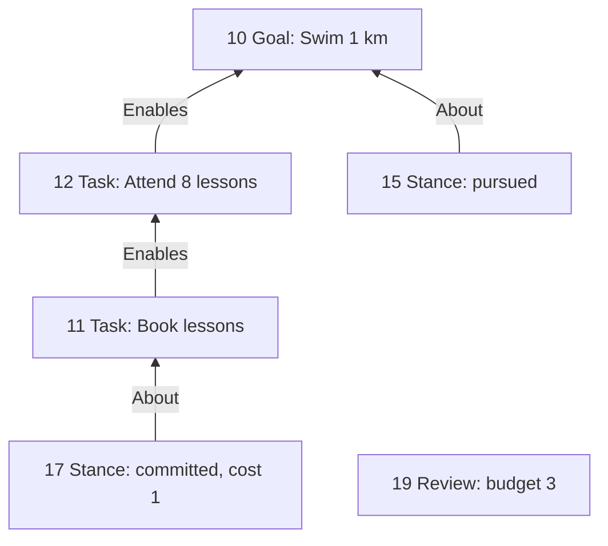
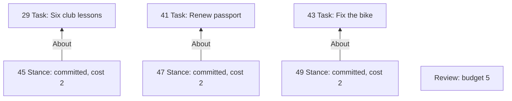
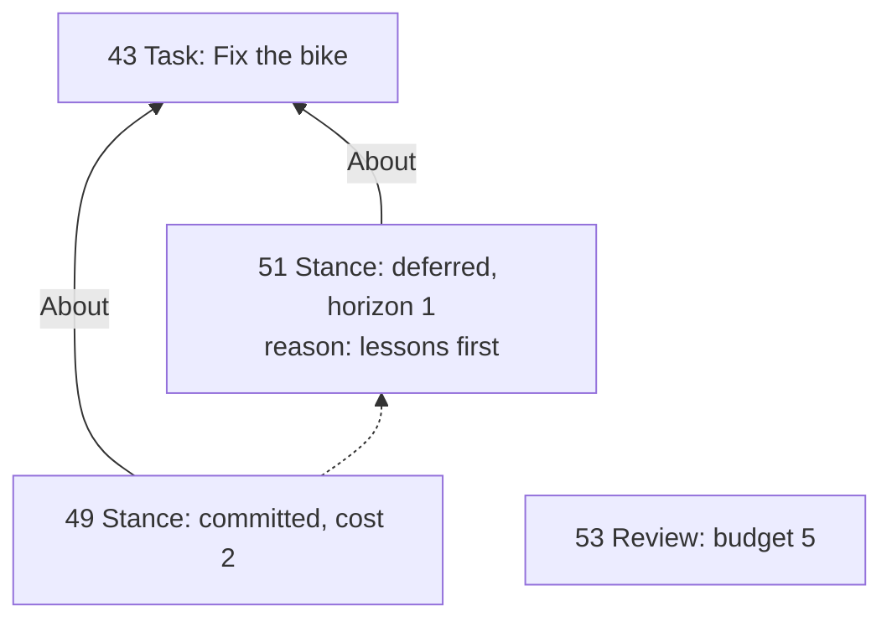
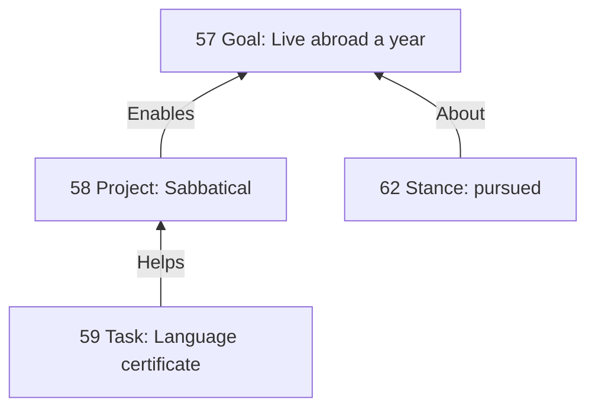
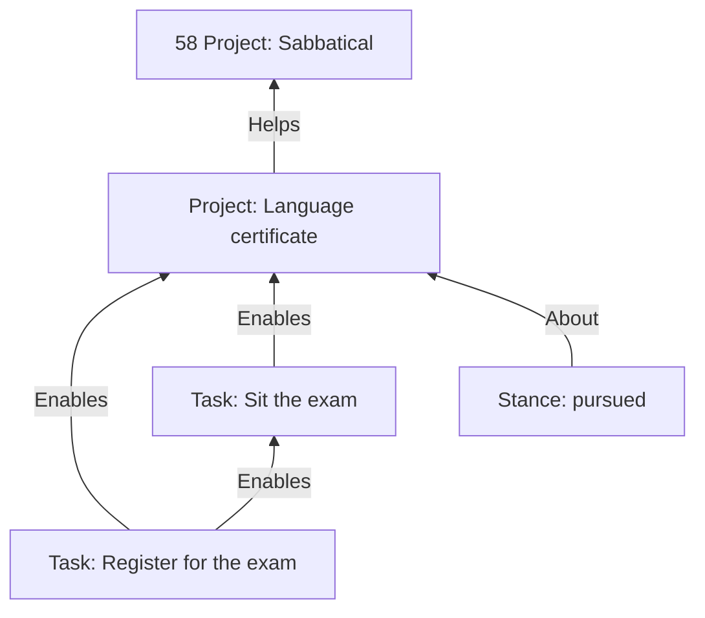
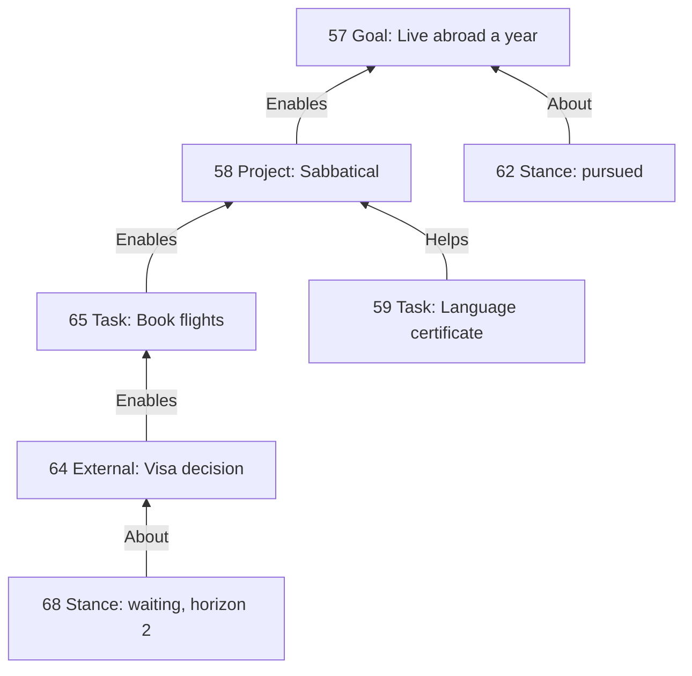
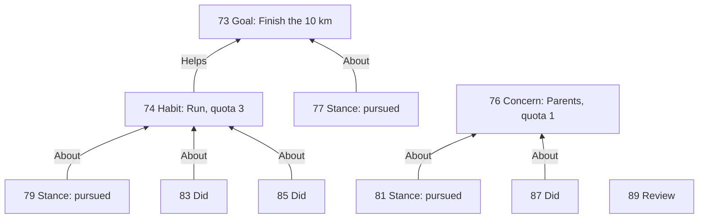
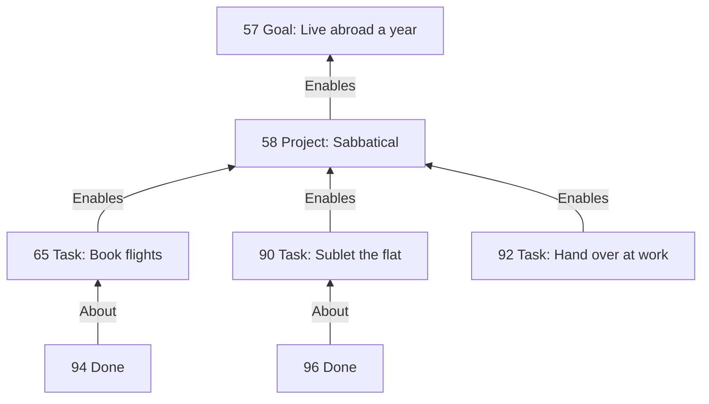

# Reviews as the clock, stances as commitment

A planning analyzer for LifeCore, worked through by example. The rules it
illustrates are owned by [PLANNING](PLANNING.md); this document is the
rationale, and each "why not" callout links the decision it explains in
[PLANNING §13](PLANNING.md#13-design-decisions). It assumes the reader knows
LifeCore's append-only graph,
revisions and supersession, exact-endpoint edges, bounded views, configured
analyzers with full-prefix replay, finding keys, observations, and dismissal.

Every entry is shown as the TOML change file Reza writes and applies with
`lifecore apply FILE` ([FILES](FILES.md)). The files were applied in order to
a scratch database holding the ten declarations of
[PLANNING §11](PLANNING.md#11-configuration-and-bootstrap) at positions 0 to
9, and the positions and `origin` values below are the ones that run
assigned; a reader repeating the walk gets different origins, since each
applied plan mints its own, and copies them from each `apply` result. The
planning analyzer is not implemented, so what each seal says is what the
contract specifies, not captured output. The files pass the structural checks
and TypeCheck as written.

Diagram conventions: solid labeled arrows are edges, dashed arrows are
predecessor links, and the number on a node is its position in the scratch
run. Each stance and event is followed by its `About` edge, which is an entry
of its own with the next position but is not drawn.

## 1. The ask

A person wants to plan their life on top of LifeCore. They have goals, the
projects and tasks that lead to them, habits that sustain them, and broad
concerns that never finish. They want two things that pull against each
other.

- **Breadth.** Everything that matters should be in the graph, including work
  they may never do, so that neglect and conflict become visible.
- **Pressure.** Recorded work should push them to act, under finite capacity,
  in a way that is hard to evade, without the database turning into a guilt
  generator.

The analyzer that serves this must coexist with whatever else the user keeps
in the same database. It owns a handful of types, and nothing else.

## 2. Why findings cannot carry it

The obvious design is a set of warnings: "this task has no path to a goal",
"this goal has had no progress", "this item is overdue". In LifeCore those
warnings run into two walls.

**Findings are facts with identity.** Re-emitting a finding merges into one
observation, and dismissing its key hides it for good. That is right for
"this edge closes a cycle". It is wrong for pressure, which needs to *renew*
after being ignored and needs *magnitude*. To fake renewal you would vary the
certificate with a counter, and every variation is a new finding that
accumulates forever. To fake magnitude you would emit escalating variants.
Neither is what the user wants, which is simply what presses most right now
([decision 12](PLANNING.md#13-design-decisions)).

**Completion by supersession erases the plan.** If "done" means revising a
task with a new status, then the moment a prerequisite is done its dependency
edges become historical, because edges hold exact revisions. An analyzer over
the current graph can no longer tell a bypassed prerequisite from a satisfied
one, and every status change asks the user to re-assert relationships that
did not change ([decision 9](PLANNING.md#13-design-decisions)).

The design answers both with graph structure rather than analyzer cleverness.
In one breath: an explicit **review** node is the only clock, and the window
between reviews is a macro-transaction whose state is judged only when it is
sealed; the dependency graph records what matters while a **stance** records
what the user has decided; status changes are **events**, not revisions, and a
finished revision is final; every connection names an exact revision, as the
core already says; and pressure between reviews is a **ranking**, not a
finding. The rest of this document earns each claim with an example.

## 3. A first plan

Reza wants to swim a kilometer. Two tasks lead there: book lessons, then
attend eight of them. The first planning session is one change file. Within
a file, an edge names a node created earlier in the same file by its
operation name, with `added`; timestamps and integers use the envelopes of
[FILES §2.1](FILES.md#21-syntax-and-values), with bare integers accepted as
shorthand.

```toml
[[entries]]
name = "swim"
kind = "node"
ty_name = "Goal"
payload = { title = "Swim 1 km" }

[[entries]]
name = "book"
kind = "node"
ty_name = "Task"
payload = { title = "Book lessons" }

[[entries]]
name = "attend"
kind = "node"
ty_name = "Task"
payload = { title = "Attend 8 lessons" }

[[entries]]
name = "book_enables_attend"
kind = "edge"
ty_name = "Enables"
from = { added = "book" }
to = { added = "attend" }

[[entries]]
name = "attend_enables_swim"
kind = "edge"
ty_name = "Enables"
from = { added = "attend" }
to = { added = "swim" }

[[entries]]
name = "pursue_swim"
kind = "node"
ty_name = "Stance"
payload = { kind = "pursued", at = { kind = "timestamp", value = "2026-01-04T18:00:00Z" } }

[[entries]]
name = "pursue_swim_about"
kind = "edge"
ty_name = "About"
from = { added = "pursue_swim" }
to = { added = "swim" }

[[entries]]
name = "commit_book"
kind = "node"
ty_name = "Stance"
payload = { kind = "committed", at = { kind = "timestamp", value = "2026-01-04T18:05:00Z" }, cost = 1 }

[[entries]]
name = "commit_book_about"
kind = "edge"
ty_name = "About"
from = { added = "commit_book" }
to = { added = "book" }
```

Then the review, as its own file, because the ritual is to append decisions
first and the review last; if the seal is rejected, the review is the
transaction that fails.

```toml
[[entries]]
name = "review_1"
kind = "node"
ty_name = "Review"
payload = { budget = 3, at = { kind = "timestamp", value = "2026-01-05T09:00:00Z" } }
```

Here is the graph after both.



> **Items** are the nodes the plan is about: `Goal`, `Project`, `Task`,
> `Habit`, `Concern`, `External`. Two edge labels connect them, both pointing
> the way work flows, from contributor to what it serves. `Enables` is strict:
> the target cannot be finished until the source is. `Helps` is optional: a
> worthwhile contribution that blocks nothing. Their union must be acyclic.
> [PLANNING §3.2](PLANNING.md#32-edges) lists every permitted
> `(from, label, to)` set; any other pair is an inconsistency at the edge's
> own prefix.

Nothing in positions 10 to 14 says Reza owes anything. The goal exists, the
tasks exist, the dependencies exist. That is *awareness*. Positions 15 and 17
add decisions.

> A **stance** is a node recording one decision about one revision, with a
> `kind`, a timestamp, and an `About` edge to the revision. The kinds are
> `committed`, `deferred`, `waiting`, `pursued`, `sufficient`, and
> `abandoned`. Changing a decision supersedes the stance with a successor,
> as with any node.

At position 15 Reza declares the goal *pursued*. That puts the goal and
everything
that strictly enables it **in play**. Recording a goal obligates a pursuit
decision, not action; a goal with no stance is the first thing the analyzer
will ask about. At position 17 Reza commits to booking lessons this coming
window at
a cost of one unit. Cost is whatever coarse capacity unit Reza likes; the
analyzer only adds it up.

> **Why is an `Enables` edge not a commitment?** If the edge meant both
> "this matters" and "I owe action on this now", honest breadth would
> produce chronic overcommitment, and deleting edges would become the
> cheapest way to feel feasible. The edge records what matters; the stance
> records what Reza decided. [Decision 7](PLANNING.md#13-design-decisions).

Then position 19 appends a `Review` with a budget of three. This is the only
entry that moves the analyzer's clock.

> A **review** divides history into **windows**. Appending one **seals** the
> window since the previous review. At that prefix, and only there, the
> analyzer judges the protocol: was every item that needed a decision given
> one, and does the committed work fit the budget. The stances sealed by a
> review are the plan for the window it opens. Between reviews, no protocol
> rule blocks anything.

What does the seal at 19 check?

1. **The frontier.** Which revisions need a decision right now? The goal is
   pursued, so not it. `Book lessons` has no `Enables` sources, so it is
   *ready* and
   needs a decision. `Attend 8 lessons` is blocked by it; the graph itself
   says why
   nothing is happening there, so it needs no decision.
2. **Undecided items.** `Book lessons` has a `committed` stance in this
   window. Nothing is undecided.
3. **Budget.** Committed cost 1, budget 3.
4. **Broken plans.** Can the goal advance at all? The chain of tasks that
   strictly enable it contains a ready one. Yes.

**Seal passes.** The transaction containing position 19 commits.

## 4. The next window

Reza books the lessons and comes back a week later. One file records the
completion and the next commitment; `About` edges from a new event or stance
to an existing item use `existing` references copied from the first plan's
result.

```toml
[[entries]]
name = "booked"
kind = "node"
ty_name = "Done"
payload = { at = { kind = "timestamp", value = "2026-01-08T17:30:00Z" } }

[[entries]]
name = "booked_about"
kind = "edge"
ty_name = "About"
from = { added = "booked" }
to = { existing = { origin = "a938292e-7f81-46b0-9329-63589c74d3f5", position = "11" } }

[[entries]]
name = "commit_attend"
kind = "node"
ty_name = "Stance"
payload = { kind = "committed", at = { kind = "timestamp", value = "2026-01-11T18:00:00Z" }, cost = 2 }

[[entries]]
name = "commit_attend_about"
kind = "edge"
ty_name = "About"
from = { added = "commit_attend" }
to = { existing = { origin = "a938292e-7f81-46b0-9329-63589c74d3f5", position = "12" } }
```

```toml
[[entries]]
name = "review_2"
kind = "node"
ty_name = "Review"
payload = { budget = 3, at = { kind = "timestamp", value = "2026-01-12T09:00:00Z" } }
```


> **Events** record that something happened to a revision. `Done` completes a
> task, project, or external; `Did` records one act of participation in a
> habit or attention to a concern. An event has a timestamp and an `About`
> edge, and is never revised. Completion is an append, not a revision of the
> item, and a done revision is final: it can never be superseded.

Look at what position 20 did not do: it did not supersede `Book lessons`.
The edge from it to `Attend 8 lessons`
is still current. Because of that, the analyzer can judge the `Done` against
the plan: at the prefix of its `About` edge, 21, it checks that every
`Enables`
source of `Book lessons` is done. It has none, so the event is accepted.

Had Reza instead tried to mark `Attend 8 lessons` done while `Book lessons`
was still open, that
`Done` would be an inconsistency at its `About` prefix and the transaction
would fail. Events cannot be taken back, so they are the one thing judged the
moment they appear. Completion is recorded against the plan, not around it.

> **Why is the `Done` judged at once and not at the seal?** Because an
> event cannot be taken back. Everything else in a window is a working
> state the seal names; a `Done` is a fact.
> [Decision 10](PLANNING.md#13-design-decisions).

> A stance's lifetime is counted in seals from its position. Relative to a
> seal, a stance appended in the window being sealed is **fresh**; one sealed
> earlier and still within its lifetime is **standing**; one past its lifetime
> has **lapsed**. Fresh or standing, a stance is a **decision**. A `committed`
> stance stands for exactly the one window after the seal that sealed it.

Now the seal at 24:

- `Book lessons` is done, so `Attend 8 lessons` is ready and enters the
  frontier. It has a fresh
  `committed` stance. Decided.
- The commitment from position 17 was the plan for window 1 and lapses here.
  Had
  the task still been open it would need a new decision, but it is done.
- Cost 2, budget 3.

**Seal passes.** Suppose the stance at 22 were missing. The seal would fail
with one
**Undecided item** inconsistency about `Attend 8 lessons` and the review.
Reza appends the
stance and retries. The transaction that fails is the one that claimed the
window was reviewed, which is the right one to fail.

> **Why judge at seals?** It follows the pattern TypeCheck uses for type
> transitions: judge once, at a fixed prefix, against the view at that
> prefix. Later entries cannot change the verdict, so replay is stable, and
> the user is never locked out of repairing the graph by the rules that say
> it needs repair. [Decision 2](PLANNING.md#13-design-decisions).

## 5. Editing a task

Reza decides eight lessons is too few and revises the task to say ten. This
is an ordinary LifeCore revision: a successor node with the same type, whose
`predecessor` is the exact identity of the old one.

```toml
[[entries]]
name = "attend_10"
kind = "node"
ty_name = "Task"
predecessor = { existing = { origin = "a938292e-7f81-46b0-9329-63589c74d3f5", position = "12" } }
intent = "revise"
payload = { title = "Attend 10 lessons" }
```


Every connection to 12 is now historical: both `Enables` edges and the
stance's `About` edge. That is exactly what SPEC §5 says supersession means,
and the analyzer adds no exception. Position 25 has no prerequisites, serves
no
goal, and has no decision. It is not even in play, because nothing pursued
reaches it any more.

Help comes from elsewhere. A separate, general analyzer
([RECONNECT](RECONNECT.md)) looks at every supersession and suggests
recreating the predecessor's edges on the successor: here two `Enables`
edges between current revisions, and one new `About` edge from the existing
stance 22 to 25. Each suggestion is exported as a one-edge proposal
([RECONNECT-EXPLAINER §4](RECONNECT-EXPLAINER.md#4-applying-a-suggestion)
shows the full export with its `acknowledges` key); the three actions, as
Reza applies them one after another, are:

```toml
[[entries]]
name = "action_0"
kind = "edge"
ty_name = "Enables"
from = { existing = { origin = "a938292e-7f81-46b0-9329-63589c74d3f5", position = "11" } }
to = { existing = { origin = "e8f87679-b71e-415f-ae5a-270de0d331fe", position = "25" } }
```

```toml
[[entries]]
name = "action_0"
kind = "edge"
ty_name = "Enables"
from = { existing = { origin = "e8f87679-b71e-415f-ae5a-270de0d331fe", position = "25" } }
to = { existing = { origin = "a938292e-7f81-46b0-9329-63589c74d3f5", position = "10" } }
```

```toml
[[entries]]
name = "action_0"
kind = "edge"
ty_name = "About"
from = { existing = { origin = "870179b6-cdb3-4915-b764-eb4fdecd37de", position = "22" } }
to = { existing = { origin = "e8f87679-b71e-415f-ae5a-270de0d331fe", position = "25" } }
```

Positions 26, 27, and 28. The core permits the last one because 22 is current
and 25 is current; a stance may acquire `About` edges over time, and its
subject is whatever they currently point at. Accept all three and the plan is
as before, with the same stance, and the same lifetime, still counting. That
is why `About` is not one-to-one: a fresh stance would have a fresh position
and a fresh lifetime.

> **Why re-point the stance instead of writing a new one?** The stance's
> lifetime is measured from its position. A new stance would be a new
> decision with a new clock; adding an `About` edge keeps the decision Reza
> made and the window it was made in.
> [Decision 5](PLANNING.md#13-design-decisions).

If Reza seals without accepting them, the seal says so: a sticky **Dropped
connection** warning per lost connection, naming 25, 12, and the edge.
It is a warning rather than a gate because sometimes dropping a connection is
exactly what the edit meant. Inside a window the graph is a working tree; the
seal is where loose ends are named
([decision 17](PLANNING.md#13-design-decisions)).

> **Why not resolve connections through the revision tree instead?** An
> earlier draft did, for stances and events only, and paid for it with rules
> against split items, against second decision chains, and against chains
> whose roots diverged, because edges still used exact revisions. One
> identity model is simpler, and the reconnection it asks for is the same
> pattern every other LifeCore relationship already follows.
> [Decision 3](PLANNING.md#13-design-decisions).

> **Why is reconnection not a planning rule?** The `About` edge from a
> stance to a revised item is an ordinary edge of the predecessor, like any
> `Enables` edge. A general analyzer covers them all, and planning keeps
> only what is about windows: naming at the seal what is still missing.
> [Decision 4](PLANNING.md#13-design-decisions).

## 6. Splitting a task

The same rule makes splits ordinary. "Attend 10 lessons" turns out to be two
things: a block of six with the club and four private ones. One file creates
both successors; the second must say `branch`, because after the first
operation the predecessor is no longer current
([FILES §2.4](FILES.md#24-node-and-edge-operations)).

```toml
[[entries]]
name = "club"
kind = "node"
ty_name = "Task"
predecessor = { existing = { origin = "e8f87679-b71e-415f-ae5a-270de0d331fe", position = "25" } }
intent = "revise"
payload = { title = "Six club lessons" }

[[entries]]
name = "private"
kind = "node"
ty_name = "Task"
predecessor = { existing = { origin = "e8f87679-b71e-415f-ae5a-270de0d331fe", position = "25" } }
intent = "branch"
payload = { title = "Four private lessons" }
```

Positions 29 and 30. Reconnect now offers each successor the four edges and
the stance, exactly as in section 5. Reza applies the four `Enables` edges
and re-points the old commitment to the club block, then writes a deferral
for the private lessons. Written as one hand-made file instead of five
exports, the edges are the same entries; the suggestions they satisfy are
simply marked satisfied rather than acknowledged.

```toml
[[entries]]
name = "book_enables_club"
kind = "edge"
ty_name = "Enables"
from = { existing = { origin = "a938292e-7f81-46b0-9329-63589c74d3f5", position = "11" } }
to = { existing = { origin = "0b34ce37-6673-4c4f-bd3f-2c36ffccacc0", position = "29" } }

[[entries]]
name = "club_enables_swim"
kind = "edge"
ty_name = "Enables"
from = { existing = { origin = "0b34ce37-6673-4c4f-bd3f-2c36ffccacc0", position = "29" } }
to = { existing = { origin = "a938292e-7f81-46b0-9329-63589c74d3f5", position = "10" } }

[[entries]]
name = "book_enables_private"
kind = "edge"
ty_name = "Enables"
from = { existing = { origin = "a938292e-7f81-46b0-9329-63589c74d3f5", position = "11" } }
to = { existing = { origin = "0b34ce37-6673-4c4f-bd3f-2c36ffccacc0", position = "30" } }

[[entries]]
name = "private_enables_swim"
kind = "edge"
ty_name = "Enables"
from = { existing = { origin = "0b34ce37-6673-4c4f-bd3f-2c36ffccacc0", position = "30" } }
to = { existing = { origin = "a938292e-7f81-46b0-9329-63589c74d3f5", position = "10" } }

[[entries]]
name = "commit_attend_about_club"
kind = "edge"
ty_name = "About"
from = { existing = { origin = "870179b6-cdb3-4915-b764-eb4fdecd37de", position = "22" } }
to = { existing = { origin = "0b34ce37-6673-4c4f-bd3f-2c36ffccacc0", position = "29" } }

[[entries]]
name = "defer_private"
kind = "node"
ty_name = "Stance"
payload = { kind = "deferred", at = { kind = "timestamp", value = "2026-01-14T20:00:00Z" }, horizon = 2 }

[[entries]]
name = "defer_private_about"
kind = "edge"
ty_name = "About"
from = { added = "defer_private" }
to = { existing = { origin = "0b34ce37-6673-4c4f-bd3f-2c36ffccacc0", position = "30" } }
```


Both successors are current. Each gets its own edges, re-pointed from the
suggestions, and its own decision: the old commitment now points at the club
block, and the private lessons are deferred. A `Done` about one leaves the
other open. The only thing the two share is their age, because the analyzer
measures how long an item has existed from the root of its revision tree, and
that is the one history query it makes.

## 7. Too much on the plate

A busier window. Reza has three ready tasks, each enabling a pursued goal,
and commits to all of them at cost 2 in one transaction. The file adds a
second goal with two tasks of its own, pursues it, and writes the three
commitments; the club block's new commitment is a second root stance about
it, later by position than the re-pointed one, so it is the one that counts.

```toml
[[entries]]
name = "trip"
kind = "node"
ty_name = "Goal"
payload = { title = "Cycling trip in May" }

[[entries]]
name = "pursue_trip"
kind = "node"
ty_name = "Stance"
payload = { kind = "pursued", at = { kind = "timestamp", value = "2026-01-15T19:00:00Z" } }

[[entries]]
name = "pursue_trip_about"
kind = "edge"
ty_name = "About"
from = { added = "pursue_trip" }
to = { added = "trip" }

[[entries]]
name = "passport"
kind = "node"
ty_name = "Task"
payload = { title = "Renew passport" }

[[entries]]
name = "passport_enables_trip"
kind = "edge"
ty_name = "Enables"
from = { added = "passport" }
to = { added = "trip" }

[[entries]]
name = "bike"
kind = "node"
ty_name = "Task"
payload = { title = "Fix the bike" }

[[entries]]
name = "bike_enables_trip"
kind = "edge"
ty_name = "Enables"
from = { added = "bike" }
to = { added = "trip" }

[[entries]]
name = "commit_club"
kind = "node"
ty_name = "Stance"
payload = { kind = "committed", at = { kind = "timestamp", value = "2026-01-18T18:00:00Z" }, cost = 2 }

[[entries]]
name = "commit_club_about"
kind = "edge"
ty_name = "About"
from = { added = "commit_club" }
to = { existing = { origin = "0b34ce37-6673-4c4f-bd3f-2c36ffccacc0", position = "29" } }

[[entries]]
name = "commit_passport"
kind = "node"
ty_name = "Stance"
payload = { kind = "committed", at = { kind = "timestamp", value = "2026-01-18T18:01:00Z" }, cost = 2 }

[[entries]]
name = "commit_passport_about"
kind = "edge"
ty_name = "About"
from = { added = "commit_passport" }
to = { added = "passport" }

[[entries]]
name = "commit_bike"
kind = "node"
ty_name = "Stance"
payload = { kind = "committed", at = { kind = "timestamp", value = "2026-01-18T18:02:00Z" }, cost = 2 }

[[entries]]
name = "commit_bike_about"
kind = "edge"
ty_name = "About"
from = { added = "commit_bike" }
to = { added = "bike" }
```

A later transaction appends a review with budget 5.

```toml
[[entries]]
name = "review_3"
kind = "node"
ty_name = "Review"
payload = { budget = 5, at = { kind = "timestamp", value = "2026-01-19T09:00:00Z" } }
```



**Seal fails.** **Budget overrun**: committed cost 6 against budget 5, with
the review and the three stances as subjects. The stances are already
committed; only the review was rejected. Reza could raise the budget,
re-estimate, or abandon a task. The move that keeps the plan honest is to
change one decision.

```toml
[[entries]]
name = "defer_bike"
kind = "node"
ty_name = "Stance"
predecessor = { existing = { origin = "92565e62-1d39-4edc-93c0-2dea662e5b56", position = "49" } }
intent = "revise"
payload = { kind = "deferred", at = { kind = "timestamp", value = "2026-01-19T09:10:00Z" }, horizon = 1, reason = "lessons first" }

[[entries]]
name = "defer_bike_about"
kind = "edge"
ty_name = "About"
from = { added = "defer_bike" }
to = { existing = { origin = "92565e62-1d39-4edc-93c0-2dea662e5b56", position = "43" } }
```

```toml
[[entries]]
name = "review_3"
kind = "node"
ty_name = "Review"
payload = { budget = 5, at = { kind = "timestamp", value = "2026-01-19T09:15:00Z" } }
```



The new stance supersedes the old one, as any revision does, and carries its
own `About` edge. The budget sums the current stance of each task, so the
total is now 4. **Seal passes.** The graph now
says, permanently: Reza intended to fix the bike this window and displaced it
for the lessons, with a reason. A list of priorities where everything is
"high" is not a choice. A budget that forces one stance to give way to
another is.

> **Which stance counts when a task has several?** The current stance of a
> revision is the current stance whose `About` edges include it; among root
> stances, the latest by position wins, and nothing is validated across
> stances. The budget then sums `cost` over tasks in the active set whose
> current stance is a fresh `committed`.
> [Decisions 21 and 22](PLANNING.md#13-design-decisions).

## 8. Deferring, and deferring again

The passport does not get renewed. In the next window Reza changes the
commitment to a deferral, by superseding the stance, and seals.

```toml
[[entries]]
name = "defer_passport"
kind = "node"
ty_name = "Stance"
predecessor = { existing = { origin = "92565e62-1d39-4edc-93c0-2dea662e5b56", position = "47" } }
intent = "revise"
payload = { kind = "deferred", at = { kind = "timestamp", value = "2026-01-25T20:00:00Z" }, horizon = 1 }

[[entries]]
name = "defer_passport_about"
kind = "edge"
ty_name = "About"
from = { added = "defer_passport" }
to = { existing = { origin = "92565e62-1d39-4edc-93c0-2dea662e5b56", position = "41" } }
```

```toml
[[entries]]
name = "review_4"
kind = "node"
ty_name = "Review"
payload = { budget = 5, at = { kind = "timestamp", value = "2026-01-26T09:00:00Z" } }
```

Suppose Reza keeps deferring, window after window.


A `deferred` stance carries a `horizon`, a number of seals. Sealed by review
*j* with horizon *n*, it stands through review *j+n* and lapses after it. It
may also carry an `Until` edge to a task, project, or external, and then it
lapses early as soon as that item is done or abandoned: "after the move" is
a deferral like any other.

| Seal | Decision for the task | Outcome |
| --- | --- | --- |
| Review 4 | `S1` fresh | decided |
| Review 5 | `S1` stands through Review 5; `S2` is fresh anyway | decided |
| Review 6 | `S2` stands through Review 6; `S3` is fresh anyway | decided |
| Review 7 | `S3` stands | decided |
| Review 8 | `S3` stands through Review 8 | decided; lapses after |
| Review 9 | nothing | **Undecided** unless a stance was appended in window 8 |

Each stance supersedes the last, but nothing is read from that chain. Each
lifetime comes from its own position and the list of reviews. What presses
on Reza is not a count of deferrals, which would mean walking the chain, but
the plain fact that the task has been open since Review 3 and is still
open. The ranking (section 14) carries that as
`OpenFor`, and it rises every window whatever Reza writes, until the task is
done or abandoned.

> **Why not count the deferrals?** Counting would read the stance chain,
> which is the lineage model the design gave up. Each stance's lifetime
> comes from its own position; the age of the task comes from its root.
> [Decision 6](PLANNING.md#13-design-decisions).

## 9. Work that matters but is not owed

Reza is planning a sabbatical abroad. A language certificate would help, and
would be a fine thing to have, but the sabbatical can go ahead without it.

```toml
[[entries]]
name = "abroad"
kind = "node"
ty_name = "Goal"
payload = { title = "Live abroad a year" }

[[entries]]
name = "sabbatical"
kind = "node"
ty_name = "Project"
payload = { title = "Sabbatical" }

[[entries]]
name = "certificate"
kind = "node"
ty_name = "Task"
payload = { title = "Language certificate" }

[[entries]]
name = "sabbatical_enables_abroad"
kind = "edge"
ty_name = "Enables"
from = { added = "sabbatical" }
to = { added = "abroad" }

[[entries]]
name = "certificate_helps_sabbatical"
kind = "edge"
ty_name = "Helps"
from = { added = "certificate" }
to = { added = "sabbatical" }

[[entries]]
name = "pursue_abroad"
kind = "node"
ty_name = "Stance"
payload = { kind = "pursued", at = { kind = "timestamp", value = "2026-01-20T19:00:00Z" } }

[[entries]]
name = "pursue_abroad_about"
kind = "edge"
ty_name = "About"
from = { added = "pursue_abroad" }
to = { added = "abroad" }
```



This is the awareness-versus-commitment line, drawn by the two edge kinds.
Pursuing the goal puts the project in play, because it strictly enables it.
It does not
put the certificate in play, because `Helps` never propagates. The
certificate is awareness: it sits
in the graph, it will still be there in five years, it appears in the ranking
as an *available contribution*, and nothing ever demands a decision about it.
There is no stance to write and nothing to delete.

If Reza wants it, Reza pursues it. Suppose the certificate were a project
with its own tasks. This file checks clean against the scratch database but
was not applied, since the walk keeps the certificate a task:

```toml
[[entries]]
name = "certificate_project"
kind = "node"
ty_name = "Project"
payload = { title = "Language certificate" }

[[entries]]
name = "certificate_helps_sabbatical"
kind = "edge"
ty_name = "Helps"
from = { added = "certificate_project" }
to = { existing = { origin = "2105e973-35a3-4c4f-b02b-873feeba70b1", position = "58" } }

[[entries]]
name = "register"
kind = "node"
ty_name = "Task"
payload = { title = "Register for the exam" }

[[entries]]
name = "sit"
kind = "node"
ty_name = "Task"
payload = { title = "Sit the exam" }

[[entries]]
name = "register_enables_sit"
kind = "edge"
ty_name = "Enables"
from = { added = "register" }
to = { added = "sit" }

[[entries]]
name = "register_enables_certificate"
kind = "edge"
ty_name = "Enables"
from = { added = "register" }
to = { added = "certificate_project" }

[[entries]]
name = "sit_enables_certificate"
kind = "edge"
ty_name = "Enables"
from = { added = "sit" }
to = { added = "certificate_project" }

[[entries]]
name = "pursue_certificate"
kind = "node"
ty_name = "Stance"
payload = { kind = "pursued", at = { kind = "timestamp", value = "2026-01-27T19:00:00Z" } }

[[entries]]
name = "pursue_certificate_about"
kind = "edge"
ty_name = "About"
from = { added = "pursue_certificate" }
to = { added = "certificate_project" }
```



The `pursued` stance on the certificate puts its strict subgraph in play:
`Register for the exam` is ready
and in the frontier, `Sit the exam` is blocked. The optional edge to the
sabbatical is
unchanged. Selecting optional work is a decision about the work, not an edit
to the reason it was recorded.

> **What about an earlier draft's `declined` stance?** It existed to silence
> optional work that was in the frontier. With `Helps` carrying no
> obligation, there is nothing to decline, and nothing that has to be
> re-declined window after window.
> [Decision 8](PLANNING.md#13-design-decisions).

## 10. Waiting on the world

Back to the sabbatical. Booking flights needs a visa decision Reza cannot
influence.

```toml
[[entries]]
name = "visa"
kind = "node"
ty_name = "External"
payload = { title = "Visa decision" }

[[entries]]
name = "flights"
kind = "node"
ty_name = "Task"
payload = { title = "Book flights" }

[[entries]]
name = "visa_enables_flights"
kind = "edge"
ty_name = "Enables"
from = { added = "visa" }
to = { added = "flights" }

[[entries]]
name = "flights_enables_sabbatical"
kind = "edge"
ty_name = "Enables"
from = { added = "flights" }
to = { existing = { origin = "2105e973-35a3-4c4f-b02b-873feeba70b1", position = "58" } }

[[entries]]
name = "wait_visa"
kind = "node"
ty_name = "Stance"
payload = { kind = "waiting", at = { kind = "timestamp", value = "2026-01-28T19:00:00Z" }, horizon = 2 }

[[entries]]
name = "wait_visa_about"
kind = "edge"
ty_name = "About"
from = { added = "wait_visa" }
to = { added = "visa" }
```

```toml
[[entries]]
name = "review_5"
kind = "node"
ty_name = "Review"
payload = { budget = 5, at = { kind = "timestamp", value = "2026-02-02T09:00:00Z" } }
```



An `External` is an item for something outside the user's control. It is
finished by a `Done` like a task, and the stance peculiar to it is `waiting`,
which must carry a horizon. The horizon is the check-in: after two seals the
wait lapses and Reza must look again, wait again, or abandon.

At the seal, 70: `Book flights` is blocked by the visa, so not in the
frontier. The visa is in play
and in the frontier, with a fresh `waiting` stance. The certificate is
awareness. Is the
goal **broken**? The rule asks whether anything can advance it: the goal's
strict subgraph, reached over `Enables` only, must contain a ready task, a
ready project, or an open external someone is waiting on; or a pursued habit
must help into it. Here `{Sabbatical, Book flights, Visa decision}` contains
a waited-on external.
**Not broken.** The plan is externally gated and says so.

Remove the `waiting` stance and the seal fails twice over: **Undecided item**
for the visa, and
**Broken plan** for the goal, since nothing in its strict subgraph can move.
The certificate
does not rescue the goal; optional contributions never do
([decision 30](PLANNING.md#13-design-decisions)).

When the visa arrives, Reza appends `Done` about it.

```toml
[[entries]]
name = "visa_granted"
kind = "node"
ty_name = "Done"
payload = { at = { kind = "timestamp", value = "2026-02-04T11:00:00Z" }, note = "Granted for twelve months" }

[[entries]]
name = "visa_granted_about"
kind = "edge"
ty_name = "About"
from = { added = "visa_granted" }
to = { existing = { origin = "419a16f0-fd7e-4c63-b811-771c258ca74d", position = "64" } }
```

`Book flights` is ready at once
and the ranking shows it undecided. The edge from the visa to it is still
current, so
when the flights are eventually booked, the analyzer confirms the
prerequisite really
was satisfied.

## 11. Habits and concerns

Running three times a week helps the 10 km goal. Calling the parents is not a
goal at all; it is a `Concern`, a broad area that never finishes and should
get attention every window. One file records the items and their pursuit;
the week's participation is a second file, and the review a third.

```toml
[[entries]]
name = "ten_k"
kind = "node"
ty_name = "Goal"
payload = { title = "Finish the 10 km" }

[[entries]]
name = "run"
kind = "node"
ty_name = "Habit"
payload = { title = "Run", quota = 3 }

[[entries]]
name = "run_helps_ten_k"
kind = "edge"
ty_name = "Helps"
from = { added = "run" }
to = { added = "ten_k" }

[[entries]]
name = "parents"
kind = "node"
ty_name = "Concern"
payload = { title = "Parents", quota = 1 }

[[entries]]
name = "pursue_ten_k"
kind = "node"
ty_name = "Stance"
payload = { kind = "pursued", at = { kind = "timestamp", value = "2026-02-03T19:00:00Z" } }

[[entries]]
name = "pursue_ten_k_about"
kind = "edge"
ty_name = "About"
from = { added = "pursue_ten_k" }
to = { added = "ten_k" }

[[entries]]
name = "pursue_run"
kind = "node"
ty_name = "Stance"
payload = { kind = "pursued", at = { kind = "timestamp", value = "2026-02-03T19:01:00Z" } }

[[entries]]
name = "pursue_run_about"
kind = "edge"
ty_name = "About"
from = { added = "pursue_run" }
to = { added = "run" }

[[entries]]
name = "pursue_parents"
kind = "node"
ty_name = "Stance"
payload = { kind = "pursued", at = { kind = "timestamp", value = "2026-02-03T19:02:00Z" } }

[[entries]]
name = "pursue_parents_about"
kind = "edge"
ty_name = "About"
from = { added = "pursue_parents" }
to = { added = "parents" }
```

```toml
[[entries]]
name = "run_1"
kind = "node"
ty_name = "Did"
payload = { at = { kind = "timestamp", value = "2026-02-04T07:00:00Z" } }

[[entries]]
name = "run_1_about"
kind = "edge"
ty_name = "About"
from = { added = "run_1" }
to = { existing = { origin = "c4b3c03a-b4cc-4f7f-90c6-4f6355742e6d", position = "74" } }

[[entries]]
name = "run_2"
kind = "node"
ty_name = "Did"
payload = { at = { kind = "timestamp", value = "2026-02-06T07:00:00Z" } }

[[entries]]
name = "run_2_about"
kind = "edge"
ty_name = "About"
from = { added = "run_2" }
to = { existing = { origin = "c4b3c03a-b4cc-4f7f-90c6-4f6355742e6d", position = "74" } }

[[entries]]
name = "called"
kind = "node"
ty_name = "Did"
payload = { at = { kind = "timestamp", value = "2026-02-07T18:00:00Z" } }

[[entries]]
name = "called_about"
kind = "edge"
ty_name = "About"
from = { added = "called" }
to = { existing = { origin = "c4b3c03a-b4cc-4f7f-90c6-4f6355742e6d", position = "76" } }
```

```toml
[[entries]]
name = "review_6"
kind = "node"
ty_name = "Review"
payload = { budget = 5, at = { kind = "timestamp", value = "2026-02-09T09:00:00Z" } }
```



A habit only `Helps`, so pursuing the goal does not put it in play; Reza
pursues the habit itself, and likewise the concern. Pursued habits and
concerns cannot be committed or completed. They are decided by *doing*: a
single `Did` in the window counts as the decision, even below quota, because
demanding a stance per window on top of the participation would be ceremony.
If Reza is injured, a `deferred` stance about the habit is the decision
instead, and it also suppresses the shortfall below
([decision 19](PLANNING.md#13-design-decisions)).

The seal at 89: both decided; a pursued habit helps into the goal, so it
is not broken; **passes**. It also emits one sticky **Shortfall** warning for
the habit, "have 2, quota 3", with subjects the habit, the review, and the
two `Did` events. The concern met its quota.

Shortfall is sticky for the reason the flag exists: it judges a closed window
once, and the next window gets its own finding with its own review in the
certificate. Nothing has to generate participation opportunities, and no
clock decides when one was missed. The review closes the window, and the
window is where the participation did or did not happen
([decision 18](PLANNING.md#13-design-decisions)).

> **Why does each `Did` carry a timestamp the analyzer ignores?** The core
> rejects a node whose predecessor, type, and payload equal a current
> node's. Two runs in one week would be the same entry without a field that
> differs. [Decision 23](PLANNING.md#13-design-decisions).

## 12. Projects and sufficient goals

The sabbatical project has three strict prerequisites. Two are done; the
third is "Hand over at work".

```toml
[[entries]]
name = "sublet"
kind = "node"
ty_name = "Task"
payload = { title = "Sublet the flat" }

[[entries]]
name = "sublet_enables_sabbatical"
kind = "edge"
ty_name = "Enables"
from = { added = "sublet" }
to = { existing = { origin = "2105e973-35a3-4c4f-b02b-873feeba70b1", position = "58" } }

[[entries]]
name = "handover"
kind = "node"
ty_name = "Task"
payload = { title = "Hand over at work" }

[[entries]]
name = "handover_enables_sabbatical"
kind = "edge"
ty_name = "Enables"
from = { added = "handover" }
to = { existing = { origin = "2105e973-35a3-4c4f-b02b-873feeba70b1", position = "58" } }

[[entries]]
name = "flights_booked"
kind = "node"
ty_name = "Done"
payload = { at = { kind = "timestamp", value = "2026-02-10T12:00:00Z" } }

[[entries]]
name = "flights_booked_about"
kind = "edge"
ty_name = "About"
from = { added = "flights_booked" }
to = { existing = { origin = "419a16f0-fd7e-4c63-b811-771c258ca74d", position = "65" } }

[[entries]]
name = "sublet_done"
kind = "node"
ty_name = "Done"
payload = { at = { kind = "timestamp", value = "2026-02-14T12:00:00Z" } }

[[entries]]
name = "sublet_done_about"
kind = "edge"
ty_name = "About"
from = { added = "sublet_done" }
to = { added = "sublet" }
```



A project is not ready while `Hand over at work` is open, so it needs no
decision; its open
task does. If Reza appended `Done` about the project now, it would be
rejected at the `About` prefix, exactly as for a task. This file passes the
structural checks and TypeCheck, which is all the scratch database runs, and
the planning analyzer would reject it at its second operation:

```toml
[[entries]]
name = "sabbatical_done"
kind = "node"
ty_name = "Done"
payload = { at = { kind = "timestamp", value = "2026-02-15T12:00:00Z" } }

[[entries]]
name = "sabbatical_done_about"
kind = "edge"
ty_name = "About"
from = { added = "sabbatical_done" }
to = { existing = { origin = "2105e973-35a3-4c4f-b02b-873feeba70b1", position = "58" } }
```

Once the hand-over is done the
project becomes *ready* and enters the frontier, where its options differ
from a task's: accept it with `Done`, which is an explicit acceptance rather
than a mechanical consequence; add another strict prerequisite, which makes
it not ready again; defer it; or abandon it. Satisfying every dependency
makes delivery possible without proving the deliverable was accepted, so
acceptance stays a decision
([decision 27](PLANNING.md#13-design-decisions)).

```toml
[[entries]]
name = "handover_done"
kind = "node"
ty_name = "Done"
payload = { at = { kind = "timestamp", value = "2026-02-27T17:00:00Z" } }

[[entries]]
name = "handover_done_about"
kind = "edge"
ty_name = "About"
from = { added = "handover_done" }
to = { existing = { origin = "e0dc24f0-d0ca-4d86-a7d8-e4e2f111d5bc", position = "92" } }

[[entries]]
name = "sabbatical_done"
kind = "node"
ty_name = "Done"
payload = { at = { kind = "timestamp", value = "2026-02-28T10:00:00Z" }, note = "Leaving on the first" }

[[entries]]
name = "sabbatical_done_about"
kind = "edge"
ty_name = "About"
from = { added = "sabbatical_done" }
to = { existing = { origin = "2105e973-35a3-4c4f-b02b-873feeba70b1", position = "58" } }
```

Goals never take `Done`. A year later Reza declares the goal `sufficient`,
superseding the `pursued` stance.

```toml
[[entries]]
name = "abroad_sufficient"
kind = "node"
ty_name = "Stance"
predecessor = { existing = { origin = "2105e973-35a3-4c4f-b02b-873feeba70b1", position = "62" } }
intent = "revise"
payload = { kind = "sufficient", at = { kind = "timestamp", value = "2027-03-01T10:00:00Z" } }

[[entries]]
name = "abroad_sufficient_about"
kind = "edge"
ty_name = "About"
from = { added = "abroad_sufficient" }
to = { existing = { origin = "2105e973-35a3-4c4f-b02b-873feeba70b1", position = "57" } }
```

That stance is legal only when every `Enables` source of the goal is done;
here the project is. Sufficiency is a judgment, but not one that may
contradict the plan. And like a done task, a sufficient goal is final
([decisions 28 and 11](PLANNING.md#13-design-decisions)).

## 13. Goals that arrive and goals that leave

Mid-window, Reza adds a goal, "Learn to cook", with no stance.

```toml
[[entries]]
name = "cook"
kind = "node"
ty_name = "Goal"
payload = { title = "Learn to cook" }
```

From that
moment it is the first row of the ranking: a sink that is neither pursued nor
otherwise decided is undecided. At the next seal it would be an **Undecided
item**. Reza can pursue it, defer it, or abandon it. A deferred goal comes
back when its horizon lapses, like any other deferred item. Awareness has a
cost, and the cost is one decision, not action.

Later, Reza abandons "Finish the 10 km", by superseding its `pursued` stance.

```toml
[[entries]]
name = "abandon_ten_k"
kind = "node"
ty_name = "Stance"
predecessor = { existing = { origin = "c4b3c03a-b4cc-4f7f-90c6-4f6355742e6d", position = "77" } }
intent = "revise"
payload = { kind = "abandoned", at = { kind = "timestamp", value = "2027-03-02T19:00:00Z" }, reason = "Knee" }

[[entries]]
name = "abandon_ten_k_about"
kind = "edge"
ty_name = "About"
from = { added = "abandon_ten_k" }
to = { existing = { origin = "c4b3c03a-b4cc-4f7f-90c6-4f6355742e6d", position = "73" } }
```

The habit "Run" is still pursued in
its own right, so it stays in play and keeps its quota; if Reza no longer
wants to run, that is a second decision. But a project that only strictly
enabled the abandoned goal leaves the active set: no frontier, no rank. It is
not deleted, and its edge is not deleted. If Reza later pursues a goal it
enables, it is back. Breadth is preserved because leaving the active set is a
consequence of a decision about a goal, not an edit to the thing recorded.

## 14. Pressure between reviews

Every protocol rule so far is judged at a seal, and every structural one at
the entry that breaks it. Between seals Reza needs to know what presses, and
that is not a set of facts to be dismissed; it is an ordering. The analyzer
produces a **valuation**: a deterministic ranking at the requested boundary,
each row with structured reasons and rendered text.

> A **valuation** has no finding identity, cannot be dismissed, is never
> recorded as an observation, and is computed only at the boundary asked for.
> It never affects transaction acceptance. Every change in rank has exactly
> one cause: an appended entry.

Taking the examples a few windows further, with the project of section 12
still waiting on its hand-over, the ranking at the head might read, abridged
to rows that illustrate each tier:

| Tier | Item | Reasons |
| --- | --- | --- |
| 0 | Goal: Learn to cook | `Undecided` |
| 0 | Task: Hand over at work | `Undecided` |
| 1 | Task: Six club lessons | `OpenFor { seals: 5 }`, `DeadlineIn { reviews: 2 }` |
| 2 | Concern: Parents | `Shortfall { have: 0, quota: 1 }` |
| 3 | Task: Renew passport | `Standing { kind: deferred, seals_left: 1 }`, `LapsesAtNextSeal`, `OpenFor { seals: 6 }` |
| 4 | Goal: Live abroad a year | `Starved { seals: 2 }` |
| 5 | Task: Language certificate | `Unselected`, `OpenFor { seals: 4 }` |

The tiers, in order of pressure:

0. **Undecided** frontier revisions. Sinks first, then by how many pursued
   goals the item reaches.
1. **Standing commitments** still open, by how long the item has existed,
   then by nearest deadline. The club lessons have been open five windows and
   committed for several of them. That is the honest shape of "the easy tasks
   got done and this one did not", and it rises without an escalation rule.
2. **Pursued habits and concerns below quota** so far this window.
3. **Deferred or waiting**, those lapsing at the next seal first, then by age.
4. **Starved goals and projects**: pursued, but nothing in their strict
   subgraph is committed this window.
5. **Available contributions**: recorded, helpful, unselected.
6. Everything else in play.

Nothing in this table can be clicked away. To move the passport down, Reza
appends a stance or a `Done`. To move the cooking goal down, Reza decides
whether to pursue it. That is what "difficult to evade" means here: not that
the analyzer is loud, but that the only quiet is a written decision.

> **Why a ranking and not findings?** A finding has a fixed identity, so it
> cannot renew after being ignored or carry magnitude without faking both.
> A ranking has no identity and nothing to dismiss.
> [Decision 12](PLANNING.md#13-design-decisions). It is a library function
> over a bounded view and a small executable, not an analyzer output, so no
> core contract changes. [Decision 13](PLANNING.md#13-design-decisions).

## 15. Where time enters

Wall-clock time enters in exactly two places, both bounded.

**Deadlines.** Goals and projects may carry a `deadline` timestamp, and each
review carries an `at` timestamp written by the user. Suppose reviews were
sealed on January 5, 12, 19, and 26, and the swimming goal is due March 2.
The median window over the recent increasing review pairs is seven days; the
latest review was 35 days before the deadline; so `DeadlineIn { reviews: 5 }`.
A task inherits the nearest deadline of the projects and goals it enables,
directly or through other items. Everything in the estimate is graph data,
so it is reproducible at any historical boundary.

**A stale review.** If the configuration sets `stale_review_after_days`, the
analyzer requires the runner's explicit evaluation time and errors without
it, then emits one nonsticky warning when the latest review is older than
that, or when there is no review at all. Unset, which is the default, the
analyzer never reads evaluation inputs.

Everything else counts seals. If Reza stops reviewing, the system goes quiet
apart from that one nudge. That is a deliberate dependence on a ritual rather
than on a clock. The alternative, judging windows by wall-clock time, would
mean replaying every historical window under today's frozen evaluation time
and accumulating findings for weeks nobody looked at.

> **Why not wall-clock windows?** Evaluation time is one frozen value per
> run, so every historical window would be judged under today's clock.
> [Decisions 1 and 32](PLANNING.md#13-design-decisions).

## 16. Where to go next

[PLANNING](PLANNING.md) states the rules compactly: types and edges, stance
kinds and lifetimes, the active set and the frontier, every finding with its
judging prefix, the valuation tiers, configuration and bootstrap, delivery
as a library function and an executable without a core change, the design
decisions this document has been citing, open questions, and acceptance
tests.
