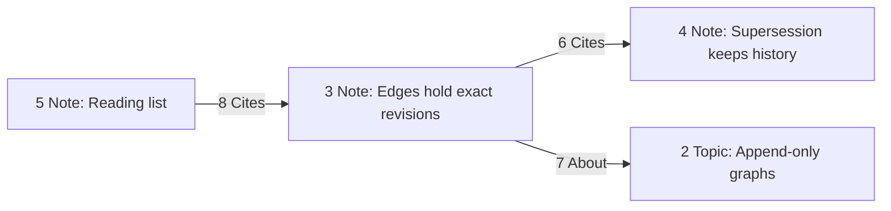
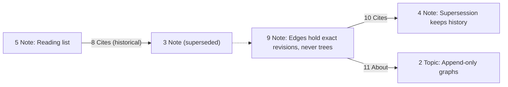
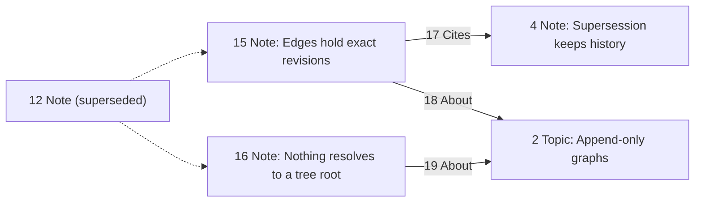
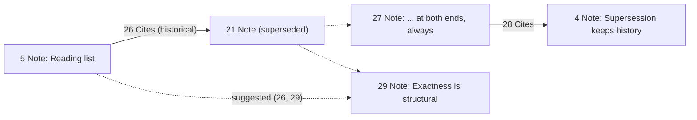

# Reconnecting a revision, by example

The Reconnect analyzer, worked through with one database from its first
entry. The rules it illustrates are owned by [RECONNECT](RECONNECT.md); the
numbered decisions it cites are in
[RECONNECT §9](RECONNECT.md#9-design-decisions). It assumes the reader knows
LifeCore's append-only graph, revisions and supersession, exact-endpoint
edges, bounded views, configured analyzers with full-prefix replay, finding
keys, observations, and dismissal.

Every entry below is shown as the TOML change file the user writes and
applies with `lifecore apply FILE` ([FILES](FILES.md)). The positions are
the ones the walk produces: a test in `lifecore-reconnect` replays sections
1 to 10 through the analyzer and checks every position and suggestion shown.
The `origin` values of sections 1 to 9 come from a scratch run, and those of
section 10, added in review, are made up in the same shape. A reader
repeating the walk gets different origins, since each applied plan mints its
own, and must copy them from each `apply` result's `operations` list.

Two steps cannot run today. `lifecore add-analyzer Reconnect` fails because
the application does not register the analyzer yet. Applying an exported
proposal with its `acknowledges` table, in sections 4 and 10, fails because
suggestion export and acknowledgment are not implemented for any analyzer
([PLAN §2.2](PLAN.md#22-suggestions-and-acknowledgment)). The same edges
applied without `acknowledges` land at the same positions.

## 1. A database with two types

```sh
lifecore init
lifecore add-analyzer Reconnect
```

Reconnect introduces no types of its own ([RECONNECT §2](RECONNECT.md#2-vocabulary)).
This database declares two: a `Note` that may cite other notes and be about a
topic, and a `Topic`.

```toml
[[entries]]
name = "note_type"
kind = "node"
ty_name = "Type"
[entries.payload]
name = "Note"
fields = { kind = "record", value = { title = ["mandatory", "text"] } }
outgoing = ["Cites", "About"]
incoming = ["Cites"]
successors = []

[[entries]]
name = "topic_type"
kind = "node"
ty_name = "Type"
[entries.payload]
name = "Topic"
fields = { kind = "record", value = { title = ["mandatory", "text"] } }
outgoing = []
incoming = ["About"]
successors = []
```

Positions 0 and 1. Reconnect emits nothing here, and nothing at
initialization: it only ever speaks at a prefix whose newest entry is a node
with a predecessor.

## 2. Three notes and a topic

One plan creates a topic, three notes, and the three edges between them.
Within one plan, an edge names a node created earlier in the same file by
its operation name, with `added`.

```toml
[[entries]]
name = "graphs"
kind = "node"
ty_name = "Topic"
payload = { title = "Append-only graphs" }

[[entries]]
name = "exact"
kind = "node"
ty_name = "Note"
payload = { title = "Edges hold exact revisions" }

[[entries]]
name = "supersession"
kind = "node"
ty_name = "Note"
payload = { title = "Supersession keeps history" }

[[entries]]
name = "reading"
kind = "node"
ty_name = "Note"
payload = { title = "Reading list" }

[[entries]]
name = "exact_cites_supersession"
kind = "edge"
ty_name = "Cites"
from = { added = "exact" }
to = { added = "supersession" }

[[entries]]
name = "exact_about_graphs"
kind = "edge"
ty_name = "About"
from = { added = "exact" }
to = { added = "graphs" }

[[entries]]
name = "reading_cites_exact"
kind = "edge"
ty_name = "Cites"
from = { added = "reading" }
to = { added = "exact" }
```

The apply result maps each name to an exact identity. This plan's origin is
`dd25176a-39c6-4c2c-b2f6-41523c063542`, and the positions are:

| Position | Entry |
| --- | --- |
| 2 | `graphs`, a `Topic` |
| 3 | `exact`, a `Note` |
| 4 | `supersession`, a `Note` |
| 5 | `reading`, a `Note` |
| 6 | `exact` Cites `supersession` |
| 7 | `exact` About `graphs` |
| 8 | `reading` Cites `exact` |



Still nothing from Reconnect: no entry so far has a predecessor.

## 3. Revising a note

The user sharpens the first note's title. A revision is a new node whose
`predecessor` is the exact identity of the old one and whose `intent` is
`revise`, which requires the predecessor to be current.

```toml
[[entries]]
name = "exact_v2"
kind = "node"
ty_name = "Note"
predecessor = { existing = { origin = "dd25176a-39c6-4c2c-b2f6-41523c063542", position = "3" } }
intent = "revise"
payload = { title = "Edges hold exact revisions, never trees" }
```

Position 9, origin `339ceea3-8198-4dc0-acd6-cad6fbb976ca`. Note 3 is now
superseded, and [SPEC §5](SPEC.md#5-current-and-historical-data) says what
that means for its edges: 6, 7, and 8 are all historical. The new note has no
citations, is about nothing, and is cited by nothing.

This is the prefix Reconnect speaks at. In the analyzer's terms, `S` is note 9,
`D` is note 3, and `before` is the view ending with position 8. It scans `D`'s
edges in `before` and asks of each whether it is present and whether its other
endpoint `O` is current. All three qualify, so all three are **eligible**, and
each produces one suggestion whose single action is the **equivalent edge**:
same label, same direction, same other endpoint, with 9 where 3 was.

| Lost edge | Other endpoint | Suggested action | Certificate |
| --- | --- | --- | --- |
| 6, `exact` Cites `supersession` | 4, current | 9 Cites 4 | `LostEdge { edge: 6, successor: 9 }` |
| 7, `exact` About `graphs` | 2, current | 9 About 2 | `LostEdge { edge: 7, successor: 9 }` |
| 8, `reading` Cites `exact` | 5, current | 5 Cites 9 | `LostEdge { edge: 8, successor: 9 }` |

The third row is an incoming edge. Reconnect does not care which end `D` was
on; `S` takes `D`'s place in whichever position it held.

Each suggestion's text names the label and direction, and nothing about the
boundary, so that replay merges observations. Each observation's range is
exactly this one prefix: at position 10 and later, Reconnect emits nothing
for this supersession, because the newest entry is no longer note 9.

## 4. Applying a suggestion

For each suggestion the application exports a ready-made proposal
([SUGGESTIONS §2](SUGGESTIONS.md#2-export)). The one for the first row, in
TOML, reads like this. The `plan_id` and the key's `database` are the scratch
database's, the version is illustrative, and the certificate is opaque text
the user carries verbatim.

```toml
plan_id = "lc1:857c2db0-a434-4c87-9c7d-6968e4e6f9dc:ee7d126e-6434-44ee-9dd4-69fecb3813f5:a6ebcfb4-e151-4388-a00d-78eec8086fc4"

[acknowledges]
database = "857c2db0-a434-4c87-9c7d-6968e4e6f9dc"
analyzer = { name = "Reconnect", version = "0.1.0", configuration = "{}" }
kind = "suggestion"
analyzer_certificate = '{"edge":{"position":"6","origin":"dd25176a-39c6-4c2c-b2f6-41523c063542"},"successor":{"position":"9","origin":"339ceea3-8198-4dc0-acd6-cad6fbb976ca"}}'

[[entries]]
name = "action_0"
kind = "edge"
ty_name = "Cites"
from = { existing = { origin = "339ceea3-8198-4dc0-acd6-cad6fbb976ca", position = "9" } }
to = { existing = { origin = "dd25176a-39c6-4c2c-b2f6-41523c063542", position = "4" } }
```

There is exactly one action, it is an edge, both endpoints are `existing`
references, and there is no node and no `added` reference
([RECONNECT §6](RECONNECT.md#6-suggestion-shape)). A user could write the
same file by hand; the export is a convenience. Applying it appends the edge
at position 10 and, because the service's own analysis reproduces the
suggestion, records an `Acknowledged` dismissal of the key. The user applies
the second suggestion the same way, after a fresh analysis, since applying
one export makes the others' tokens stale:

```toml
[[entries]]
name = "action_0"
kind = "edge"
ty_name = "About"
from = { existing = { origin = "339ceea3-8198-4dc0-acd6-cad6fbb976ca", position = "9" } }
to = { existing = { origin = "dd25176a-39c6-4c2c-b2f6-41523c063542", position = "2" } }
```

Position 11. The third suggestion, `reading` citing the new note, the user
leaves alone for now. The graph is:



> **Why is the third suggestion still in the report?** Reconnect suggestions
> are sticky ([RECONNECT §4](RECONNECT.md#4-sticky)). The observation's
> range ended at position 9, but a sticky advisory stays in current reports
> until dismissed. The analyzer judged the supersession once and never looks
> again; if it re-emitted at every prefix it would scan every current node's
> predecessor edges at every prefix, and it would need a rule for when a lost
> connection stops mattering, which is the resolution judgment no analyzer
> may make. [Decision 6](RECONNECT.md#9-design-decisions).

## 5. A chain of revisions

The user revises the note again.

```toml
[[entries]]
name = "exact_v3"
kind = "node"
ty_name = "Note"
predecessor = { existing = { origin = "339ceea3-8198-4dc0-acd6-cad6fbb976ca", position = "9" } }
intent = "revise"
payload = { title = "Edges hold exact revisions, never trees or roots" }
```

Position 12, origin `675b2165-b393-491f-aef1-118a9418a901`. Now `S` is 12
and `D` is 9. The edges of 9 in `before` are 10 and 11, both with current
other endpoints, so Reconnect suggests 12 Cites 4 and 12 About 2, with
certificates `(10, 12)` and `(11, 12)`.

It suggests nothing about `reading`. Edge 8 belonged to note 3, not to note
9, and note 9 never acquired an equivalent. `S2` copies from `S1` only. The
record of that loss is the still-open suggestion `(8, 9)` from section 3,
which has not gone anywhere ([RECONNECT §3](RECONNECT.md#3-trigger-and-heuristic),
chain row).

> **Why not offer `reading` → 12 as well?** Because 12 is judged against
> 9's edges, and following one supersession at a time keeps each finding
> about exactly one event. The open `(8, 9)` suggestion is where that loss
> is recorded. [Decision 4](RECONNECT.md#9-design-decisions).

The user applies both exports, appending edges 13 (12 Cites 4) and 14
(12 About 2). Their files have the same shape as section 4's, with 12 in
`from`.

## 6. A split

The note turns out to be two claims. One plan creates two successors of
note 12.

```toml
[[entries]]
name = "exact_edges"
kind = "node"
ty_name = "Note"
predecessor = { existing = { origin = "675b2165-b393-491f-aef1-118a9418a901", position = "12" } }
intent = "revise"
payload = { title = "Edges hold exact revisions" }

[[entries]]
name = "exact_roots"
kind = "node"
ty_name = "Note"
predecessor = { existing = { origin = "675b2165-b393-491f-aef1-118a9418a901", position = "12" } }
intent = "branch"
payload = { title = "Nothing resolves to a tree root" }
```

Positions 15 and 16, origin `5bbd6e5a-e7ca-4437-b21c-e654be419d3c`. The
second operation must say `branch`: `revise` requires the predecessor to be
current immediately before the append, and after the first operation note 12
is already superseded ([FILES §2.4](FILES.md#24-node-and-edge-operations)).
With `revise` on both, `lifecore check` refuses the file with
`invalid proposal ... revises a predecessor that is not current`, pointing at
the second operation's `intent`. The authoring format makes the user say
that a split is a split.

Reconnect judges each successor at its own prefix:

- At position 15, `S` is 15, `D` is 12, and 12's edges in `before` are 13
  and 14. Suggestions: 15 Cites 4 and 15 About 2, certificates `(13, 15)`
  and `(14, 15)`.
- At position 16, `S` is 16 and `D` is again 12. Note 12 is already
  superseded in `before`, by 15. That does not matter: eligibility asks
  whether the edge is present and whether the *other* endpoint is current,
  and says nothing about `D`. Suggestions: 16 Cites 4 and 16 About 2,
  certificates `(13, 16)` and `(14, 16)`.

The four keys are distinct, because each names its successor. Both branches
are offered both edges because, at position 16, note 15 has no edges yet:
nothing in `before` says where 12's connections went. Had the second branch
been appended a year later, after the user reconnected 15, it would be judged
by the same rule with a different `before`, and the edges 15 carried by then
would not be offered again. Section 10 shows that case.

> **Why not require the predecessor to be current?** The second successor
> of a split always finds its predecessor superseded, and so does a late
> branch. Both must be judged like the first successor, or splitting would
> silently lose connections on every branch but the first. What a later
> branch is offered is then narrowed by what its siblings already carry.
> [Decisions 2 and 11](RECONNECT.md#9-design-decisions).

The user accepts both suggestions for `exact_edges`, edges 17 (15 Cites 4)
and 18 (15 About 2), and only the topic for `exact_roots`, edge 19 (16 About
2). The suggestion `(13, 16)`, the root note citing `supersession`, stays
open. Reconnecting one branch said nothing about the other, because 16 was
judged before edge 17 existed.



## 7. Revising the other endpoint first

Now the topic is revised, and only afterwards the note.

```toml
[[entries]]
name = "graphs_v2"
kind = "node"
ty_name = "Topic"
predecessor = { existing = { origin = "dd25176a-39c6-4c2c-b2f6-41523c063542", position = "2" } }
intent = "revise"
payload = { title = "Append-only typed graphs" }
```

Position 20, origin `6fc86157-f1b9-406f-ae41-f9008b032ccd`. Edges 18 and
19 end at the topic, so they are now historical, and Reconnect judges the
topic's revision like a note's: `S` is 20 and `D` is topic 2, whose edges in
`before` are 7 (historical, `O` = 3 superseded), 11 (historical, `O` = 9
superseded), 14 (`O` = 12 superseded), 18 (`O` = 15 current), and 19 (`O` =
16 current). So two suggestions are emitted here, 15 About 20 and 16 About
20, with certificates `(18, 20)` and `(19, 20)`; the first three edges are
suppressed because their note endpoint is superseded.

Then the note:

```toml
[[entries]]
name = "exact_edges_v2"
kind = "node"
ty_name = "Note"
predecessor = { existing = { origin = "5bbd6e5a-e7ca-4437-b21c-e654be419d3c", position = "15" } }
intent = "revise"
payload = { title = "Edges hold exact revisions at both ends" }
```

Position 21, origin `2e297507-9635-42d6-b0dd-6a35dc46cf51`. Note 15's edges
in `before` are 17 and 18.

- Edge 17, 15 Cites 4: note 4 is current. Suggested, `(17, 21)`.
- Edge 18, 15 About 2: topic 2 is superseded by 20. **Suppressed.** The
  equivalent edge, 21 About 2, would fail the endpoint check of
  [SPEC §7.1](SPEC.md#71-append-checks), and Reconnect does not pick 20 in
  its place.

The connection from the new note to the new topic is not lost to the user,
though: the suggestion `(18, 20)` from the topic's own prefix already offers
15 About 20, and a user who revises the note after accepting it would see 21
About 20 suggested in turn.

> **Why not suggest 21 About 20 directly?** Choosing among `O`'s successors
> would resolve a connection through a revision tree, which the model never
> does. Reconnect only ever substitutes `S` for `D` and keeps `O` exactly.
> [Decision 3](RECONNECT.md#9-design-decisions).

## 8. Both endpoints in one plan

The browser's Reconnection step, and a careful hand-written file, revise a
note and its topic together and add the edge between the new revisions in
the same plan.

```toml
[[entries]]
name = "exact_roots_v2"
kind = "node"
ty_name = "Note"
predecessor = { existing = { origin = "5bbd6e5a-e7ca-4437-b21c-e654be419d3c", position = "16" } }
intent = "revise"
payload = { title = "Nothing resolves to a tree root or leaf" }

[[entries]]
name = "graphs_v3"
kind = "node"
ty_name = "Topic"
predecessor = { existing = { origin = "6fc86157-f1b9-406f-ae41-f9008b032ccd", position = "20" } }
intent = "revise"
payload = { title = "Append-only typed graphs with history" }

[[entries]]
name = "roots_about_graphs"
kind = "edge"
ty_name = "About"
from = { added = "exact_roots_v2" }
to = { added = "graphs_v3" }
```

Positions 22, 23, and 24, origin `9588541e-f0e1-4126-9c6e-4024e655f8b7`.
Reconnect judges every prefix of the plan, and the plan's own entries are
part of history, so:

- At 22, `S` is 22 and `D` is 16. Edge 19, 16 About 2, has `O` = 2
  superseded; suppressed. Edge 13 was never reconnected to 16, so 16 has no
  other edge. Nothing from this supersession. Had the user instead accepted
  `(19, 20)` in section 7, 16 would hold an About edge to 20, 20 would be
  current at this prefix, and the suggestion `22 About 20` would be emitted
  here, naming 20 exactly although 23 is about to replace it. The analyzer
  cannot see position 23 from position 22 ([RECONNECT §3](RECONNECT.md#3-trigger-and-heuristic),
  same-plan row).
- At 23, `S` is 23 and `D` is 20. Its edges in `before`: none, since
  neither `(18, 20)` nor `(19, 20)` was accepted. Nothing.
- At 24, the newest entry is an edge. Nothing.

Edge 24 is the intended repair, written by the user, not an equivalent edge of
anything. When a same-plan suggestion does name an endpoint that the same
plan then supersedes, its export is rejected by `prepare` for a stale
endpoint. The error reads:

```text
invalid proposal at entry 0 ("action_0"): edge EntryId { .. } references a stale endpoint
```

and the application marks that export `inapplicable`, which the client hides
by default. The finding itself is unchanged; the analyzer never re-judges.

## 9. Recreating an edge by hand

Back to `(17, 21)`, the open suggestion that note 21 cite note 4. Instead of
applying the export, the user writes the edge:

```toml
[[entries]]
name = "edges_v2_cites_supersession"
kind = "edge"
ty_name = "Cites"
from = { existing = { origin = "2e297507-9635-42d6-b0dd-6a35dc46cf51", position = "21" } }
to = { existing = { origin = "dd25176a-39c6-4c2c-b2f6-41523c063542", position = "4" } }
```

Position 25. The suggestion `(17, 21)` is still in the current report: its
observation ended at 21, it is sticky, and Reconnect does not know the edge
exists. What changes is the export. When the application builds the proposal
for `(17, 21)` it compares the action with the current graph, finds the
equivalent edge present, and marks the export `satisfied`. The client hides
satisfied suggestions by default and labels them in history mode. Applying
the export anyway is rejected as a duplicate under
[SPEC §7.1](SPEC.md#71-append-checks):

```text
invalid proposal at entry 0 ("action_0"): entry EntryId { .. } duplicates an eligible earlier entry
```

The finding stays unacknowledged, since nothing was applied with its key.
The user can dismiss it:

```json
{"method": "findings.dismiss", "params": {"key": { "...": "the complete key" }, "reason": "no_longer_relevant"}}
```

> **Why does the application, not the analyzer, notice the edge?** The
> analyzer judged one event, once, and its key must not change. The export
> step already holds the action and the current graph, so it is the right
> place to compare them, and `satisfied` and `inapplicable` are application
> result types outside the core observation.
> [Decision 7](RECONNECT.md#9-design-decisions).

## 10. A late branch

The split of section 6 offered both branches everything, because at the
second branch's prefix the first had no edges yet. A branch appended after
its sibling has been reconnected is judged with more in `before`. To show
it, the user first gives the reading list the citation it has lacked since
section 3, to the current revision of the note:

```toml
[[entries]]
name = "reading_cites_edges_v2"
kind = "edge"
ty_name = "Cites"
from = { existing = { origin = "dd25176a-39c6-4c2c-b2f6-41523c063542", position = "5" } }
to = { existing = { origin = "2e297507-9635-42d6-b0dd-6a35dc46cf51", position = "21" } }
```

Position 26, origin `33ac7e25-d351-4bef-9d54-bcdb372c5f26`. The newest entry
is an edge, so Reconnect says nothing. Note 21 now has two edges, 25 (21
Cites 4) and 26 (5 Cites 21). The user revises it:

```toml
[[entries]]
name = "exact_edges_v3"
kind = "node"
ty_name = "Note"
predecessor = { existing = { origin = "2e297507-9635-42d6-b0dd-6a35dc46cf51", position = "21" } }
intent = "revise"
payload = { title = "Edges hold exact revisions at both ends, always" }
```

Position 27, origin `8b50c1da-aafd-4498-8fba-c4fdff909d0f`. `S` is 27, `D`
is 21, and 21's edges in `before` are 25 and 26, both with current other
endpoints. Note 21 has no other current descendant, so nothing is claimed.
Suggestions: 27 Cites 4, certificate `(25, 27)`, and 5 Cites 27, certificate
`(26, 27)`. The user applies the first export only:

```toml
[[entries]]
name = "action_0"
kind = "edge"
ty_name = "Cites"
from = { existing = { origin = "8b50c1da-aafd-4498-8fba-c4fdff909d0f", position = "27" } }
to = { existing = { origin = "dd25176a-39c6-4c2c-b2f6-41523c063542", position = "4" } }
```

Position 28, with its `acknowledges` table naming `(25, 27)`, which records
an `Acknowledged` dismissal. `(26, 27)` stays open.

Later the user decides note 21 also deserves a second, different successor,
a separate claim that the reading list was really citing. Note 21 is
superseded, so the file must say `branch`:

```toml
[[entries]]
name = "exact_edges_alt"
kind = "node"
ty_name = "Note"
predecessor = { existing = { origin = "2e297507-9635-42d6-b0dd-6a35dc46cf51", position = "21" } }
intent = "branch"
payload = { title = "Exactness is structural, not a convention" }
```

Position 29, origin `07f4b6e8-e453-4ae4-b82f-8a5ad138b8fc`. `S` is 29 and
`D` is 21 again, and `before` is the view ending with position 28. The
edges of 21 are still 25 and 26, and both other endpoints, notes 4 and 5,
are current. What differs from position 27 is that 21 now has a current
descendant other than `S`: note 27, a **sibling** of 29. Reconnect reads
27's edges in `before` and asks, for each edge of 21, whether 27 carries its
equivalent, same label, same direction, same exact other endpoint:

| Edge of 21 | Equivalent on 27 | Present in `before`? | Verdict |
| --- | --- | --- | --- |
| 25, 21 Cites 4 | 27 Cites 4 | Yes, edge 28 | **Claimed.** Suppressed. |
| 26, 5 Cites 21 | 5 Cites 27 | No | Eligible. Suggested: 5 Cites 29, certificate `(26, 29)`. |

One suggestion, not two. The citation of note 4 went to 27 and is not
offered again; the reading list's citation, which 27 never took, is offered
to the new branch. The split distributes 21's connections instead of
duplicating them.



> **Why not offer 29 Cites 4 as well?** Nothing in the model forbids both
> branches citing note 4; [SPEC §5](SPEC.md#5-current-and-historical-data)
> gives exactly that as its example of keeping a connection on two
> successors. But a suggestion is a guess about what the user meant, and in
> a split the predecessor's connections usually belong to one branch or the
> other. Edge 28 is the only evidence in `before` of where the citation
> went, so Reconnect takes it as the answer and offers 29 the rest. A user
> who wants both writes the second edge by hand, as in section 9.
> [Decision 11](RECONNECT.md#9-design-decisions).

> **Which other successors of 21 count?** Any node below 21, at any depth,
> that is current in `before`, and nothing else. Had the user revised 27
> into a note 27' without reconnecting the citation, 27 would be superseded
> and edge 28 historical, so nothing current below 21 would cite note 4: edge 25
> would be unclaimed, and 29 would be offered 29 Cites 4 while the open
> suggestion `(28, 27')` recorded the loss, exactly as a chain behaves. Had
> 27' reconnected the citation, 27' would claim edge 25 in 27's place. A
> node outside 21's subtree never claims: note 15 once carried 17, 15 Cites
> 4, but 15 is 21's predecessor, not its descendant.
> [Decision 12](RECONNECT.md#9-design-decisions).

> **What if 29 had come before 28?** Then `before` would not contain edge 28,
> nothing would be claimed, and 29 would be offered both edges like the
> second branch of section 6. Applying `(25, 27)` afterwards would not touch
> `(25, 29)`: the analyzer judged 29 once, and the export check compares the
> action, 29 Cites 4, with the current graph, where it is absent and both
> endpoints are current. The user dismisses it, or applies it if both
> branches should cite note 4. Whether the export should instead be marked
> `claimed` is [open question 1](RECONNECT.md#10-open-questions).
> [Decision 13](RECONNECT.md#9-design-decisions).

In the browser, a draft of `exact_edges_alt` checked before apply shows the
same thing: one suggestion under the branch's operation, labeled sticky, and
nothing about note 4. The tray lists every observation of the check,
including those emitted at prefixes inside the draft, so the user sees what
the branch will and will not be offered before committing it
([UI §5](UI.md#5-drafts-and-writes)).

## 11. Why the certificate is just two identities

Every key in this walk has had the form `LostEdge { edge, successor }`.
Section 10 showed a connection re-asserted and lost again: edge 25 carried
to note 21 the citation that 17 had carried to note 15, and revising 21 lost
it with key `(25, 27)`. That is a different key from `(17, 21)`, because the
re-asserted edge is a new entry and the loss comes with a new successor.
Dismissing `(17, 21)` in section 9 therefore hid nothing about the later
loss.

The key carries no boundary, so replay produces equal keys every time, and no
label or other endpoint, since the edge identity already determines both.
The split in section 6 showed the other half: one lost edge, two successors,
two keys. The sibling rule of section 10 changes none of this: a claimed
edge produces no observation, and an unclaimed one produces the key it would
have had without siblings. [Decision 8](RECONNECT.md#9-design-decisions).

## 12. Narrowing the analyzer

A database may want Reconnect for some labels or some successor types only.
The configuration is a `SubgraphFilter` like DAG Check's
([RECONNECT §7](RECONNECT.md#7-configuration)):

```sh
lifecore add-analyzer Reconnect '{ "filter": { "edge_types": ["Cites"] } }'
```

Under that suite entry, section 3 would have produced the two `Cites`
suggestions and not the `About` one. `node_types` restricts by the
successor's `ty_name` instead; `{ "filter": { "node_types": ["Note"] } }`
would have skipped the topic's prefix in section 7 entirely. The configuration string
is part of the analyzer's identity, so this suite entry and a plain
`Reconnect` entry produce findings with different keys, and dismissals under
one do not carry to the other. An unknown field such as `"filters"` is an
`InvalidAnalyzerConfiguration` error, not an ignored key.

## 13. Where planning comes in

[PLANNING](PLANNING.md) revises items, stances, and events the same way this
walk revised notes, and its `About` edge from a stance or `Did` to a revised
item is an ordinary incoming edge of the predecessor, exactly like `reading`
citing `exact` in section 3. That is why planning has no re-point suggestion
of its own ([RECONNECT §8](RECONNECT.md#8-planning-analyzer),
[decision 1](RECONNECT.md#9-design-decisions)): a planning database runs
Reconnect in its suite, and planning keeps only its seal-time
dropped-connection warning, which judges a connection against any current
successor at a window's close. That is a planning rule about windows, not a
general rule about supersession.
