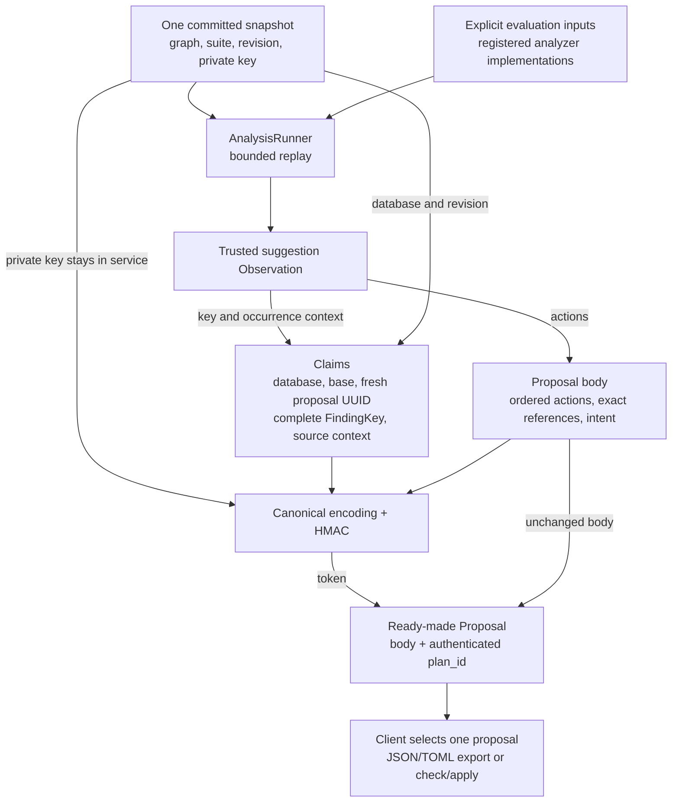

# Suggestions, authenticated proposals, and dismissals

Status: selected application design, pending implementation. This document
explains the interaction between the existing analyzer model and the planned
synchronous application service. [MESSAGES.md](MESSAGES.md) describes current
library behavior; [FILES.md](FILES.md) and [INTERFACES.md](INTERFACES.md) define
the shared proposal, storage, and transport contracts.

## 1. What each identity means

| Information | Responsibility |
| --- | --- |
| `FindingKey` | Identifies an issue for grouping and dismissal: database, exact analyzer identity/configuration/version, category, and complete opaque certificate. |
| `Observation` | Records an occurrence of that issue, including evaluated view, inputs, wording, and a suggestion's ordered actions. |
| `Proposal` | Contains complete ordered graph operations with exact references and explicit revision intent. |
| Ordinary `plan_id` | Identifies a proposal and its expected database/graph-suite base. It carries no suggestion provenance or automatic dismissal. |
| Authenticated suggestion `plan_id` | Binds a complete finding key and source context to the exported proposal content and expected base. |
| `Dismissal` | Persistent display state for a whole finding key, with a reason and optional note. It is neither a resolution assertion nor an application receipt. |

One finding may have observations at several prefixes or evaluation times, with
different suggested actions. Select actions from a concrete observation; dismiss
the issue identified by its complete key. Analyzers must distinguish materially
different issues in their certificates. Repeated observations of the same issue
are intentionally hidden by the same dismissal, including future emissions.

Applying an authenticated suggestion acknowledges that issue. It does not prove
that the issue is resolved, that the analyzer will stop emitting it, or that its
actions remain the best recommendation under a later evaluation context.

## 2. Export from trusted analysis

The application produces a ready-made `Proposal` alongside each observation it
exports as a suggestion. Its JSON form is an ordinary changefile object, not a
JSON string embedded inside another JSON string. TOML uses the same proposal
type. The core `Observation` and `AnalysisOutput` types need no storage or token
fields; the application response associates the observation with its proposal.



Mint only from an observation the service obtained from its own analyzer run,
or a trusted in-memory result with the exact source/context. Accepting a client
object and signing it after structural validation would authenticate invented
suggestions. If an interface accepts an unsigned serialized observation, it must
match it against a trusted result or reproduce it through replay before minting.
The primary interface avoids that step: return the authenticated proposal with
the observation, and let the caller select the already constructed proposal.

Source observations must belong to the selected committed history. Historical
occurrences, including sticky ones, can be exported against the current committed
base; their original evaluated view stays explicit. Diagnostics from an uncommitted
check candidate can refer to provisional entries, so do not mint directly
applicable suggestion tokens for them. Analyze again after successful commit.

Freeze the snapshot, source inputs, implementations, and resulting operations
during export. Do not attach a newer base revision to actions from a different
snapshot. If another writer advances the database during export, the result is
a proposal against the original base and will be rejected as stale on application.
Minting itself does not change storage, reserve a base, or dismiss a finding.

An exported bundle associates each observation with its own independent proposal
and fresh proposal UUID. They may share the database/base and even the finding
key. Selecting or downloading one changes nothing. Applying one that changes the
graph/suite invalidates the others' base expectations, even if their actions
would otherwise be compatible. A bundle is not a sequence of plans to replay.

## 3. Authenticated plan IDs

Use two explicit token kinds in the initial version:

```text
lc1:ordinary:<database-uuid>:<graph-revision-uuid>:<proposal-uuid>
lc1:suggestion:<claims-base64url>:<mac-base64url>
```

The first form is the ordinary base expectation described in FILES. The generic
mint operation and `lifecore plan-id` produce only that kind. The second form is
issued only through trusted suggestion export. This supersedes the preliminary
token spelling; no legacy reader or migration is required.

Suggestion claims contain:

| Field | Content |
| --- | --- |
| `database` | Persistent database UUID. |
| `graph_revision` | Revision UUID for the complete expected graph and ordered suite. |
| `proposal_id` | Fresh proposal UUID, distinct from the database's secret key. |
| `finding_key` | Complete `FindingKey`, including the opaque certificate string; category must be `Suggestion` and database must match. |
| `source_context` | Original analysis view, observation's evaluated view, frozen evaluation inputs, and ordered implementation identities from that run. |

Source context includes initialization versus prefix zero explicitly. Its views
must belong to the claimed database/history, and the finding's analyzer identity
must occur among the recorded implementations. Source context records issuance;
it does not override the inputs selected for a later check/apply.

The full key is necessary because a digest cannot reconstruct a dismissal key.
Embedding it avoids a persistent token-to-finding registry and permits application
after the analysis cache has disappeared. Tokens can therefore be large. Their
claims are authenticated, not encrypted, and clients keep the token opaque.

Authenticate both claims and content with HMAC-SHA-256 using a per-database
256-bit key generated by a cryptographically secure random source. Use a vetted
implementation and its constant-time verification operation. This is a secret
authentication key, not a public salt or a hand-built salted hash. See
[HMAC](https://www.rfc-editor.org/rfc/rfc2104.html) and
[the SHA-256 variant](https://www.rfc-editor.org/rfc/rfc4231.html).

Define the authenticated bytes as the UTF-8 JCS encoding of an object with these
fields:

| Field | Authenticated value |
| --- | --- |
| `domain` | Literal string `lifecore/suggestion-plan`. |
| `version` | Integer `1`, corresponding to `lc1`. |
| `kind` | Literal string `suggestion`. |
| `claims` | The complete typed claims above. |
| `proposal` | The complete normalized shared `Proposal` with only `plan_id` removed. |

Thus the version, token kind, database, base, finding, context, and every proposal
field are bound together. Omitting `plan_id` from the body avoids self-reference.
There is no need for a separate content digest. This MAC does not replace exact
finding equality or the core transaction's exact base comparison.

`claims-base64url` is the unpadded base64url encoding of the claims' canonical JSON
bytes. `mac-base64url` encodes the full 32-byte MAC without padding. Require the
specified canonical encodings and known field sets; reject malformed tokens,
unknown kinds/versions, invalid claims, and failed authentication. Never silently
reinterpret a failed suggestion token as an ordinary or absent token.

### Content equality across JSON and TOML

Parse into the shared typed proposal first, serialize its canonical value model,
then apply the [JSON Canonicalization Scheme](https://www.rfc-editor.org/rfc/rfc8785.html).
Canonicalizing raw author text would give the wrong result for integer shorthand
and equivalent timestamp spellings. Canonical payload integers and large control
integers are strings, preserving their precision through this process.

Include format version, operation names/order, references, revision intent, and
all payload values. Sort object keys through JCS; retain array order and exact
string content. Reject duplicate object/control keys and unknown fields rather
than authenticating an ambiguous interpretation. Optional fields use the shared
omission/default rules. Do not normalize Unicode or analyzer configuration text.

Whitespace, TOML comments, object-key ordering, and format conversion do not
invalidate a token when they decode to the same typed proposal. Accepted bare
integer shorthand and its envelope canonicalize identically; timestamp spellings
follow Jiff's ordinary parsing/serialization. Changing an action, operation name,
reference, intent, or actual value does invalidate authentication.

## 4. Check and atomic application

`check` verifies the supplied token and base, then performs ordinary full-prefix
validation under the selected implementations and explicit inputs. Show both
the prospective graph changes and automatic dismissal. An authenticated token
does not certify validity; missing analyzers, inconsistencies, invalid sources,
or invalid revision intent still reject the proposal. Check saves neither graph
changes nor dismissals and never replaces a missing or invalid token.

Application is one synchronous service operation:

1. Freeze the request and selected evaluation inputs. Acquire the stable writer
   lock and reload the complete snapshot, including key and latest dismissals.
2. Verify token syntax, authenticated claims/content, database and base, and
   source-history consistency. An ordinary or absent token confers no automatic
   dismissal, even if its operations resemble an analyzer suggestion.
3. Prepare/check every historical and proposed prefix through the core transaction
   path, retaining exact references and the suggestion source/intent rules.
4. Commit the prepared graph into an isolated candidate snapshot, preserving
   the core's exact base guard. If the authenticated finding has no dismissal,
   insert `Acknowledged` with `note = None`. Preserve any existing reason/note
   and all other dismissal records from the reload.
5. Allocate a fresh graph revision only if graph/suite state changed. Publish
   the entire candidate atomically and perform required synchronization while
   holding writer exclusion. Return the actual analysis context, entry mapping,
   and dismissal effect.

No invalid proposal can dismiss its finding. A pre-publication failure preserves
both graph and dismissal state; there is no interval with only one half published.
After publication, synchronization or transport failure can leave acknowledgment
uncertain, but the published unit still contains both effects. Reconcile the
service's in-memory snapshot with published storage in that case; do not pretend
the old state is authoritative or automatically repeat the write.

This coordination belongs to the application layer. The core transaction remains
an in-memory graph operation, and the libraries do not acquire signing keys,
filesystem locks, or dismissal side effects. The proposal envelope needs no
arbitrary `dismissals` list: automatic dismissal derives from the verified token.
Explicit dismissal/restore operations remain available separately.

## 5. Edits, context changes, and display

An authenticated suggestion is a fixed exported proposal. Users may deliberately
turn it into an ordinary draft by removing/replacing its suggestion token; it
then receives normal checks and no automatic dismissal. If desired, mint an
ordinary token for the deliberately selected base. Do not silently repair a MAC,
rebase a stale suggestion, or issue new suggestion provenance for edited actions.
An unchanged export to another format preserves the token verbatim.

Changed host time or installed implementation versions need not change the graph
revision. Apply still checks anew using the requested context; it need not
reproduce the original suggestion before accepting its already authenticated
actions. Show original and current evaluation contexts separately. Dismiss the
original complete finding key; a new analyzer version or certificate identifies
a different finding and is not suppressed by that dismissal.

Sticky controls which historical observations are displayed within a replayed
analysis. It neither makes a suggestion currently applicable nor turns it into
a persistent report. Dismissal hides matching findings under normal filters;
restore makes them eligible for display again without undoing graph changes.
No reason or successful suggestion application establishes resolution, and no
dismissal can weaken the unfiltered inconsistency gate.

## 6. Key lifetime and the boundary of the guarantee

The private storage envelope includes `proposal_auth_key`, encoded as unpadded
base64url for the 32 random bytes. Generate it at initialization and publish it
with the initial snapshot. Reuse it across runs and ordinary writes; minting
does not rotate the key or change graph revision. Treat a missing/malformed key
as an invalid snapshot, not a request to generate a replacement while loading.

The field is storage-only: omit it from public database descriptions, analysis,
RPC results, proposal exports, and logs. Share public domain types across CLI,
HTTP, and files without exposing the private snapshot envelope as a result type.
The local CLI and server both read the same key when acting on that database.

The guarantee assumes control over the state file. Anyone who can read that file
or a full backup can obtain the key; it cannot be secret from the database owner.
Copying the complete snapshot preserves identity, revision, key, and token
validity. A deliberate new database identity/key does not accept those tokens.
If key replacement is introduced, it invalidates outstanding suggestion tokens;
do not add key history or rotation management in this round. Ordinary base tokens
carry no MAC and are unaffected by key replacement.

Authentication proves service issuance and unmodified content. It is not a new
authorization system for users who can already submit changes and dismiss
findings through the application.

## 7. Retries and empty suggestions

A MAC does not record that a token has been used. After a graph-changing apply,
its original base becomes stale; that rejection cannot distinguish a completed
retry from an unrelated intervening write. Existing dismissal is not evidence
of prior application and must not cause actions to be skipped as already done.

An empty suggestion can pass checking and publish only its acknowledgment. It
does not advance graph revision, so its token can still authenticate later.
Restoring the finding and reapplying such a proposal can acknowledge it again.
Restoring an older full snapshot can likewise make old proposals eligible again.
These are consequences of the absence of one-use or receipt semantics.

Durable receipts and consumed-token tracking remain backlogged. Until then,
report uncertain acknowledgment, preserve drafts, and support inspection rather
than automatic retries. The [deferred receipt contract](FILES.md#84-deferred-receipts-and-retry-recovery)
must eventually distinguish completed applications before stale-base rejection.

## 8. Focused acceptance scenarios

| Scenario | Required outcome |
| --- | --- |
| Caller supplies an invented observation or asks generic minting for suggestion provenance | No authenticated suggestion without matching trusted analyzer output. |
| Two observations share a finding key but differ in actions or context | Export separate bound proposals; either successful application acknowledges the same issue. |
| Claims, kind, base, key, or proposal content is altered | Reject before mutation; never downgrade the token automatically. |
| JSON/TOML syntax differs but the typed proposal is equal | Authentication survives format conversion, comments, key order, integer shorthand, and equivalent parsed timestamps. |
| Parsing encounters duplicate keys, unknown fields, or imprecise/out-of-range integers | Reject before authentication/application. |
| A source belongs to another history or an uncommitted preview | Refuse suggestion minting for that source/base. |
| Application fails checking or fails before publication | Neither graph changes nor acknowledgment persist. |
| Publication succeeds but synchronization or response delivery fails | Both effects may already be visible; report uncertainty without replaying. |
| Another writer edits dismissals between export and apply | Reload under the lock, preserve other records and existing reason/note for the selected finding. |
| Graph/suite changes after export | Reject the old base, including sibling proposals from the same bundle. |
| Time or implementation changes without a graph/suite change | Check anew, show both contexts, and dismiss only the authenticated original key on success. |
| Restart discards analysis caches | Verify using the persisted key and self-contained token, without a report registry. |
| The client receives a description, report, or exported proposal | It contains no private authentication key. |
| A user edits a suggestion and deliberately converts it to an ordinary proposal | Normal checks apply; successful application does not automatically dismiss. |
| A suggestion has no actions, or its finding is already dismissed/restored | Preserve graph revision when unchanged; do not infer prior application or promise one-use behavior. |
